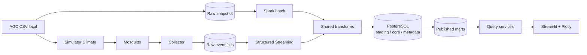

# ADR-001 — PostgreSQL local trước, sensor replay và đường chuyển ClickHouse

- Ngày: 2026-11-03
- Trạng thái: thiết kế được cập nhật theo hướng PostgreSQL trước và bổ sung sensor giả lập; chưa được kiểm chứng bằng hệ thống chạy thật.
- Phạm vi: sáu BR trong `docs/br/` và sensor extension của BR-01/03; xem [ma trận truy vết triển khai](../implementation/requirements-matrix.md). [Bộ sơ đồ Mermaid chi tiết](../architecture/README.md).

## Bối cảnh

Project phân tích dữ liệu lịch sử Autonomous Greenhouse Challenge từ CSV, khoảng 104 MB sau giải nén. Người dùng yêu cầu toàn bộ hệ thống chạy local, bổ sung giả lập nhận sensor và giữ khả năng chuyển từ PostgreSQL sang ClickHouse sau. Không có phần cứng IoT thật trong phạm vi này.

Đề xuất này thay BigQuery bằng PostgreSQL và GCS bằng filesystem local. Mục tiêu là có pipeline, warehouse, ứng dụng và kiểm thử tái lập được trên máy nhóm, phục vụ đánh giá correctness, performance và hiệu quả khai thác dữ liệu.

## Stack đề xuất

| Lớp | Công nghệ | Trách nhiệm |
|---|---|---|
| Ngôn ngữ | Python, SQL | Ingestion, transformation, truy vấn và ứng dụng |
| Raw | Filesystem local | Archive/CSV gốc theo snapshot, checksum và manifest |
| Sensor | Python simulator + Mosquitto MQTT + Python collector | Replay, fault injection, durable spool và raw event files |
| Xử lý | PySpark batch + Structured Streaming file source, `local[2]` mặc định dự kiến | Chung transforms chuẩn hóa/quality; episode theo event time; checkpoint và idempotent sink |
| Warehouse | PostgreSQL thuần trước | Schema `staging`, `core`, `mart`, `meta`, `config`; versioned core và dimensional marts |
| Ứng dụng | Streamlit + Plotly | Bộ lọc, biểu đồ, drill-down, CSV export và form kịch bản giá |
| Truy cập SQL | Psycopg; PostgreSQL JDBC driver cho Spark khi cần | Truy vấn có tham số, batch load và quản lý transaction |
| Điều phối | Python CLI + Makefile | Chạy tuần tự, log, kiểm tra trạng thái và phục hồi |
| Môi trường | Docker Compose | Database/app, batch job, broker/simulator/collector/stream-worker và persistent volumes |
| Kiểm thử | pytest và SQL assertions | Fixture, đối soát độc lập, integration, rerun và phục hồi |

Python/Java/Spark, PostgreSQL, Mosquitto, MQTT client, driver và image phải được chọn phiên bản tương thích, khóa trong cấu hình build và kiểm chứng ở T02–T04. ADR này chưa khẳng định một tổ hợp phiên bản đã chạy thành công. ClickHouse chưa thuộc runtime bắt buộc; T37–T39 là roadmap tùy chọn sau MVP.

## Luồng dữ liệu và ranh giới xử lý

- PySpark tạo dữ liệu typed và các episode khí hậu/EC/pH cho BR-01/03. Spark hỗ trợ `local[K]` để chạy K worker threads trên một máy; chế độ này không chứng minh khả năng mở rộng trên nhiều máy. [Tài liệu Spark](https://spark.apache.org/docs/latest/submitting-applications.html).
- PostgreSQL tổng hợp nước, thu hoạch, năng lượng và chi phí cho BR-02/04/05/06; lưu các version của rule, scenario và provenance. PostgreSQL dùng mô hình client/server, phù hợp để app và pipeline truy cập cùng một database local. [Kiến trúc PostgreSQL](https://www.postgresql.org/docs/current/tutorial-arch.html).
- UI và export gọi cùng lớp truy vấn. Công thức KPI không được viết lại riêng trong giao diện. Cache phải bao gồm snapshot/published version, rule/scenario version và bộ lọc liên quan.
- Job ghi staging theo run ID; kiểm tra thành công mới công bố version dữ liệu. Ghi Spark/JDBC qua nhiều connection không được xem là một transaction duy nhất. Bước publish do một transaction PostgreSQL kiểm soát; app chỉ đọc version đã công bố.
- Lưu raw bất biến theo quy ước ứng dụng, mount chỉ đọc cho bước transform; correction tạo metadata/version mới thay vì sửa CSV nguồn.
- Historical/replay/fault run có data scope riêng; retry giữ event identity, không cộng bản replay vào cùng KPI lịch sử. Source time giữ nguyên, published/received time phục vụ đo latency.
- Collector lưu bền trước ACK; Spark chỉ đọc file hoàn chỉnh sau atomic rename. QoS/checkpoint không tự bảo đảm exactly-once đến DB: cần idempotency keys, constraints và fault tests.
- V1 tái tính cycle bị ảnh hưởng khi late event/correction; giữ episode provisional và observed-through khi replay chưa đối soát xong. Phần còn lại của vụ chưa phát không được tính là missing trong live coverage.

## Cách chạy dự kiến

Compose profile batch có `db`, `batch-job`, `app`; profile sensor thêm `simulator`, `broker`, `collector`, `stream-worker`. Không cần Spark master/worker riêng cho cấu hình ban đầu. Tách broker state, simulator outbox, collector spool, raw-ready và Spark checkpoints thành storage local bền vững. [Tài liệu Docker Compose](https://docs.docker.com/compose/intro/compose-application-model/).

PostgreSQL lưu dữ liệu trong named volume. Raw và output nằm trong các thư mục riêng trên host; không đưa dataset hoặc output lớn vào Git. App truy cập database bằng hostname service trong Compose; người dùng mở app qua cổng được bind vào localhost. Streamlit hỗ trợ khởi động server local bằng `streamlit run`. [Tài liệu Streamlit](https://docs.streamlit.io/develop/concepts/architecture/run-your-app).

Những đường dẫn/lệnh triển khai cụ thể sẽ được tạo tại T04. Chưa có Compose hoặc ứng dụng hoạt động được tạo bởi ADR này.

## Local và offline

- Setup lần đầu có thể cần Internet để tải dataset, container images và Python/Java dependencies. Cung cấp đường nhập archive từ máy cho trường hợp chuẩn bị dữ liệu thủ công.
- Sau setup, batch, sensor replay, warehouse, kiểm thử và cả sáu màn hình nghiệp vụ phải hoạt động khi ngắt Internet. Đóng gói driver/dependency vào image; tránh tải Maven artifact lúc job khởi chạy hoặc dùng tài nguyên giao diện từ CDN.
- GitHub chỉ phục vụ lưu mã nếu nhóm sử dụng; GitHub Actions không phải dependency của build/test/demo. Tất cả kiểm tra bắt buộc phải có lệnh local tương đương.
- T28 phải kiểm chứng vận hành offline và khôi phục database từ backup. Tài nguyên phần cứng và thời gian chạy sẽ được ghi theo máy đo thật; chưa công bố mức RAM tối thiểu hoặc hiệu năng chưa đo.

## Lý do lựa chọn và giới hạn

PostgreSQL cho phép tập trung vào grain, constraints, SQL marts, version và giao dịch với khối lượng dữ liệu hiện có. Đây là warehouse phân tích quy mô project trên cơ sở dữ liệu quan hệ, không phải hệ phân tích phân tán tương đương BigQuery.

PySpark giữ vai trò công nghệ xử lý dữ liệu để triển khai và đánh giá trong môn học. Dataset nhỏ chưa tự tạo nhu cầu dùng Spark; báo cáo phải đo cả overhead và thời gian xử lý, không mặc định Spark nhanh hơn công cụ đơn giản.

Giữ cùng PySpark/PostgreSQL khi so sánh Hybrid (qua core vật lý) và Kimball (staging sang marts) ở T24. Tách đánh giá kiến trúc khỏi lựa chọn engine; có thể đánh giá index, materialization hoặc batch load bằng workload thực.

MQTT được bổ sung cho yêu cầu sensor giả lập. Kafka, Airflow, Kubernetes, MinIO, dbt và API backend riêng chưa thuộc stack bắt buộc. Filesystem đáp ứng raw local; Streamlit đáp ứng ứng dụng tương tác. Các BR hiện tại mô tả baseline lịch sử; T35 bổ sung AC live/replay, không tự coi baseline là đã nghiệm thu streaming.

## Khả năng chuyển ClickHouse

Giữ raw, source identity, metric definitions, fixture và query/command contracts độc lập database. PostgreSQL adapter chứa SQL/transaction/constraints cụ thể; không bỏ các bảo đảm này để giả lập tính portable. Khi chuyển, thiết kế lại schema, dedup/version selection, sink, publication và persistence của scenario cho ClickHouse.

Backfill từ raw cùng các configuration/correction versions, đối soát sáu BR và fault tests trên hai engine, rồi cutover có cutoff và rollback đã diễn tập. Không cần triển khai hai engine hoặc dual-write ở phiên bản đầu. [Sơ đồ migration](../architecture/09-clickhouse-migration.md).

## Điều kiện hoàn tất quyết định triển khai

- Khóa phiên bản và kiểm chứng build trên máy nhóm, bao gồm kiến trúc CPU đang sử dụng.
- Chạy được một luồng Resources → mart nước → BR-02 và kiểm thử đối soát.
- Rerun không nhân dữ liệu; ngắt job không làm ứng dụng đọc bản chưa hoàn tất.
- Chạy offline sau setup; dữ liệu còn nguyên khi restart dịch vụ.
- Ghi lại cấu hình và lệnh tái lập trong README; giữ T02 chưa hoàn tất đến khi đủ bằng chứng.
