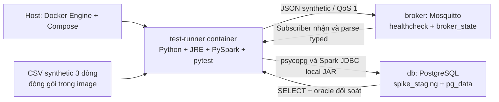

# ADR-002 — Khóa stack và kiểm chứng tương thích bằng container

- Ngày: 2026-11-04.
- Trạng thái: spike T02 đã đạt trên Linux arm64; toàn bộ bằng chứng dưới đây dùng dữ liệu **synthetic**, không phải pipeline AGC hoặc nghiệm thu sáu BR.
- Kế thừa [ADR-001](001-local-deployment-stack.md). T04 đã hấp thụ spike vào [compose.yaml](../../compose.yaml), [package greenhouse](../../src/greenhouse/) và [tests](../../tests/). Không giữ bộ Compose thứ hai; xem [môi trường hiện hành](../implementation/local-environment.md).

**Ghi chú lịch sử:** bảng kết quả T02 dưới đây vẫn mô tả lần đo spike ban đầu. Scaffold T04 thêm image UI/sensor, env credentials và storage/profile mới; các lệnh tái lập bên dưới đã được cập nhật cho layout hiện tại. Không suy ra T02 đã kiểm chứng các thành phần T04.

## Quyết định và vai trò

**Docker-first:** host chỉ cần Docker Engine và Docker Compose v2 trở lên. Python, JRE, Spark, driver và test dependencies nằm trong image; không yêu cầu venv, Java, Spark, PostgreSQL hoặc Mosquitto trên host. Mọi thao tác runtime có lệnh `docker compose` tương đương. Nếu thêm Makefile/CLI ở T04, chúng chỉ là wrapper gọi Compose.

| Thành phần | Vai trò trong thiết kế triển khai | Phần kiểm chứng ở spike T02 |
|---|---|---|
| Python | Importer, query/command services và simulator/collector sau này | Parse JSON synthetic thành dataclass typed, kết nối MQTT và psycopg |
| PySpark + JRE | Batch và Structured Streaming dùng chung semantic transforms; duration/episode BR-01/03 | Một batch job `local[2]` đọc CSV ba dòng rồi ghi/đọc JDBC; chưa chạy streaming |
| PostgreSQL | Staging/core/marts và metadata có transaction; dữ liệu dùng chung cho sáu BR | Schema riêng `spike_staging`, INSERT/SELECT psycopg và bảng nhận JDBC |
| pgJDBC | Spark đọc/ghi PostgreSQL; driver nằm sẵn trong image | Load JAR local, ghi JDBC và đọc lại; không dùng `--packages` hoặc tải Ivy/Maven khi chạy |
| Psycopg 3 binary | Query có tham số và coordinator transaction; hỗ trợ số liệu chính xác cho BR-06 sau này | Kết nối thật, ghi/đọc typed values, kiểm tra timestamp, 0 và NULL |
| Mosquitto + Paho | Đường simulator → broker → collector cho extension BR-01/03 | Publisher/subscriber QoS 1 thực, đợi SUBACK trước phát, nhận đúng bytes; chưa phải durable collector |
| Streamlit + Plotly | Bộ lọc, chart, drill-down, CSV và scenario của sáu BR | Chỉ khóa phiên bản theo prototype; chưa đóng gói/chạy app trong spike |
| pytest | Correctness/integration và các fault tests phục vụ đánh giá môn học | Kiểm tra MQTT → typed record → psycopg và CSV → Spark → JDBC → PostgreSQL, đối soát bằng oracle literal |
| Filesystem / Docker volumes | Raw bất biến và storage local; PostgreSQL/broker có volume riêng | Chỉ named volumes cho DB/broker, fixture synthetic đóng gói trong image; không mount/copy dataset AGC |

Chọn PostgreSQL trước theo ADR-001. Giữ raw/source identity, quy tắc và query contracts độc lập engine; chưa hiện thực adapter ClickHouse. BigQuery/GCS không thuộc kiến trúc này. Spark local là một JVM trên một máy, không phải bằng chứng xử lý phân tán nhiều máy.

Schema spike tạo bằng SQL tường minh trong test và chỉ có bảng synthetic; đây không phải migration core. Migration staging/core/mart/meta/config, parser AGC, batch load đầy đủ và publication transaction thuộc T06–T08; T04 chỉ dựng scaffold. Nhiều JDBC connection không có transaction chung; spike không khẳng định atomic publish hoặc exactly-once.

## Phiên bản đã khóa và cơ sở tương thích

Chọn một baseline có thể tái lập, không tự chạy theo `latest`. Image được khóa cả tag cụ thể và manifest digest trong Compose/Dockerfile, giữ native platform theo host; không ép `linux/amd64` trên Apple Silicon.

| Thành phần | Phiên bản / nơi khóa | Nguồn chính thức |
|---|---|---|
| Python | `3.12.12`; image `python:3.12.12-slim-bookworm` | [Python release](https://www.python.org/downloads/release/python-31212/), [official image](https://hub.docker.com/_/python) |
| Java JRE | Eclipse Temurin `17.0.17+10`; image `eclipse-temurin:17.0.17_10-jre-jammy` | [Adoptium release](https://github.com/adoptium/temurin17-binaries/releases/tag/jdk-17.0.17%2B10), [official image](https://hub.docker.com/_/eclipse-temurin) |
| Spark/PySpark | `4.0.1`, Py4J `0.10.9.9` | [Spark 4.0.1](https://spark.apache.org/docs/4.0.1/), [PySpark metadata](https://pypi.org/project/pyspark/4.0.1/) |
| PostgreSQL | `17.10`; image `postgres:17.10-bookworm` | [Release 17.10](https://www.postgresql.org/docs/17/release-17-10.html), [official image](https://hub.docker.com/_/postgres) |
| pgJDBC | `42.7.14`; `/opt/jdbc/postgresql-42.7.14.jar` | [pgJDBC download/requirements](https://jdbc.postgresql.org/download/), [Spark JDBC](https://spark.apache.org/docs/4.0.1/sql-data-sources-jdbc.html) |
| Psycopg / binary | `3.3.7` cho cả hai package | [Supported systems/binary install](https://www.psycopg.org/psycopg3/docs/basic/install.html), [release metadata](https://pypi.org/project/psycopg/3.3.7/) |
| Mosquitto | `2.0.22`; image `eclipse-mosquitto:2.0.22` | [Release](https://mosquitto.org/blog/2025/07/version-2-0-22-released/), [official image](https://hub.docker.com/_/eclipse-mosquitto) |
| Paho MQTT | `2.1.0`, callback API VERSION2 | [Release metadata](https://pypi.org/project/paho-mqtt/2.1.0/), [client API](https://eclipse.dev/paho/files/paho.mqtt.python/html/client.html) |
| Streamlit / Plotly | `1.66.1` / `7.1.0`; [prototype requirements](../../prototypes/dashboard/requirements.txt) | [Streamlit metadata](https://pypi.org/project/streamlit/1.66.1/), [Plotly metadata](https://pypi.org/project/plotly/7.1.0/) |
| pytest | `8.4.2` | [Release metadata](https://pypi.org/project/pytest/8.4.2/) |
| Python transitive dependencies | Py4J, psycopg-binary, typing_extensions, iniconfig, packaging, pluggy, Pygments đều pin chính xác trong [requirements.lock](../../requirements.lock) | Metadata dependencies của các package đã chọn trên PyPI |
| Python build tools | pip `25.2`, setuptools `80.9.0`, wheel `0.45.1`, pin trong Dockerfile | Build PySpark không dùng build isolation để tránh tự resolve build tools khác |

Spark 4.0.1 công bố Java 17/21 và Python 3.9+, gồm ARM64; Python 3.12 + JRE 17 nằm trong miền hỗ trợ. pgJDBC yêu cầu Java 8+ và hỗ trợ PostgreSQL mới; Psycopg 3.3 hỗ trợ Python 3.10+ và PostgreSQL 10–18. Metadata của UI yêu cầu Python tối thiểu 3.11 (Streamlit) và 3.8 (Plotly), đều phù hợp Python 3.12. T04 đã khóa closure tại [requirements-ui.lock](../../requirements-ui.lock) và đóng gói image UI riêng; bằng chứng scaffold nằm trong hướng dẫn môi trường hiện hành.

JDBC JAR được tải từ Maven Central **lúc build**, kiểm SHA-256 `73914527305a40cce504b0d3d90b23caf565136912d607ae8ae7c5895512332c` (1,221,004 byte, khớp bản tải từ trang pgJDBC). Python dependencies được cài và `pip check` ngay trong build. Setup cần Internet cho images/apt/PyPI/JAR; runtime không tải package. Đây là khóa phiên bản và base digest, chưa phải build bit-for-bit: apt metadata còn phụ thuộc repository và Python lock chưa khóa hash toàn bộ artifact.

## Sơ đồ spike đang kiểm chứng



DB/broker không publish cổng ra host; test chạy trong Compose network `internal: true`, không có đường Internet ở runtime. Healthcheck DB dùng `pg_isready`; broker dùng publish QoS 1. `depends_on: service_healthy` chờ readiness, không thay cơ chế reconnect/recovery tương lai ([Docker startup order](https://docs.docker.com/compose/how-tos/startup-order/)). Broker anonymous chỉ dùng trên network riêng của spike. T02 từng dùng credentials synthetic cố định. Scaffold T04 đã chuyển sang biến bắt buộc `GREENHOUSE_DB_PASSWORD` từ `.env`; Compose hiện không chứa password hard-code.

Cấu hình đo T02 trước đây: job 2 CPU/3 GiB, heap 1 GiB; DB 1 CPU/768 MiB, broker 0.25 CPU/128 MiB. Những biến `SPIKE_*` cũ đã được thay bằng `GREENHOUSE_*`; hạn mức/profile/storage hiện tại theo [hướng dẫn môi trường T04](../implementation/local-environment.md). Không dùng số đo fixture T02 làm sizing AGC.

## Tái lập từ đầu bằng Docker Compose

Chạy tại root repository, chỉ cần Docker. Lệnh hiện hành:

```bash
cp .env.example .env
docker compose -p smart-greenhouse --profile '*' build
docker compose -p smart-greenhouse --profile '*' down -v
docker compose -p smart-greenhouse --profile batch run --rm job
docker compose -p smart-greenhouse --profile test run --rm test-runner
docker compose -p smart-greenhouse --profile '*' down -v
```

`down -v` hiện xóa toàn bộ named volumes của scaffold trong project `smart-greenhouse`, không chỉ hai volume của spike cũ. Không xóa dataset bind mounts. [.dockerignore](../../.dockerignore) không gửi dataset/credential/backlog/scratch vào image. Test dùng fixture synthetic tại [tests/fixtures](../../tests/fixtures/); helper T02 ở [diagnostics/stack_probe.py](../../src/greenhouse/diagnostics/stack_probe.py), test tại [tests/integration/test_stack.py](../../tests/integration/test_stack.py). Test không cần dataset hoặc source bind mount.

## Kết quả kiểm chứng và giới hạn

Chạy ngày 2026-11-04 trên Apple Silicon; Docker Engine client/server `29.9.2`, Docker Desktop `4.97.0`, Compose `5.6.1`, context `desktop-linux`. Docker VM báo `linux/aarch64`, 4 CPU, 8,186,347,520 byte RAM (~7.62 GiB). Host không chạy Python/Java để thực thi spike.

| Kiểm chứng / lệnh | Kết quả quan sát |
|---|---|
| `docker compose -p smart-greenhouse --profile test config --quiet` | Exit 0; cấu hình hợp lệ |
| `time docker compose -p smart-greenhouse --profile test --progress plain build test-runner` | Build lần đầu 78.03 giây, có tải base layers/dependencies; `pip check`: không có broken requirements. Sau khi thêm báo cáo runtime/RAM, rebuild layer source mất ~0.53 giây với dependency layers đã cache. Đây không phải benchmark build chuẩn hóa. |
| `down -v` → `up -d --wait db broker` | Chỉ project `smart-greenhouse`; DB/broker healthy. Đã thực hiện cả lần đầu chưa có volumes và lần hai xóa volumes cũ rồi tạo lại. |
| `time docker compose -p smart-greenhouse --profile test run --rm test-runner` | Lần đầu **7 passed in 4.21s**, wall 5.459s; sau khi xóa volumes và dựng lại: **7 passed in 4.02s**, wall 5.229s; exit 0 cả hai lần |
| MQTT → typed → psycopg | QoS 1 pub/sub, đợi SUBACK; bytes nhận đúng payload synthetic. INSERT/SELECT trả đúng ID, nhãn synthetic, source timestamp không timezone và các measure. |
| CSV → Spark → JDBC → PostgreSQL | Spark `4.0.1`, master `local[2]`; ba record synthetic khớp oracle literal qua psycopg, kể cả 0 và NULL; JDBC query đọc lại đủ 3 record. |
| Parser invalid/NULL/0 | Bốn case từ chối nhãn historical, NaN, boolean ở measure và timestamp tự gắn timezone; một case giữ 0 và missing độc lập |
| Phiên bản thực tế | Python `3.12.12`, JRE `17.0.17`, PySpark `4.0.1`, psycopg `3.3.7`, paho-mqtt `2.1.0`, pytest `8.4.2`; `SHOW server_version` = `17.10 (Debian 17.10-1.pgdg12+1)`; `mosquitto -h` = `2.0.22` |
| Network | `docker network inspect smart-greenhouse_default --format 'Internal={{.Internal}}'` = `Internal=true`; hai lượt test thành công không cần đường Internet từ runtime |
| RAM test container, cgroup v2 `memory.peak` | 445,353,984 byte (~424.72 MiB) lượt đầu; 443,752,448 byte (~423.20 MiB) lượt sau reset; `memory.max` = 3,221,225,472 byte (3 GiB). High-water mark của cả container, gồm Python/JVM và bộ nhớ cgroup tính vào; không phải riêng JVM heap. |
| RAM DB/broker | Một mẫu idle sau lượt đầu, `docker stats --no-stream`: DB 27.9 MiB/768 MiB, broker 2.254 MiB/128 MiB; đây không phải peak tải. |

Image local sau build, kích thước `.Size` do `docker image inspect` báo (không phải dung lượng download nén, không cộng được thành disk thực do shared layers):

| Image đã chạy | Architecture | Size byte |
|---|---|---:|
| `smart-greenhouse-processing:spike` | `linux/arm64` | 837,633,545 |
| PostgreSQL theo digest trong Compose | `linux/arm64` | 458,634,135 |
| Mosquitto theo digest trong Compose | `linux/arm64` | 14,023,841 |

Pytest vẫn in version và cgroup peak cuối mỗi lần chạy qua [conftest](../../tests/conftest.py). Spark có cảnh báo thiếu native Hadoop library; dùng lớp Java tích hợp và test CSV/JDBC vẫn đạt. Spike không dùng HDFS/Hadoop native. Sau kiểm chứng đã chạy `docker compose -p smart-greenhouse down -v`; giữ images để build/test lại, không xóa image/volume của project khác.

Chưa kiểm chứng: ingest AGC, schema core/marts, pipeline recovery/idempotency/publication, MQTT durable collector/manual ACK, fault matrix, Structured Streaming, replay/live view, UI trong container, KPI/basis/timezone, hiệu năng AGC và vận hành offline toàn hệ thống. Không BR nào được nghiệm thu bởi spike này. Broker persistence được cấu hình nhưng chưa có fault test chứng minh end-to-end durability. Các base image có manifest amd64/arm64; **chỉ arm64 đã build/chạy**, chưa kiểm chứng runtime amd64. Resource numbers chỉ mô tả fixture ba dòng, không suy rộng thành sizing AGC hoặc p95 workload nghiệp vụ.

## Phương án thay thế để so sánh ở T24

Kimball gọn dùng **cùng PySpark/PostgreSQL**, raw snapshot, contracts làm sạch/quality, rules, units và output; tạo marts từ staging chuẩn hóa thay vì qua core vật lý riêng. Tái dùng query contracts/UI khi đầu ra tương thích. Đo cả ingest/transform/rebuild/storage/query, không chỉ SELECT trên cùng mart rồi suy ra kiến trúc nhanh hơn. Không đổi đồng thời engine và kiến trúc; ClickHouse là nhánh đánh giá sau MVP theo ADR-001.
