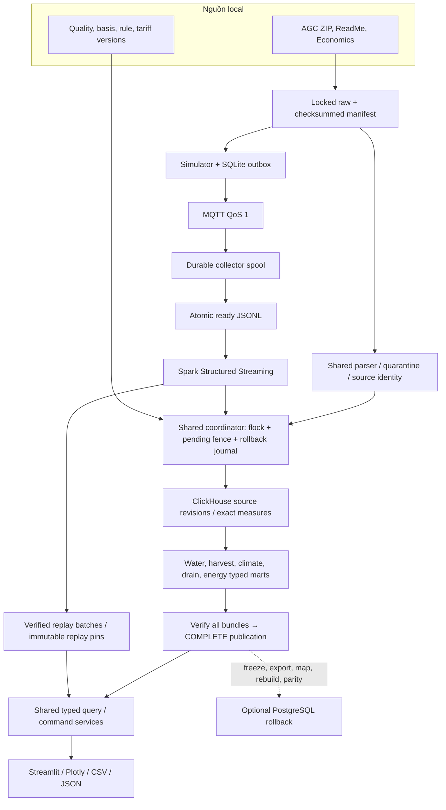

# 01 — Kiến trúc tổng quan

Warehouse Hybrid: raw bất biến → canonical core có revision → typed marts theo
publication. ClickHouse là engine mặc định; PostgreSQL là adapter đối chứng và
rollback riêng. Native batch dùng Python; Spark thực sự chạy ở sensor streaming.

Historical resource/production facts và replay Climate không được gộp scope.
Replay bổ sung BR-01/03; không tạo dữ liệu năng lượng hoặc thu hoạch từ sensor
Climate. Cost/intensity là service trên quantities có nguồn, không phải số giả
trong UI. Diagram không bao gồm cloud, actuator hoặc mô hình dự đoán.

[Deployment](02-local-deployment.md) · [schema](05-core-schema.md) ·
[marts](07-data-marts.md) · [recovery](10-durable-recovery.md).
