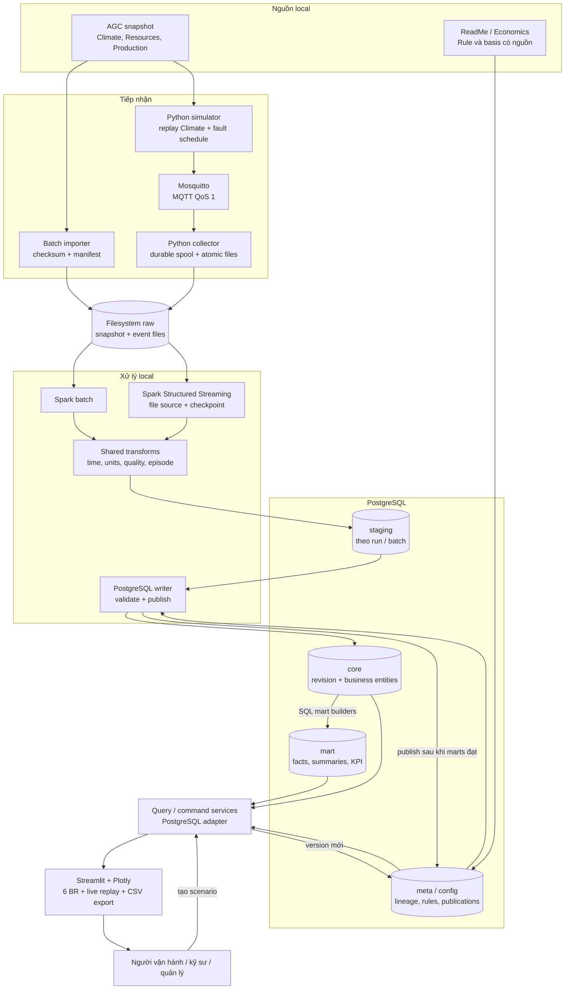

# 01 — Kiến trúc tổng quan

Kiến trúc Hybrid: raw độc lập database → staging → core chuẩn hóa có version → dimensional marts. Sensor giả lập và nguồn batch hội tụ vào cùng quy tắc chất lượng/nghiệp vụ; người dùng chọn historical hoặc replay scope.

Ứng dụng chỉ đọc publication đã công bố; các mũi tên core → mart không có nghĩa app được phép đọc mart đang xây. State của pipeline, broker và DB đều nằm local. Sau bước tải dataset/images/dependencies, demo và test phải chạy khi ngắt Internet.

Raw Climate có thể nạp trực tiếp để phân tích lịch sử hoặc phát lại qua MQTT để kiểm chứng đường sensor. Hai đường có scope riêng; không UNION chúng để tăng số lượng quan sát. Resources/Production tiếp tục giữ grain nguồn, không giả lập thành cảm biến tần suất cao.

Các phần đã chọn: PostgreSQL, Python/PySpark, Mosquitto, Streamlit/Plotly, filesystem, Docker Compose. ClickHouse chỉ xuất hiện trong [roadmap chuyển đổi](09-clickhouse-migration.md).
