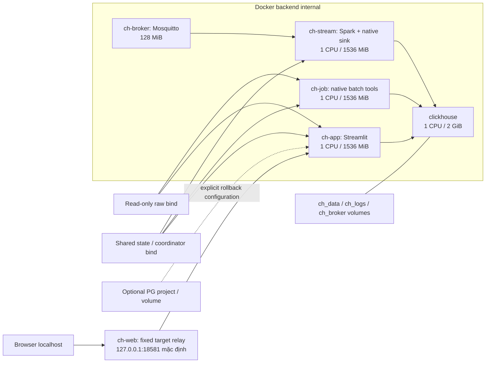

# 02 — Deployment local

`compose.yaml` include `compose.clickhouse.yaml`. App mặc định không có dependency
PostgreSQL. `compose.postgres.yaml` là cấu hình riêng; dùng project khác khi chạy.

Chỉ relay join frontend bridge; app/DB/job/stream không có runtime Internet.
Snapshot preparation có writable raw mount riêng. `.env` chọn paths, project,
port và credential local; không commit. Không đổi project/volume như cách
chuyển backend vì có thể nhìn vào một warehouse rỗng.

Images và apt/pip/JDBC/browser dependencies được chuẩn bị trước runtime offline.
Processing image chung giữ PostgreSQL compatibility; native sink dùng HTTP
stdlib, không gọi PostgreSQL/JDBC. CH server/config và resource caps được pin
trong Compose; benchmark ghi caps thực tế riêng.

Sau cutover, app/job/stream cần cùng coordinator và
`GREENHOUSE_CH_REQUIRE_CUTOVER_JOURNAL=1`. Host filesystem phải hỗ trợ flock;
không dùng cơ chế này như distributed lock. Không prune data volumes khi thiếu
storage; kiểm cache và headroom trước các read/rebuild lớn.
