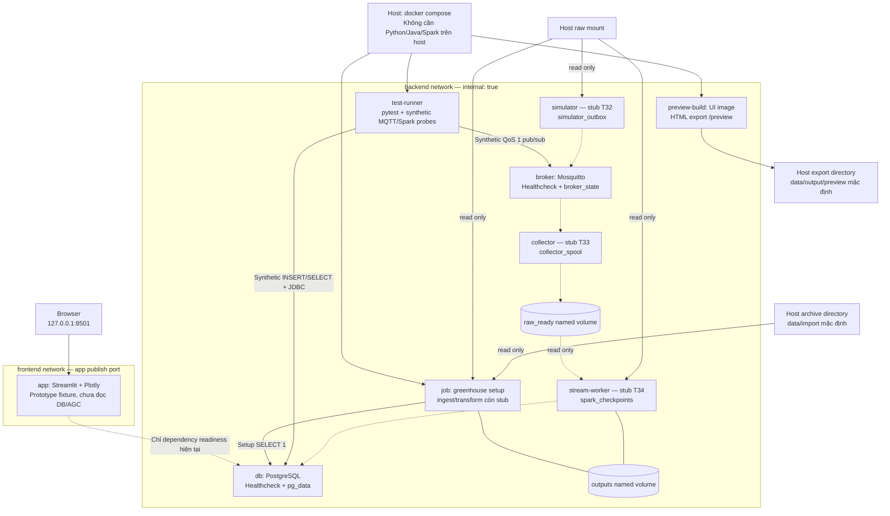

# 02 — Services và lưu trữ local

Host chỉ cần Docker Engine + Compose v2 trở lên. [Compose hiện tại](../../compose.yaml) là scaffold T04 mở rộng trực tiếp spike T02, không có stack thứ hai. Phiên bản theo [ADR-002](../adr/002-container-stack-compatibility.md); [hướng dẫn môi trường](../implementation/local-environment.md) chứa lệnh build/setup/test/prototype, bảng mounts và giới hạn.

Mũi tên nét đứt của sensor là thiết kế cho task sau; commands hiện thoát mã 2, không nhận telemetry hoặc ghi warehouse. Không có Spark master/worker cluster; processing image dùng local mode.

| Nền / profile | Services | Trạng thái |
|---|---|---|
| Base batch (luôn bật) | db, app, job | `docker compose build` build processing/UI; job mặc định setup một lần; app chạy prototype |
| sensor | Base batch + broker, simulator, collector, stream-worker | Cấu hình/volumes hợp lệ; ba command sensor còn stub |
| test | test-runner + dependencies db/broker khi `run test-runner` | Unit/config/CLI + MQTT/psycopg/Spark/JDBC synthetic tests |
| tools | preview-build | Tạo lại HTML qua image UI, output mount riêng |

- Chỉ app publish `127.0.0.1:${GREENHOUSE_APP_PORT}:8501`. DB/MQTT không publish cổng. Job/test/sensor chỉ dùng network backend nội bộ; app nối thêm frontend để người dùng mở trình duyệt.
- Healthcheck DB/broker/app và `depends_on: service_healthy` kiểm readiness, không chứng minh reconnect/durable ACK hoặc recovery.
- Processing image dùng chung job/stream-worker/test-runner; UI image dùng chung app/preview; sensor image Python nhẹ dùng chung simulator/collector. Base tags/digests và đủ dependencies được khóa khi build; JDBC JAR đã kiểm SHA-256, không tải lúc chạy.
- `.env` cung cấp password bắt buộc; không hard-code password trong Compose. Input paths cấu hình qua env, không gắn đường dẫn máy cá nhân vào source.
- PostgreSQL, broker, outbox, spool, raw-ready, checkpoints và output là named volumes riêng. Raw-ready cho writer/reader dùng cùng volume để sau này hỗ trợ atomic rename; chưa có collector thật ở T04.
- Import/raw bind mounts chỉ đọc khi xử lý; output tách riêng. Setup không sửa nguồn. Prototype/fixtures nằm sẵn trong images, không cần venv/cache trên host.
- Hạn mức cấu hình được bằng `GREENHOUSE_*_CPUS`/`GREENHOUSE_*_MEMORY`: job/test 2 GiB, stream 1.5 GiB, app 768 MiB, DB 512 MiB, broker/simulator/collector mỗi service 128 MiB. Không chạy tất cả profiles cùng test khi không cần; đây chưa phải sizing AGC.
- `down` giữ named volumes; `down -v` xóa storage của project, không xóa archive/raw bind mount. Backup/drain/recovery pipeline thật còn thuộc T08/T28/T36; không xem việc khởi động scaffold là bằng chứng các cơ chế đó đã đạt.
