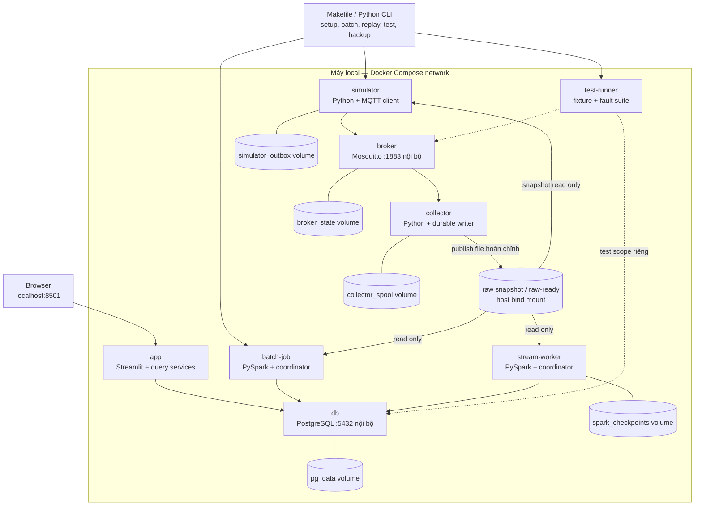

# 02 — Services và lưu trữ local

Một máy chạy Docker Compose. Spark dùng local mode trong container; không dựng master/worker cluster cho bản đầu. Tên service/volume dưới đây là thiết kế để hiện thực ở T04.

| Profile/lệnh dự kiến | Thành phần cần chạy |
|---|---|
| Batch | db, app; batch-job chạy theo lệnh |
| Sensor | db, app, broker, collector, stream-worker; simulator theo lệnh |
| Test | Dịch vụ tùy test, database/scope/volume kiểm thử riêng |

- Chỉ app cần expose mặc định trên `127.0.0.1`; cổng DB/MQTT cho debug nếu bật cũng bind localhost. Giao tiếp container dùng service name, không dùng localhost của host.
- Healthcheck và retry giới hạn xử lý thứ tự khởi động; `depends_on` đơn thuần không phải cơ chế phục hồi.
- Image chứa sẵn Python/Java, JDBC và MQTT dependencies tương thích; không tải package lúc demo. Credentials qua cấu hình local không commit.
- Raw-ready và thư mục file tạm dùng cùng filesystem để atomic rename. File đã công bố không append/sửa tiếp.
- Backup nhất quán dùng điểm dừng/drain; giữ raw + manifests + cấu hình để có thể dựng lại DB. Không phục hồi checkpoint tiến xa hơn DB nếu chưa replay/đối soát phần thiếu.
- Hạn mức CPU/RAM, kích thước batch, disk budget và backpressure được cấu hình và đo tại T25/T36; chưa khẳng định cấu hình tối thiểu.
