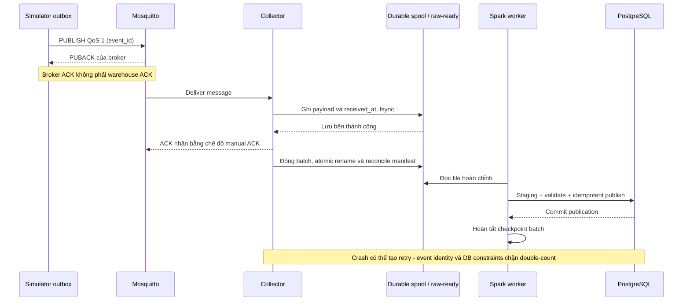

# 03 — Sensor simulator và ingestion

Mỗi khoang có một thiết bị giả lập phát một bundle Climate cho mỗi slot nguồn. Payload giữ actual, requested/realized setpoint và drain measurements riêng; setpoint là controller context, không phải cảm biến đo. Không tạo ngẫu nhiên baseline khi đã có dữ liệu thật để replay.

```mermaid
flowchart LR
    CSV["Climate snapshot"] --> SELECT["Chọn khoang / cửa sổ<br/>scope + replay manifest"]
    SELECT --> CLOCK["Replay scheduler<br/>speed, pause, resume"]
    CLOCK --> FAULT["Fault injector có seed<br/>duplicate, delay, gap, conflict"]
    FAULT --> ENV["Envelope + outbox<br/>event ID ổn định khi retry"]
    ENV --> MQ["MQTT broker<br/>topic v1 / replay / compartment"]
    MQ --> RECEIVE["Collector<br/>received_at + envelope validation"]
    RECEIVE --> SPOOL["Durable spool<br/>payload gốc + checksum"]
    SPOOL --> VALID{"Envelope hợp lệ?"}
    VALID -->|"Có"| PACK["Gom JSONL<br/>đóng file + fsync + rename"]
    VALID -->|"Không"| Q["Quarantine envelope<br/>giữ bytes và reason"]
    PACK --> READY[("Raw-ready files<br/>manifest + checksum")]
    READY --> SPARK["Spark file stream"]
    Q --> AUDIT["DQ report / reconciliation"]
```

| Trường envelope | Quy ước |
|---|---|
| `schema_version`, `event_id` | Schema tường minh; retry cùng event giữ ID và nội dung |
| `data_scope_id`, `replay_id`, `device_id` | Tách replay/fault run; device có nhãn simulated |
| `cycle_id`, `compartment_id` | Mapping metadata đã xác minh |
| `source_record_id`, snapshot/file/row | Truy về CSV; độc lập surrogate ID database |
| `source_time_serial`, `source_observed_at` | Giữ thời gian AGC, không tự gắn timezone |
| `sequence`, `published_at` | Thứ tự phát logic và thời gian phát thực có timezone |
| `payload`, `units`, `fault_tags` | Không điền missing; fault injection có lineage |

`received_at` do collector bổ sung. QoS 1 cho phép delivery lặp: phải phân biệt duplicate cùng ID/nội dung và conflict cùng ID/khác nội dung. Manifest/reconciliation mới xác nhận đủ dữ liệu đầu-cuối; ACK publisher từ broker không xác nhận DB đã commit.

Simulator còn phát control messages trên topic riêng cho replay cursor, pause/resume và completion manifest, có schema version và sequence riêng. Collector lưu bền chúng như telemetry. Cursor chỉ tiến theo control sequence đã xác nhận, không lấy timestamp lớn nhất của telemetry đến không đúng thứ tự. Completion message chỉ là yêu cầu đối soát, không tự chuyển replay sang complete.

Collector phải chọn client hỗ trợ ACK sau lưu bền, kiểm chứng bằng fault tests. Nếu crash sau rename trước cập nhật manifest, khởi động lại kiểm tra file/checksum và hoàn thiện manifest; không phát file mới chứa cùng dữ liệu mà không giữ identity. Publisher outbox/replay manifest cho phép khôi phục cả trường hợp broker state chưa đủ để phục hồi.

Backpressure: giới hạn số message đang xử lý và dung lượng spool; disk đầy phải dừng ACK/nhận thêm có kiểm soát và báo trạng thái. Không drop im lặng. Replay clock chỉ tăng theo tiến độ phát; dashboard tính freshness theo thời gian nhận, còn missing slot và duration theo thời gian nguồn.

T32–T36 phải có fault matrix cho restart tại các điểm lưu bền/ACK/DB commit/checkpoint. Stream kết thúc chỉ khi đối soát expected unique events với accepted, quarantined, intentionally missing và unresolved conflicts.
