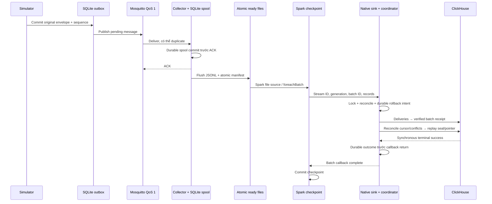

# 03 — Sensor simulation, ingestion và replay

Simulator phát lại Climate AGC thật, giữ source provenance và sequence. MQTT
QoS 1 có thể giao trùng; correctness dựa vào durable state, canonical identity
và sealed receipts, không dựa vào giả định transport exactly-once.

Event ID + payload hash phân biệt duplicate và conflict; conflict không chọn
first arrival. Partial/late/control mismatch làm replay provisional. Source
clock 2019–2020 khác received UTC; completed replay vẫn có thể có collector
stale sau khi finite producer dừng.

Checkpoint bind backend, namespace, scope, stream, generation và config hash.
Không tái dùng checkpoint PostgreSQL cho CH hoặc khi rebuild vào DB mới.
Backup SQLite cần WAL/SHM nhất quán hoặc SQLite backup API; ready/checkpoint,
broker, config và DB phải thuộc cùng cutoff. Xem
[sensor native](../implementation/clickhouse-sensor.md) và
[proof replay](../evaluation/sensor-replay.md).
