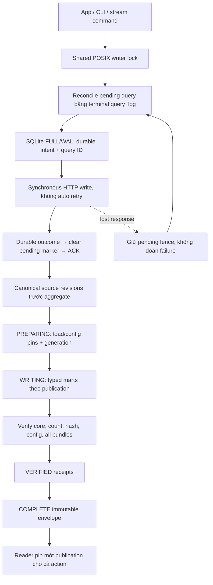

# 04 — Processing, publication và fencing

Native batch dùng parser/semantic transforms Python chung cho exact Decimal,
quality, units và grain. PG baseline có Spark batch staging và SQL marts;
Spark Structured Streaming là phần chạy thật trên đường sensor hiện tại.

CH không có transaction nhiều bảng cho protocol này. Complete envelope chỉ
được ghi sau khi verify mọi bundle; incomplete attempt không thành dữ liệu UI.
Retry cùng semantic key/hash collapse physical copies; payload khác bị từ chối.
Correction append revision mới, raw và published membership cũ giữ nguyên.

Read cache gồm action-owned results và bounded process-local proof cache opt-in.
Proof dùng namespace/server/table identity, active part checksums và fresh config
pins; INSERT/mutation/merge/schema recreation làm stamp thay đổi. Process restart
cần cold proof mới. Cache không phải durable backup và không phải completeness
proof của transport.

Journal/source metadata giữ để rollback; derived marts được rebuild. Xem
[cutover/rollback](../implementation/clickhouse-cutover-rollback.md).
