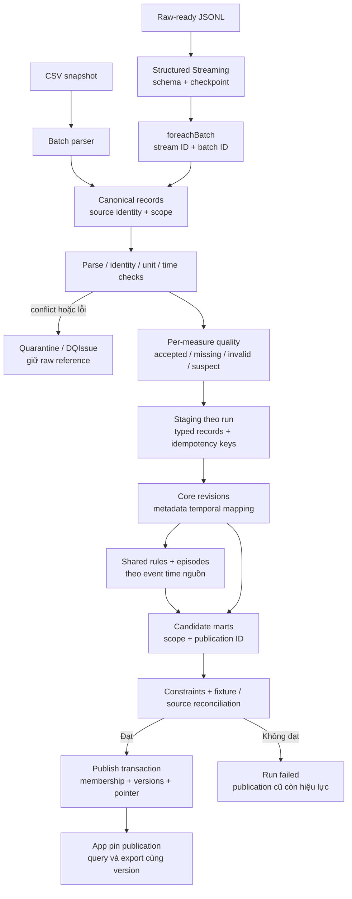
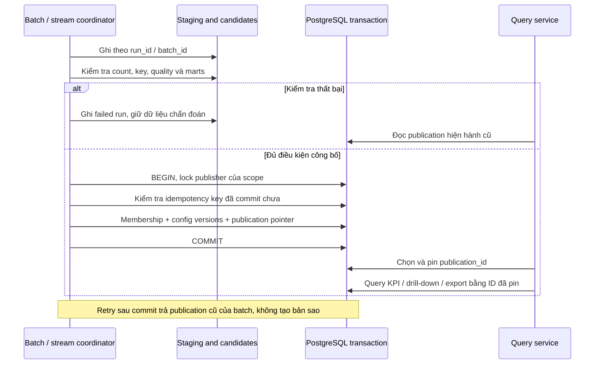

# 04 — Processing, publication và recovery

Batch và stream dùng chung semantic transforms. Schema đầu vào khác nhau được adapter chuyển về canonical records trước tính nghiệp vụ. Structured Streaming dùng file source; không giả định Spark có MQTT source tích hợp trong thiết kế này.

## Publication contract

Core revisions và candidate marts được ghi bằng run riêng, chưa xuất hiện trong query public. Khi đạt kiểm tra, một coordinator transaction tạo membership core chính xác, ghi cấu hình phiên bản và đổi publication pointer. Candidate data đã commit trước đó chỉ trở thành public khi pointer được công bố. Giữ một publisher tuần tự cho mỗi scope ở bản đầu; không để hai writer đảo thứ tự publication.

`processed_batch` có unique `(stream_id, checkpoint_generation, batch_id)`; identity record vẫn bắt buộc vì có thể reset checkpoint hoặc replay file. Cùng event ID nhưng khác content phải quarantine/conflict, không `ON CONFLICT DO NOTHING` để che thay đổi.

## Late data và thời gian

- V1 giữ mọi late event; không dùng watermark để loại mất bản ghi phục vụ đối soát lịch sử. ForeachBatch chuẩn hóa/ghi dữ liệu; job nghiệp vụ đọc các core revisions cần thiết để tái tính cycle bị ảnh hưởng ở quy mô AGC.
- Episode phải xét chuỗi slot xuyên các micro-batch. Không kết thúc episode chỉ vì batch hết; late record có thể nối hoặc ngắt chuỗi. Lưu trạng thái open/provisional khi replay chưa đối soát xong.
- `observed_through` là cursor theo event time nguồn, không phải `max(received_at)`. Coverage live tính đến cursor, giữ các gap trước cursor; không tính phần tương lai của vụ vào unknown.
- Replay complete khác harvest snapshot complete. Resources/Production cần được nạp cùng source snapshot trong scope replay nếu hiển thị bối cảnh liên quan; không JOIN scope ngầm.
- Độ trễ vận hành dùng lần publish thực đến khi dữ liệu queryable; duration nghiệp vụ dùng slot 5 phút nguồn. Thay replay speed không làm đổi duration.

Các kiểm thử quan trọng: crash giữa staging/publication, sau commit trước checkpoint; cùng batch phát lại; late event qua biên episode; conflict; hai thao tác query pin cùng publication khi bản mới được công bố.

## Batch coordinator đã triển khai

[Workflow contract và lệnh](../../src/greenhouse/db/README.md#workflow-chạy-lại-và-publication) triển khai bốn step có trạng thái, SHA-256 artifacts, local Spark Parquet/profiling và publication psycopg. `workflow_candidate` freeze revision IDs; config hash pin parser/quality/basis/code. Lock theo workflow chống resume đồng thời; lock scope dùng chung cho load/correction/publish. Candidate cũ hơn latest hoặc config drift không được đẩy lùi current pointer.

Publication transaction có hook cho T09 materialize marts trên **cùng connection**; synthetic test chứng minh hook rollback cùng membership và pointer. `publication_seal` chốt membership checksum/count và artifact checksum; publication cũ bất biến. Rerun không đổi chọn lại publication cũ và không gọi hook. Step completed được kiểm checksum trước skip, attempt lỗi có batch path mới và giữ mọi pending/source để chẩn đoán. Spark chỉ staging, không coi JDBC nhiều connection là atomic publication.

Raw snapshot khác là data scope khác, không merge/matching hoặc tự mở rộng basis. Correction tường minh trong locked snapshot có old/new/evidence/actor/version, chỉ append revision và giữ raw identity. Các cơ chế processed_batch, episodes, late sensor và streaming trong thiết kế trên thuộc các task sau; batch hiện chưa materialize KPI.
