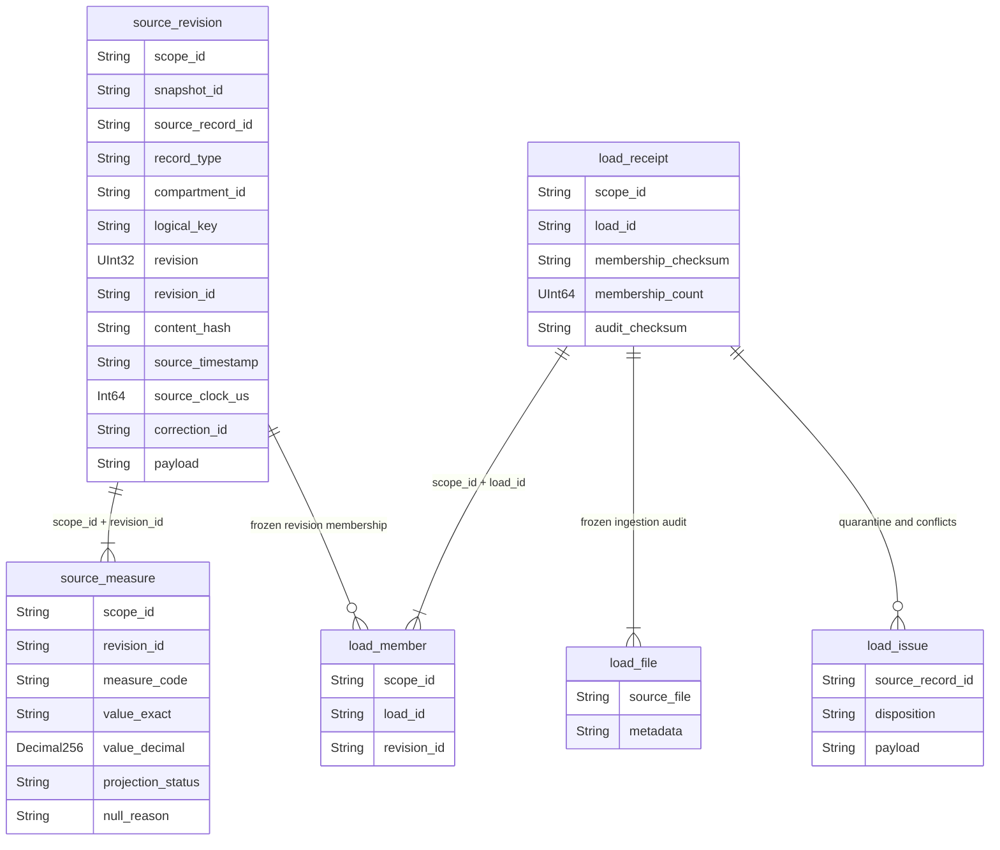

# 05 — Core schema ClickHouse

Các bảng là MergeTree append-only. Quan hệ trong ERD là quan hệ logic được
repository/manifests kiểm, không phải foreign key hoặc unique constraint CH.

Semantic key: Climate/Resources dùng type × compartment × logical time; harvest
còn giữ source record identity để không gộp các record thu hoạch cùng ngày.
Revision ordinal liên tiếp và correction parent được kiểm trước append. Hai
payload khác nhau cho cùng ordinal là conflict; không chọn last-write-wins.
Published membership giữ revision cụ thể, nên correction không đổi pin cũ.

`value_exact` là biểu diễn Decimal canonical; Decimal(76,38) / Decimal256 chỉ là projection
khi round-trip chính xác. Giá trị ngoài miền projection vẫn có exact String,
không truncate hoặc đi qua Float64 để tính tiền/KPI. Source clock lưu string và
microseconds naive; received/operating clock có UTC thật.

Physical retries giống nhau được collapse trước aggregate. Không đợi background
merge để tuyên bố số liệu đúng. `source_disposition` giữ audit dòng không đủ điều
kiện core, không biến quarantine thành missing giả.
