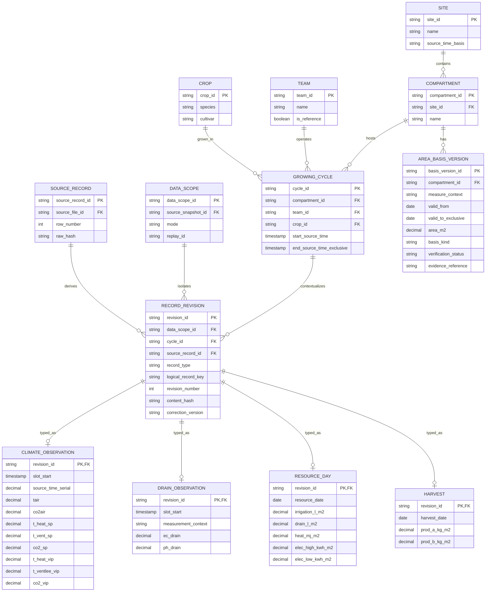
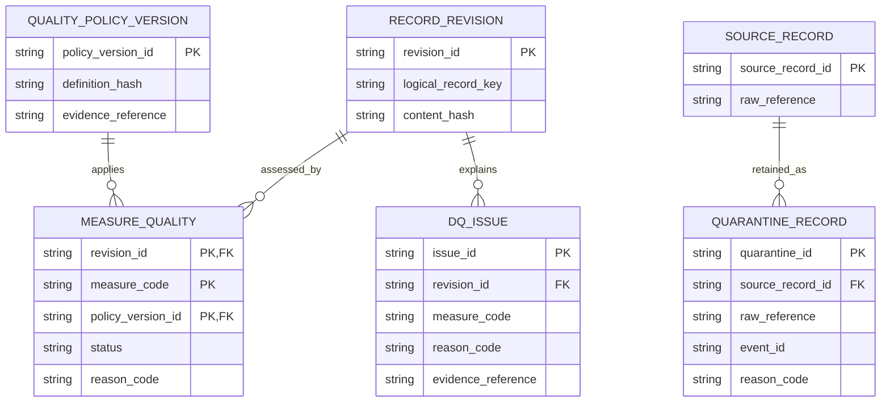

# 05 — Core schema PostgreSQL

Core giữ đúng grain nguồn, metadata nghiệp vụ và lịch sử correction. Trong ERD, `revision_id` là khóa bất biến của một phiên bản; một logical record có thể có nhiều revision, nhưng publication chỉ chọn một. Truy vấn core cho UI phải qua membership của publication, không đọc tất cả revision rồi SUM.

Một source row Climate sinh logical records climate và drain riêng, cùng source reference. Các subtype của `RECORD_REVISION` loại trừ nhau theo `record_type`; đây là invariant cần constraint/validation, không suy ra tự động từ các cạnh ERD.

| Entity | Grain nghiệp vụ trong một scope | Kiểm tra bắt buộc |
|---|---|---|
| ClimateObservation | cycle × slot 5 phút | Requested/realized riêng; điểm cuối vụ không tạo thêm duration |
| DrainObservation | cycle × slot × context | Context drain process computer; quality EC/pH độc lập |
| ResourceDay | cycle × ngày | Một nguồn tổng ngày; không SUM counter 5 phút vào cùng total |
| Harvest | cycle × source record | Không mặc định một harvest/ngày; giữ record ID |
| AreaBasisVersion | compartment × measure context × hiệu lực × version | Một mapping hợp lệ cho measure/ngày; không tự lấy floor area |

`RECORD_REVISION` unique `(scope, record_type, logical_record_key, revision_number)`. Trong publication, logical record chỉ chọn một revision; chỉ đúng scope/cycle/source được phép liên kết. FK đảm bảo quan hệ; slot uniqueness, subtype và temporal overlap cần kiểm tra thêm. Các bảng fact có thể giữ cột NULL; dùng trạng thái quality để quyết định accepted thay vì bỏ cả row.

Với payload chưa parse được, `source_record_id` có thể chưa xác định: quarantine vẫn phải giữ raw reference và delivery identity. MEASURE_QUALITY dùng bốn trạng thái accepted/missing/invalid/suspect; đánh giá ngoài ngưỡng nghiệp vụ nằm ở mart, không phải lỗi cảm biến mặc định.

## Triển khai core hiện tại

[SQL migrations và loader](../../src/greenhouse/db/README.md) là nguồn DDL thực; ERD phía trên diễn tả các entity logic. Migration 001–003 tạo `core`, `meta`, `config`; migration 004 thêm workflow/publication seal và giữ typed values/quality bất biến. Chưa tạo marts nghiệp vụ.

| Entity logic | Bảng/view triển khai và khác biệt chi tiết |
|---|---|
| Site / Compartment / Team / Crop / GrowingCycle | `core.site`, `compartment`, `team`, `crop`, `growing_cycle`. IDs lấy folder, không suy ra số khoang; cultivar NULL. Mọi seed có evidence_reference; cycle window là convention T03. |
| RecordRevision | `core.record_revision`: scope/snapshot/run/source/cycle, logical key có cycle prefix, revision number, observed_at, closing flag. Composite FK + trigger kiểm snapshot/source/cycle và half-open window; unique theo slot/ngày/version cho climate/drain/resource; Harvest theo source record, cho phép nhiều record cùng ngày. |
| Climate / Drain | `core.climate_observation`, `core.drain_observation`: hai revision dùng chung source identity; type discriminator/FK ngăn subtype sai. Context drain cố định `drain_process_computer`; không coalesce requested/realized. |
| ResourceDay / Harvest | `core.resource_day`, `core.harvest`: NUMERIC giữ đơn vị nguồn; tên cột heat_mj_m2, elec_*_kwh_m2, irrigation_l_m2, drain_l_m2, prod_*_kg_m2. Date/ISO year/week được sinh từ observed_at, không chia tổng ngày thành slot. |
| AreaBasisVersion | Bảng thực ở **`config.area_basis_version`**, cùng assumption/application; theo scope, khoang, measure, hiệu lực và version. Context source_verified/shared_analysis/sensitivity tách biệt; toggle không đổi definition. |
| MeasureQuality | `core.measure_quality`: status bốn trạng thái + **applicability_status** applicable/unknown. CO₂ setpoint 0 accepted về numeric nhưng applicability unknown/off_mode_unverified nên usable_value NULL. pH zero suspect theo policy demo. |
| LabAnalysis | Đã giữ raw/staging T06; **core deferred** vì ERD chưa model context mẫu lab. `meta.file_ingestion` giữ cả ingestion status loaded và core status deferred; không tuyên bố đã có LabAnalysis core. |

Source serial NUMERIC/token nguyên văn là nguồn thời gian có thẩm quyền; `meta.source_record.source_timestamp` giữ nguyên độ chính xác T06 (truncate µs), có time_precision/time_policy_version, không round lại ngầm. Core observed_at là canonical slot hoặc ngày từ parser v1, `timestamp without time zone`. Closing point nằm ngoài cycle, còn metadata nhưng `usable_value=NULL`; không sinh duration. Clock emitted/received dùng timestamptz trong schema sensor-event dự phòng.

Quality áp theo measure: missing/invalid/suspect không xóa measure khác của cùng row. Quarantine chỉ do invalid_numeric với time/header/width hợp lệ có thể tạo core partial, giữ quarantine nguồn; lỗi time/header, conflict và ngoài vụ không tạo revision. Không phân loại out-of-target, không tính KPI ở core.

`core.explain_measure` là diagnostic candidate có value/unit/quality/applicability/basis/reason/raw reference. App chỉ dùng `core.published_measure`: current pointer → publication membership → selected revisions và quality/basis pin của cùng publication; view rỗng khi chưa publish. Loader thấp cấp không thay pointer; run-pipeline/publish thực hiện coordinator. Coordinator kiểm đủ subtype/quality/membership, có hook marts cùng transaction và công bố pointer; T31 sẽ bọc SQL bằng contracts. Không dùng khả năng đọc candidate như bằng chứng app/BR đã nghiệm thu.
