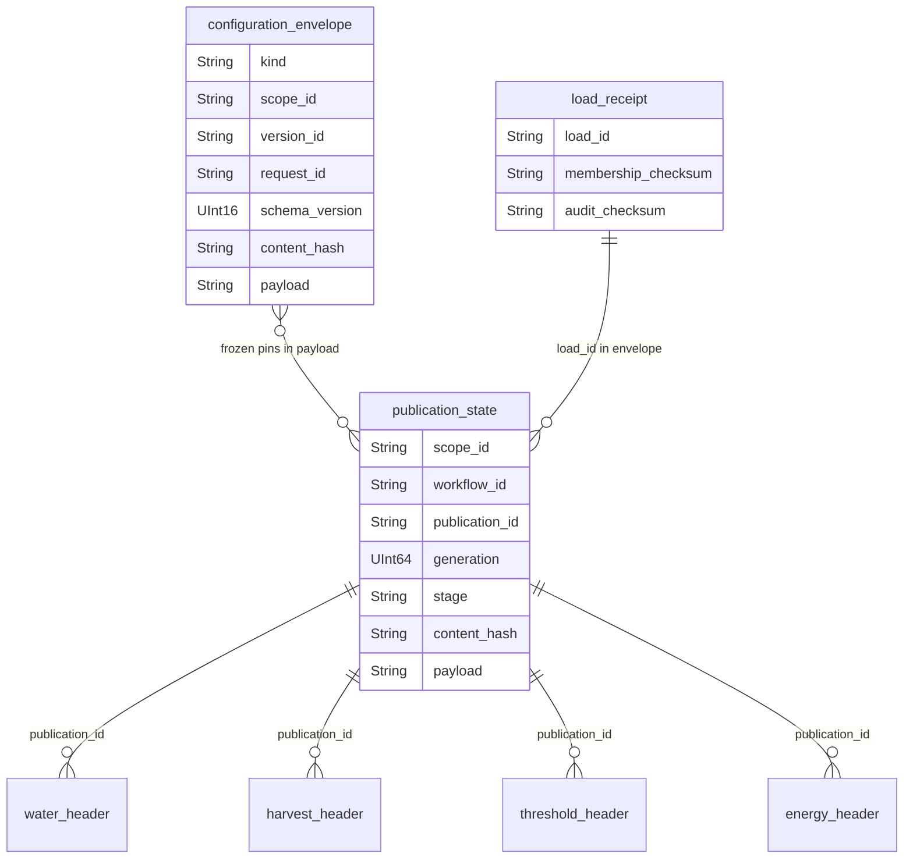
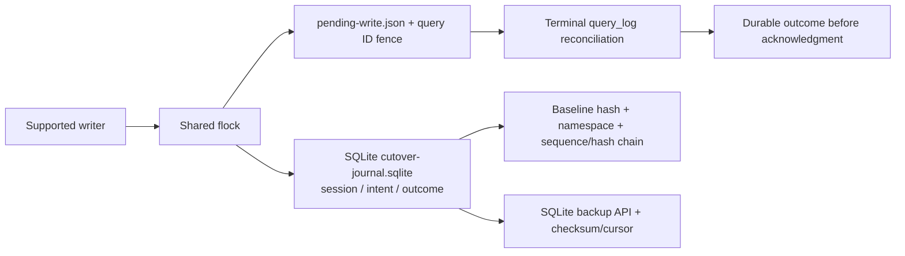

# 06 — Metadata, cấu hình và journal

Một rule/tariff/scenario version lưu trong một complete envelope: header và
segments/rates không bị lộ một phần. Request ID và content hash được kiểm dưới
shared writer lock. Publication đóng băng config pins, không đọc latest config
để thay ngược lịch sử.

Các family gồm snapshot, area basis, quality/bundle configuration, irrigation/
harvest rules, threshold schedules, tariffs, cost scenarios, replay config và
migration/rebuild provenance. Scenario ghim publication, context, baseline,
changes, derived rates và request/version chain. Rule mới không thành nguồn
xác minh nông học; area assumption có status/evidence riêng.

SQLite journal ở coordinator filesystem, không phải bảng ClickHouse. Bản
PostgreSQL rollback giữ archive native trong `meta.clickhouse_cutover_archive`,
config envelopes trong `meta.clickhouse_configuration_archive` và source/target
scenario mappings riêng. Trùng ID giữa hai lineage không cho phép ghi đè version
bất biến; mapping giữ original IDs và kiểm retry.
