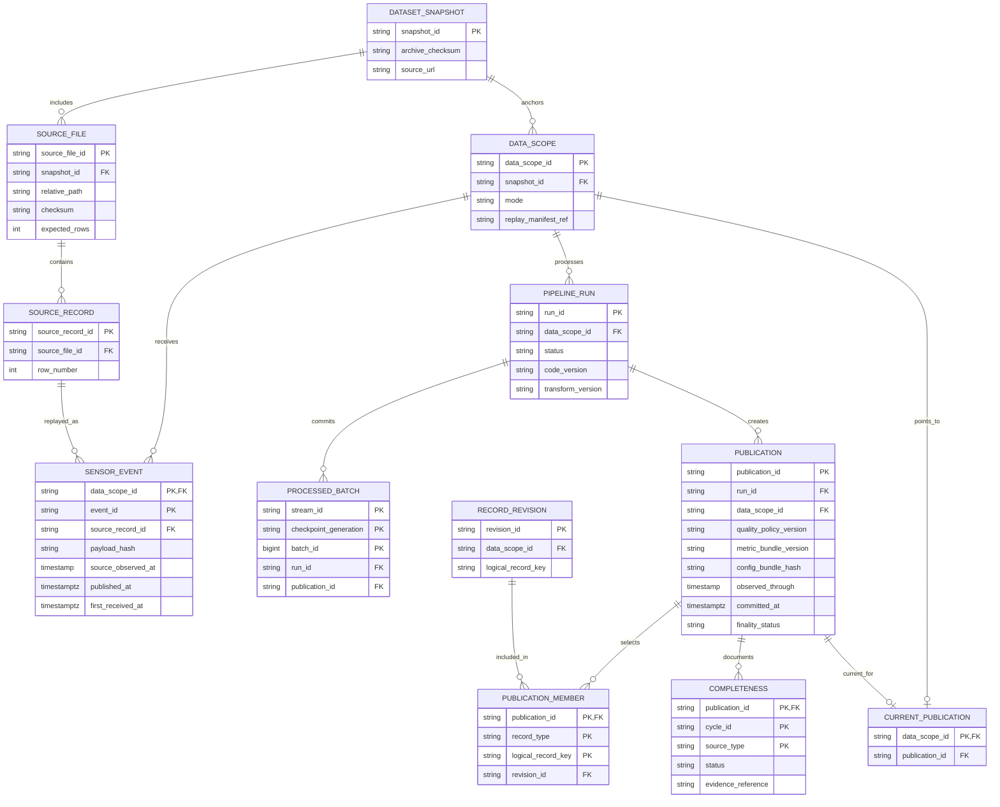
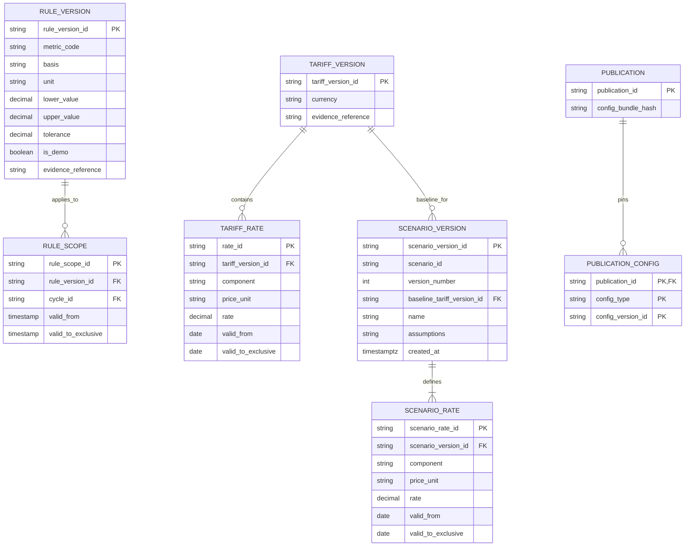

# 06 — Metadata, lineage và cấu hình

Schema `meta` ghi nguồn, ingestion, publication và tiến độ replay; schema `config` giữ cấu hình có version. Đây là dữ liệu cần chuyển cùng raw khi migrate, đặc biệt các scenario do người dùng tạo.

SENSOR_EVENT là bản envelope hợp lệ canonical; raw delivery log giữ mọi lần giao, duplicate và conflict. Cùng event ID khác payload không được ghi đè canonical im lặng. Bảng `PROCESSED_BATCH` và publication cùng transaction; publication membership phải kiểm tra revision thuộc đúng scope và logical key.

Completeness Resources/Production là bằng chứng đủ snapshot và xử lý nguồn; không suy ra từ tỷ lệ ngày có harvest. Finality của replay và completeness từng nguồn là các trạng thái riêng.

`PUBLICATION_CONFIG` là biểu diễn logic của tập tham chiếu version: DDL dùng junction tables có FK cụ thể cho rule, quality, metric, basis, correction và tariff; không dùng một polymorphic ID không kiểm tra được tham chiếu. Scenario được pin thêm trong query/result identity; khi materialize kết quả scenario phải giữ publication nguồn.

Rate intervals nửa mở, không overlap theo component/version; gap ngăn tính canonical total. Baseline không bị sửa khi tạo scenario. Giá heat lịch sử giữ đúng `0.0083 EUR/MJ`; tiền dùng decimal. Scenario chỉ thay giá, giữ quantities và area basis cùng publication; nguồn daily không hỗ trợ đổi lịch giờ cao/thấp điểm.

RULE_VERSION có metric-specific parameters: BR-01 dùng setpoint ± tolerance; BR-03 dùng lower/upper profile. Không áp cột lower/upper tĩnh cho toàn bộ cơ chế setpoint BR-01.
