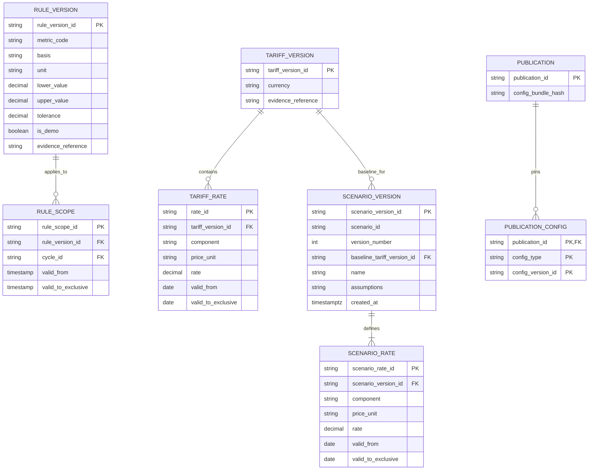

# 06 — Metadata, lineage và cấu hình

Schema `meta` ghi nguồn, ingestion, publication và tiến độ replay; schema `config` giữ cấu hình có version. Đây là dữ liệu cần chuyển cùng raw khi migrate, đặc biệt các scenario do người dùng tạo.

SENSOR_EVENT là bản envelope hợp lệ canonical; raw delivery log giữ mọi lần giao, duplicate và conflict. Cùng event ID khác payload không được ghi đè canonical im lặng. Bảng `PROCESSED_BATCH` và publication cùng transaction; publication membership phải kiểm tra revision thuộc đúng scope và logical key.

Completeness Resources/Production là bằng chứng đủ snapshot và xử lý nguồn; không suy ra từ tỷ lệ ngày có harvest. Finality của replay và completeness từng nguồn là các trạng thái riêng.

`PUBLICATION_CONFIG` là biểu diễn logic của tập tham chiếu version: DDL dùng junction tables có FK cụ thể cho rule, quality, metric, basis, correction và tariff; không dùng một polymorphic ID không kiểm tra được tham chiếu. Scenario được pin thêm trong query/result identity; khi materialize kết quả scenario phải giữ publication nguồn.

Rate intervals nửa mở, không overlap theo component/version; gap ngăn tính canonical total. Baseline không bị sửa khi tạo scenario. Giá heat lịch sử giữ đúng `0.0083 EUR/MJ`; tiền dùng decimal. Scenario chỉ thay giá, giữ quantities và area basis cùng publication; nguồn daily không hỗ trợ đổi lịch giờ cao/thấp điểm.

RULE_VERSION có metric-specific parameters: BR-01 dùng setpoint ± tolerance; BR-03 dùng lower/upper profile. Không áp cột lower/upper tĩnh cho toàn bộ cơ chế setpoint BR-01.

## Metadata đã triển khai và phần tiếp nhận sau

[Migrations/contract hiện tại](../../src/greenhouse/db/README.md) triển khai các entity cần cho một load core từ staging T06:

- `meta.schema_migration`: file version/SHA-256/applied_at, transaction + advisory lock; skip checksum khớp, đổi checksum fail.
- `meta.dataset_snapshot`, `data_scope`, `source_folder_mapping`, `source_file`: snapshot identity, scope historical/replay/fault và mapping có nguồn; không tự đặt số khoang/area. Scope composite FK gắn đúng snapshot.
- `meta.pipeline_run`, `file_ingestion`, `source_record`: run manifest gốc, ingestion/core statuses riêng, counts cân, output-consumability, stable source ID, file/physical line/raw hash/reference/serial/time precision. Loader không glob; failed/deferred/outputs_consumable=false không thành core loaded. Run failed chỉ lưu metadata blocked; run unfinished bị từ chối.
- `meta.dq_issue`, `quarantine_record`, `correction`: giữ parse issues và per-measure quality issues ở hai lớp; số issue không phải số record lỗi duy nhất. Correction yêu cầu source, old/new, actor/evidence/version, append-only; không tự sửa năm. Reference ngoài vụ còn quarantine nên T12 phải giữ completeness false. `meta.harvest_ingestion_state` chỉ chứng minh tình trạng giải quyết source rows, chưa phải kết luận completeness nghiệp vụ.
- `config.measure_definition`, `quality_policy_version`: unit/type catalog; policy effective intervals, definition/hash, evidence/demo label; version bất biến. MEASURE_QUALITY còn có applicability unknown để giữ off_mode_unverified riêng với numeric validity.
- `config.area_basis_version`, `basis_assumption_version`, `assumption_application`, `basis_application`: Production verified 62.5; shared analysis `AGC_SHARED_BASIS_V1` assumed_unverified; phương án `AGC_FLOOR_96_SENSITIVITY_V1` riêng, tắt mặc định. Selection tường minh theo scope/khoang/measure/context và hiệu lực; không chọn latest hay thăng assumption thành verified. Tắt assumption/application mở NULL path; version cũ giữ nguyên.
- `meta.publication`, `publication_member`, `publication_basis`, `current_publication`: version/membership/config pin/pointer. Composite FK chặn sai scope/key/revision/basis; publication không bị sửa. `core.published_measure` dùng quality policy và basis được pin, không lấy toggle hiện tại. Không có publication được tạo bởi loader T07.
- `meta.sensor_event`: schema dự phòng theo ERD, source_observed_at naive, published_at/first_received_at timestamptz; chưa có producer/collector/replay ghi vào bảng này.

Các entity rule/tariff/scenario, processed_batch, publication completeness và junction config bổ sung vẫn là thiết kế cho T14–T21/T32–T36, chưa được tạo hoặc chạy ở T07. T07 chỉ pin quality policy và basis vì chưa có metric/rule/tariff versions để tham chiếu; không dùng polymorphic config ID giả. Loader nạp một transaction, từ chối run trùng; không triển khai resume/upsert correction/recovery. Coordinator bổ sung bên dưới; T31 tiếp nhận adapter SQL/DTO.

## Workflow và publication thực thi

Migration 004 bổ sung `meta.workflow_run` (scope/snapshot/input/versions/status/ingestion/publication), `workflow_step` (bốn step, attempt/status/times/counts/versions/errors/artifact checksum), `workflow_candidate` (frozen revision IDs), `workflow_basis` (frozen basis/context), `core_baseline_receipt` (parser/policy/exact-value fingerprint/count) và `publication_seal` (publication/workflow/membership checksum/count/Spark artifact checksum). Receipt và seal bất biến. Typed values và quality cũng append-only để baseline receipt/historical publication giữ nguyên ý nghĩa.

Run mới cùng snapshot ghi metadata reused khi raw/hash/key/values không đổi; không tạo source/revision mới. Correction tường minh append cả audit và một revision n+1, raw/source identity không đổi. Snapshot mới có scope riêng và basis cần quyết định riêng. Publication pin quality và basis; membership/basis bị khóa sau seal. Pointer chỉ nhận publication đã seal. Workflow/step completed cập nhật trong cùng transaction publication, tránh ghi “failed” giả nếu client bị ngắt ngay sau commit. Xem [contract vận hành](../../src/greenhouse/db/README.md#workflow-chạy-lại-và-publication).
