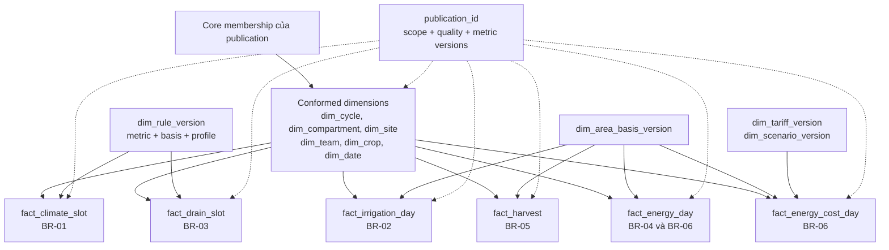
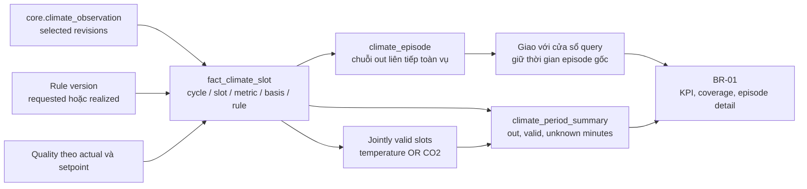
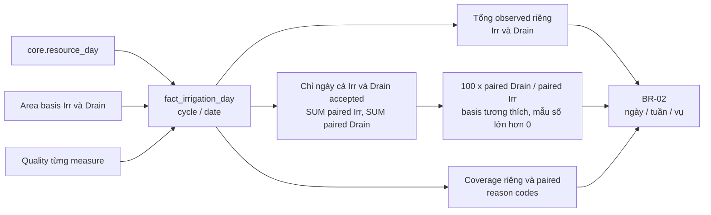
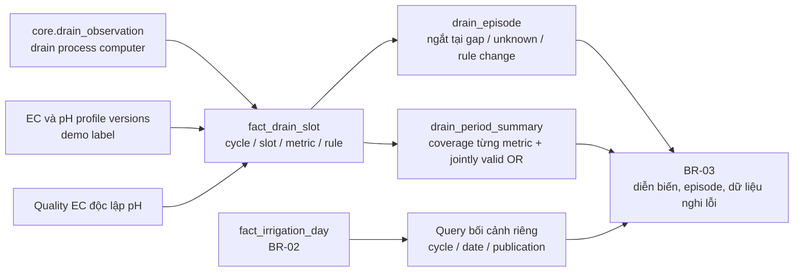
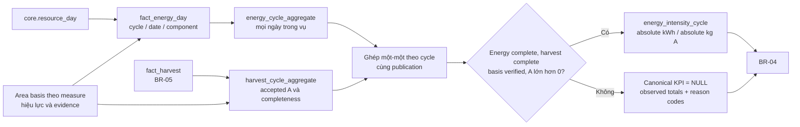
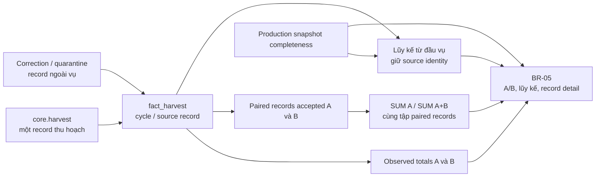
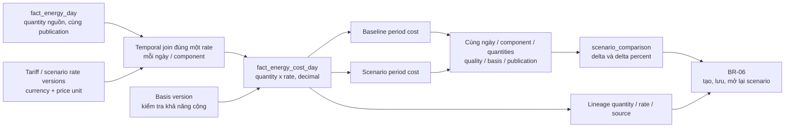

# 07 — Dimensional marts cho sáu BR

Marts chỉ dùng core revisions được publication lựa chọn, cùng quality/config versions. Grain dưới đây là grain nghiệp vụ; khóa vật lý bổ sung `publication_id` và các version được nêu. `dim_date` dùng thời gian nguồn, gồm ISO year/week; không chuyển timezone ngầm.

## Dimensions dùng chung

Các cạnh dimension → fact thể hiện lookup/FK, không phải phép JOIN mọi fact cùng nhau. Dimensions nghiệp vụ được đóng băng theo publication, unique `(publication_id, business_key)`; facts tham chiếu cùng publication. `dim_date` có thể dùng chung bất biến. Không cần SCD Type 2 đầy đủ ở bản đầu vì publication đã giữ snapshot metadata; bổ sung chỉ khi có nhu cầu khác.

| Fact / kết quả | Grain trong publication | Measure và trạng thái chính |
|---|---|---|
| `fact_climate_slot` | cycle × slot × metric × requested/realized × rule version | actual, lower/upper, quality, out/valid/unknown minutes |
| `fact_drain_slot` | cycle × slot × metric × drain context × rule version | EC/pH, quality, low/high, out/valid/unknown minutes |
| `fact_irrigation_day` | cycle × ngày | observed và paired Irr/Drain, paired-valid flag, basis status |
| `fact_harvest` | cycle × source harvest record | observed A/B, paired A/B, quality, completeness reference |
| `fact_energy_day` | cycle × ngày × heat/elec_high/elec_low | quantity nguồn, kWh/m², absolute kWh nếu đủ basis, quality |
| `energy_intensity_cycle` | cycle × metric version | energy, accepted A, kWh/kg A hoặc NULL và reasons |
| `fact_energy_cost_day` | cycle × ngày × component × tariff/scenario version | quantity, rate, cost, unit/basis, pricing status |

Tỷ lệ, pH, nhiệt độ, CO₂ và intensity là non-additive: tổng hợp lại tử/mẫu đúng tập dữ liệu, không SUM hoặc AVG các tỷ lệ con. Summary theo window có thể là query/view ở MVP; không mặc định materialize mọi tổ hợp bộ lọc.

## BR-01 — Khí hậu

- Slot ở điểm biên cuối vụ được lưu nhưng không cộng thêm 5 phút. Requested và realized không fallback cho nhau.
- Episode ngắt tại unknown/gap/đổi rule; filter minimum episode length không thay tổng giờ out.
- OR tính hợp trên tập cùng hợp lệ; không cộng hai tổng riêng. Live episode chưa hoàn tất có trạng thái provisional và observed-through.

## BR-02 — Tưới và drain

Drain ratio là tỷ số tổng trên cùng tập ngày; không AVG ratio ngày. Irr=0 không được chia; Drain>Irr được gắn cờ, không clamp. Cumulative counters trong Climate không cộng vào Resources. `Irr - Drain` không được gọi là lượng cây hấp thụ.

### Mart nước đã triển khai

Migration 005 tạo `mart.dim_date` (source date, ISO year/week), `mart.dim_irrigation_cycle` (cycle/compartment/window/name đóng băng theo publication), `mart.fact_irrigation_day` và receipt `mart.irrigation_publication`. Fact grain là **(publication_id, cycle_id, resource_date)**; FK buộc revision đúng membership đã chọn, cùng scope/cycle/compartment. Fact giữ raw quantities, source unit, quality/applicability/reasons riêng, accepted/paired flags, basis/assumption pins, correction identity/version, daily ratio và Drain>Irr flag. Chỉ observed member days thành fact; gap/conflict không sinh quantity 0. Calendar trong service giữ expected days của cửa sổ đã cắt theo cycle.

Water hook mặc định chạy **một statement set-based** trên cùng psycopg connection/transaction với membership + basis pins + pointer T08. Nó chèn dimensions/facts/receipt trước seal; optional caller hook vẫn cùng transaction. Lỗi hook/FK làm rollback tất cả và giữ pointer cũ. Seal chặn insert/update/delete fact/dimension/receipt của publication đó; date dimension có generated ISO keys và bất biến. `pipeline-v2-irrigation` đổi config bundle hash, vì vậy workflow mới tạo publication có mart thay vì reuse publication cũ chưa có mart. Rerun không đổi reuse publication/mart; không nhân facts.

Daily ratio dùng integer/remainder arithmetic với half-even 50 significant digits để khớp Decimal oracle, kể cả bước nhân 100 trước phép chia. Observed quantity và paired sums giữ NUMERIC/Decimal exact. Summary ngày/tuần/vụ đọc fact rồi dùng nguyên [oracle T31](../../src/greenhouse/queries/irrigation.py); không materialize filter combinations hoặc AVG daily ratios. ISO weekly summaries trả cả year/week và expected day denominator của phần tuần trong window/cycle; tổng paired quantities/ngày của các tuần khớp vụ.

`config.irrigation_rule_profile` chứa immutable version ID, logical rule/version, **một data scope/compartment**, bốn bounds, units, evidence và demo label. Profile không có seed mặc định cho AGC. Request chọn `rule_version` tường minh; query-time đánh giá daily quantities/ratio, bằng biên là trong dải, thiếu usable pair hoặc Irr=0 là unknown. Kết quả/cache giữ profile/version/demo evidence. Đổi threshold tạo version mới, không sửa facts hoặc profile cũ. [Adapter và vận hành](../../src/greenhouse/db/README.md#mart-nước-và-rule-profiles) / [query contracts](../../src/greenhouse/queries/README.md).

AGC basis vẫn là `assumed_unverified` theo `AGC_SHARED_BASIS_V1`, nhãn **“giả định chưa xác minh”**; không thăng thành verified. Phần này là nền mart/query, chưa phải UI T10 hoặc nghiệm thu BR-02 T11. Các marts còn lại trong tài liệu vẫn là thiết kế.

## BR-03 — EC/pH drain

pH suspect không làm mất EC hợp lệ cùng slot. Bối cảnh nước giữ grain ngày; không JOIN amount ngày xuống từng slot rồi SUM. Không trộn drain PC với slab sensor hoặc lab sample để tính duration.

## BR-04 — Cường độ năng lượng

Heat MJ chuyển kWh bằng chia 3.6. Quy đổi lượng tuyệt đối bằng area tương ứng từng measure; không mặc định diện tích Resources bằng Production. Tính energy và harvest riêng trước JOIN để tránh fan-out; giữ năng lượng các ngày không thu hoạch. BR-04 chỉ được nghiệm thu thực nghiệm khi có KPI đủ bằng chứng hoặc đã quyết định thay BR theo T03.

## BR-05 — Thu hoạch và chất lượng A/B

Không xem ngày không có harvest record là missing sensor. Chỉ diễn giải ngày không sự kiện thành 0 khi snapshot complete đã xác nhận. Giữ nhiều record cùng ngày nếu có; không dedup theo date đơn thuần. Canonical energy intensity tái dùng accepted A/completeness tại cùng publication.

## BR-06 — Chi phí và scenario

Heat dùng rate `0.0083 EUR/MJ` trên quantity MJ; không nhân giá MJ với kWh. Component cost giữ `/m²` theo basis nguồn; tổng chỉ cộng khi basis tương thích hoặc đã chuyển absolute EUR có căn cứ. Gap giá/dữ liệu khiến canonical total NULL; partial totals có nhãn. Không chia delta percent khi baseline=0, không đổi lịch vận hành hoặc gọi chi phí scenario là hóa đơn thực tế.
