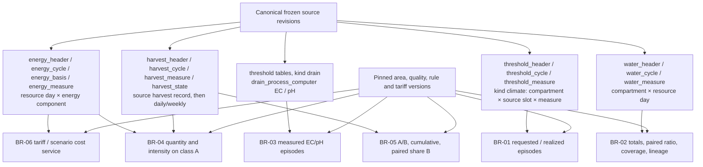

# 07 — Typed marts và sáu BR

Mọi mart có publication identity, scope, cycle và configuration reference. Fact
được tính từ canonical membership đã đóng băng, không cộng incremental aggregate
trực tiếp từ deliveries còn có thể duplicate/correction.

- BR-01/03: interval intersection, quality/applicability, requested/realized basis,
  boundary và episode clipping theo shared rule engine; không nối qua missing.
- BR-02: tỷ lệ dùng tổng Drain / tổng Irr trên các ngày paired hợp lệ; không lấy
  trung bình tỷ lệ ngày, không cộng L/m² giữa các compartment.
- BR-05: giữ grain record, NULL/zero và completeness; share B dùng A/B paired.
- BR-04: MJ→kWh, area basis và denominator A phải hợp lệ; A=0 cho intensity NULL.
- BR-06: rate có interval/currency/unit; thiếu quantity/rate không thành zero cost.
  Scenario derivation giữ nguyên năng lượng, thay giá theo command đã ghim.

Calendar window dùng half-open source time; UI hai ngày inclusive được chuyển
sang contract tương ứng. Closing rows được giữ/audit nhưng không cộng ra ngoài
cycle. Native thresholds đọc theo cycle sorting prefix để giữ memory bounded.

[Correctness](../evaluation/correctness.md) và [native parity](../evaluation/clickhouse-parity.md)
giữ dữ liệu fixture, full raw, scenario và engine tách biệt.
