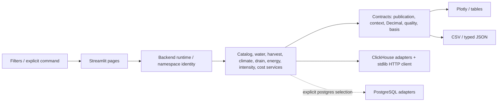
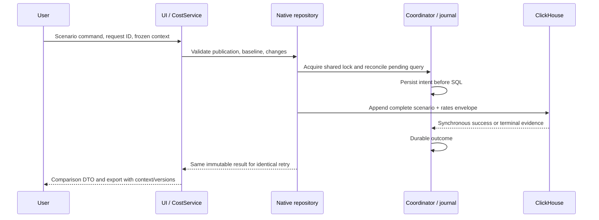

# 08 — Application và contracts

Streamlit là thin UI trên shared typed services. Mỗi action tạo một connection,
pin publication/context và dùng cùng DTO cho chart, table, drilldown và export.
Không có phép tính KPI riêng trong HTML/Plotly.

Default backend là ClickHouse; error không fallback PG. Namespace gồm backend,
host, port, database và user, không có password. Đổi namespace xóa widget,
historical context và write intent cũ. Old publication vẫn có semantic API pin;
catalog UI chọn complete generation hiện hành của scope.

Replay refresh ghim một publication cho toàn bộ render. Historical và replay
không chia sẻ scope; rule lịch sử chỉ map khi snapshot/compartment hợp lệ.
App không tự migrate/publish/seed fixture khi thiếu dữ liệu. Missing data,
connection error và unverified raw mount có trạng thái riêng.
