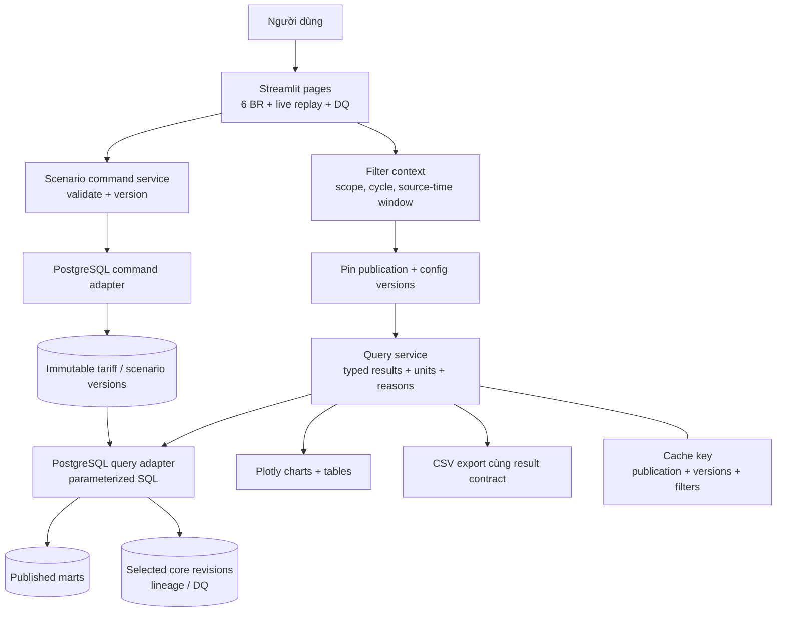
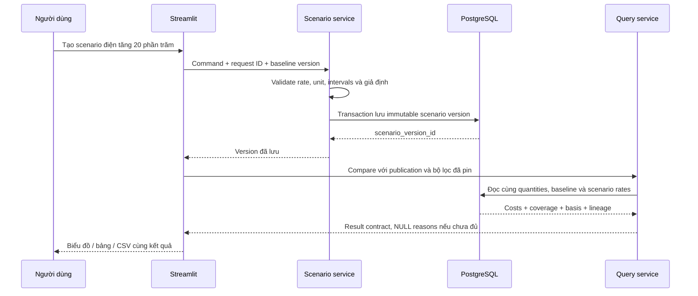

# 08 — Ứng dụng, query contracts và scenario

Streamlit là ứng dụng local, không cần thêm REST backend riêng cho phạm vi hiện tại. Lớp service là Python module dùng chung, không phải một microservice phải vận hành.

| Contract (đã triển khai / dự kiến) | Trách nhiệm |
|---|---|
| `get_climate_summary(context)` / `get_drain_summary(context)` | Duration, coverage, rule basis và trạng thái finality |
| `list_episodes(context, page)` | Episode gốc, phần giao cửa sổ, pagination |
| `pin_publication(scope)` / `get_irrigation_days(context)` / `get_irrigation_summary(context)` — đã triển khai | PublicationRef, sealed water mart day DTO và pure observed/paired summary |
| `get_harvest_summary(context)` | A/B observed/paired, lũy kế, completeness |
| `get_energy_intensity(context)` | Cycle KPI và gates; không coi một cửa sổ tùy ý là toàn vụ |
| `compare_energy_cost(context, scenario_version)` | Cùng quantities/publication, baseline/scenario/delta |
| `get_replay_status(scope)` | Cursor, last receive, backlog, lag, stale và finality |
| `get_lineage(publication, revision_id=... / record_key=...)` — đã triển khai cho batch | Kiểm membership đã pin → T08 raw hash verification; chưa có sensor lineage |
| `create_scenario(command)` | Version mới, baseline bất biến, chống double-submit |

Mỗi kết quả có publication/snapshot/scope, quality/metric/config versions liên quan, unit, time basis và reason codes. Raw values tính toán không bị làm tròn theo giao diện; CSV phải giữ NULL/0 và metadata. Khóa cache chứa cả scenario version; thay publication hoặc cấu hình không trả cache cũ.

Live view dùng dữ liệu đã công bố, không truy vấn trực tiếp MQTT hoặc staging. Màn hình hiển thị rõ simulated replay clock, source time và thời gian nhận cuối. Pause replay không biến dữ liệu đang có thành 0; stale transport và missing measurement là hai trạng thái khác nhau.

Để chuyển ClickHouse sau này, giữ service contracts nhưng thay SQL/sink/command adapters; contract tests so kết quả nghiệp vụ. Chưa cần xây framework đa database hoặc adapter giả khi chỉ có PostgreSQL.

## Contract thực thi và ranh giới

[Contracts thuần Python](../../src/greenhouse/contracts/README.md) dùng frozen dataclasses/enums/Decimal; [service và oracle BR-02](../../src/greenhouse/queries/README.md) nhận adapter bằng Protocol, không import psycopg/Spark/greenhouse.db. [PostgreSQL query adapter](../../src/greenhouse/db/query_adapter.py) mặc định đọc sealed water mart đã pin membership/quality/basis; core adapter riêng giữ oracle để đối soát. Không di chuyển SQL T07/T08 hoặc thêm framework/engine/dependency; migration 005 thêm mart/rule config. Core unit `L/m²/day` được validate rồi ánh xạ sang nhãn daily quantity `L/m²`, không đổi giá trị; source unit vẫn đi cùng DTO.

Các DTO đã có: QueryContext, PublicationRef/Versions, MeasureValue, IrrigationDay/Summary, LineageResult, ScenarioCommand và SinkBatch/source identity. JSON envelope version 2: Decimal exact strings, NULL khác 0, source timestamp naive ISO, operational timestamp có offset, enums string; scale nguồn giữ nguyên. Summary percentages dùng 50 significant digits, quantity sums exact. IDs do nguồn/caller sinh, không PostgreSQL sequence. Cache key chứa publication + versions/config + context/window + scenario version, không chỉ các bộ lọc UI.

Main chốt: mỗi cycle hiện thuộc một compartment; context chứa đúng một compartment ID trong tuple. Multi-compartment comparison dùng contexts riêng với cycle tương ứng và cùng PublicationRef; không pool per-m² quantities. Request whole-date half-open được cắt theo cycle, giữ effective window và expected-day denominator. Service tạo missing-day DTO với NULL, kiểm duplicate/mixed grain/unit, tính ratio of paired sums và coverage. Assumption `AGC_SHARED_BASIS_V1` có pin phù hợp cho phép ratio với status/ID/version và nhãn **“giả định chưa xác minh”**; thiếu/tắt basis ở publication mới → NULL path, observed totals riêng còn giữ. Toggle sau publish không thay kết quả publication cũ. Không có rule profile → `not_configured`, không mặc định threshold.

Water mart/default publish hook và query day/ISO week/cycle đã triển khai, khớp oracle/DTO; T10 nối UI/export không SQL, T11 mới nghiệm thu BR-02. ScenarioCommand chỉ validate request/baseline/component changes cho T21; SinkBatch chỉ validate source identity/values/clocks cho T33. Chưa có command persistence, sensor transport, harvest/climate summary contracts thực thi, adapter ClickHouse hoặc fake adapter.

Water queries hiện có `get_irrigation_weekly(context)` (ISO year/week cùng IrrigationSummary, expected days cắt theo cycle) và `get_irrigation_cycle(context)` (toàn vụ). `QueryContext.rule_version` chọn immutable `IrrigationRuleProfile` tường minh theo scope/compartment. Result/cache giữ rule version, bounds, evidence/demo label; daily rule status within_range/outside_range/unknown, summary status configured với outside/unknown day counts. Bằng biên là trong dải; thiếu usable pair hoặc Irr=0 là unknown. Không chọn profile vẫn not_configured và không có ngưỡng AGC mặc định. Shape này dùng JSON v2, source Decimal/NULL/clock conventions giữ nguyên; source publication ref và query-time rule metadata là hai phần riêng.
