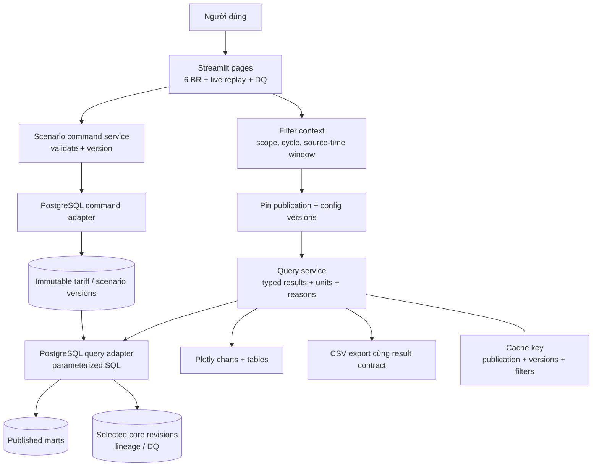
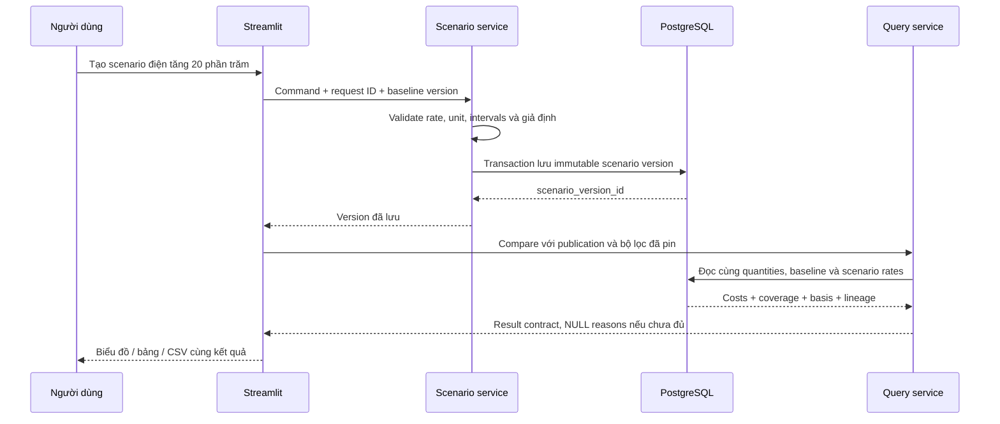

# 08 — Ứng dụng, query contracts và scenario

Streamlit là ứng dụng local, không cần thêm REST backend riêng cho phạm vi hiện tại. Lớp service là Python module dùng chung, không phải một microservice phải vận hành.

| Contract dự kiến | Trách nhiệm |
|---|---|
| `get_climate_summary(context)` / `get_drain_summary(context)` | Duration, coverage, rule basis và trạng thái finality |
| `list_episodes(context, page)` | Episode gốc, phần giao cửa sổ, pagination |
| `get_irrigation_summary(context)` | Observed/paired quantities và denominator |
| `get_harvest_summary(context)` | A/B observed/paired, lũy kế, completeness |
| `get_energy_intensity(context)` | Cycle KPI và gates; không coi một cửa sổ tùy ý là toàn vụ |
| `compare_energy_cost(context, scenario_version)` | Cùng quantities/publication, baseline/scenario/delta |
| `get_replay_status(scope)` | Cursor, last receive, backlog, lag, stale và finality |
| `get_lineage(publication, record_key)` | Core revision → source row/raw event + quality |
| `create_scenario(command)` | Version mới, baseline bất biến, chống double-submit |

Mỗi kết quả có publication/snapshot/scope, quality/metric/config versions liên quan, unit, time basis và reason codes. Raw values tính toán không bị làm tròn theo giao diện; CSV phải giữ NULL/0 và metadata. Khóa cache chứa cả scenario version; thay publication hoặc cấu hình không trả cache cũ.

Live view dùng dữ liệu đã công bố, không truy vấn trực tiếp MQTT hoặc staging. Màn hình hiển thị rõ simulated replay clock, source time và thời gian nhận cuối. Pause replay không biến dữ liệu đang có thành 0; stale transport và missing measurement là hai trạng thái khác nhau.

Để chuyển ClickHouse sau này, giữ service contracts nhưng thay SQL/sink/command adapters; contract tests so kết quả nghiệp vụ. Chưa cần xây framework đa database hoặc adapter giả khi chỉ có PostgreSQL.
