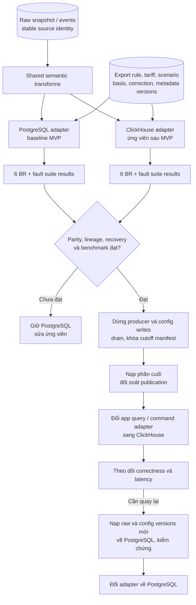

# 09 — Roadmap chuyển PostgreSQL sang ClickHouse

> T37–T39 tùy chọn sau MVP. Sơ đồ này không đưa ClickHouse vào deployment bắt buộc hiện tại.

Không đổi simulator, MQTT, raw format, source identity hoặc định nghĩa sáu BR chỉ để chuyển engine. Thiết kế vật lý, SQL marts, dedup, publication và cách lưu scenario cần adapter riêng; đây không phải thao tác thay connection string.

| Giữ nguyên | Thiết kế lại / kiểm chứng |
|---|---|
| Raw và event contracts | DDL/types, sorting key, partition và compression |
| PySpark transforms thuần nghiệp vụ | Sink batch, retry/dedup và query SQL theo engine |
| BR formulas, fixtures và expected outputs | Correction/version selection trước tổng hợp |
| UI và DTO contracts | Publication nhất quán khi không có cùng transaction model |
| Rule/tariff/scenario definitions | Command persistence, idempotency và khôi phục cấu hình |

Không dựa vào background merge để bảo đảm KPI hết duplicate ngay. Không cộng incremental aggregate từ một nguồn còn có thể phát duplicate/correction mà chưa có cơ chế sửa tổng. Bản đầu của adapter có thể tái tính marts từ tập revision canonical theo publication, sau đó tối ưu bằng bằng chứng benchmark.

Khi so PostgreSQL/ClickHouse, giữ Hybrid và workload giống nhau; khi so Hybrid/Kimball ở T24, giữ engine giống nhau. Công bố riêng hai thí nghiệm để không quy sai nguyên nhân cải thiện.

Chuyển đổi ban đầu dùng backfill từ raw và khoảng dừng có kiểm soát, không cần CDC/dual-write. Mọi lần quay lại sau cutover phải mang theo events và configuration versions mới; PostgreSQL snapshot cũ một mình không đủ. Không xóa nguồn hoặc DB đối chứng trước khi nghiệm thu.
