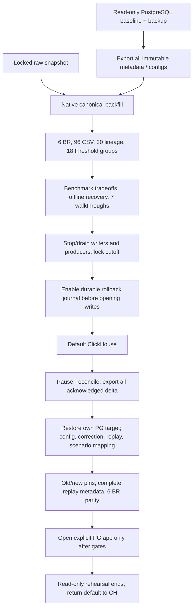

# 09 — Chuyển ClickHouse và rollback

ClickHouse là deployment mặc định sau các gate backfill, parity, benchmark,
offline restore, walkthrough và cutover. PostgreSQL tiếp tục là adapter đối
chứng/rollback. Shared semantic code và query contracts giữ nguyên; physical
publication/config references được map có kiểm chứng.

Không dual-write ở runtime. Raw sensor một mình không đủ rollback: cần cả
corrections, configuration/scenario versions, memberships, receipts và journal.
Scenario/request ID collision giữa các lineage được namespace có mapping, giữ
bản cũ và original IDs. Không dùng snapshot cũ như thể đã chứa mọi thao tác mới.

Đối chiếu engine ở [benchmark](../evaluation/clickhouse-performance.md) giữ
workload/caps và engine label. PostgreSQL nhanh hơn các workload đã đo; CH có
active footprint thấp hơn. Cold verification và scenario writes có chi phí lớn.
Hybrid/Kimball là thí nghiệm riêng trên PG, không phải bằng chứng CH nhanh hơn.

[Runbook cutover/rollback](../implementation/clickhouse-cutover-rollback.md) ghi
stop/drain, cursor/checksum, journal fence, restore và điều kiện mở app.
[Local recovery](../evaluation/clickhouse-local-repro.md) và
[acceptance](../evaluation/clickhouse-acceptance.md) dẫn evidence version cụ thể.
