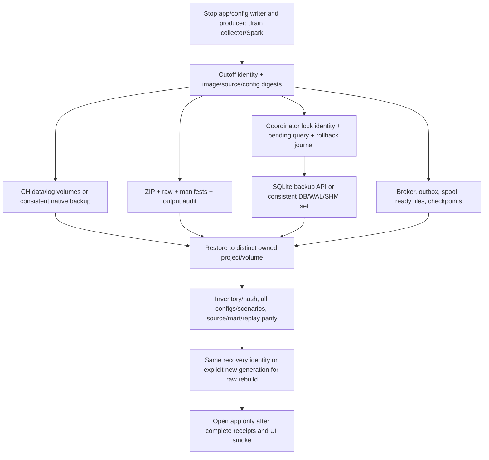

# 10 — Backup, recovery và storage

Recovery cần một mốc quiescent chung, không chỉ database dump hoặc một file raw.
Raw, accepted publications và replay scopes có identity/checksum để đối chiếu.

Physical restore và raw rebuild là hai trường hợp khác nhau. Rebuild DB mới cần
checkpoint generation mới và explicit publication/context mapping; không bỏ qua
ready records bằng checkpoint của warehouse khác. Old pins và original envelopes
phải giữ được hoặc được archive/map minh bạch; unknown state phải fail closed.

Verified-row caches là temporary/process-local, có thể tốn nhiều disk khi cold
proof. Chúng không phải backup. Dừng đúng app/tool process giải phóng spool;
Docker build cache có thể dọn khi thiếu storage. Không prune volume người dùng,
raw, backup hoặc coordinator để lấy chỗ cho một phép đo.

Local `metric_log` periodic writer đã tắt sau memory diagnosis; query_log vẫn
bật để reconcile pending SQL. Không đánh đổi terminal evidence lấy memory.
Xem [recovery evidence](../evaluation/clickhouse-local-repro.md) và
[cutover runbook](../implementation/clickhouse-cutover-rollback.md).
