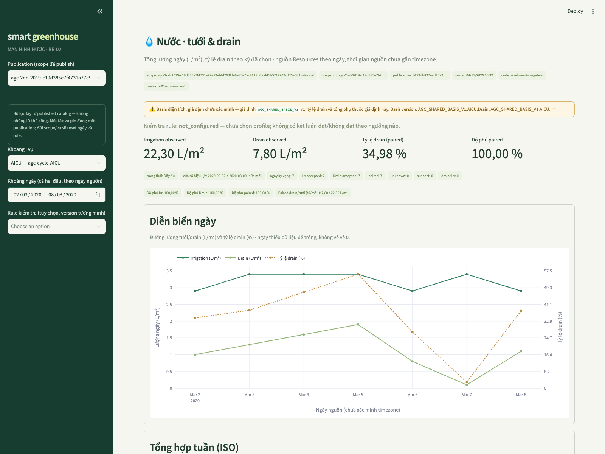
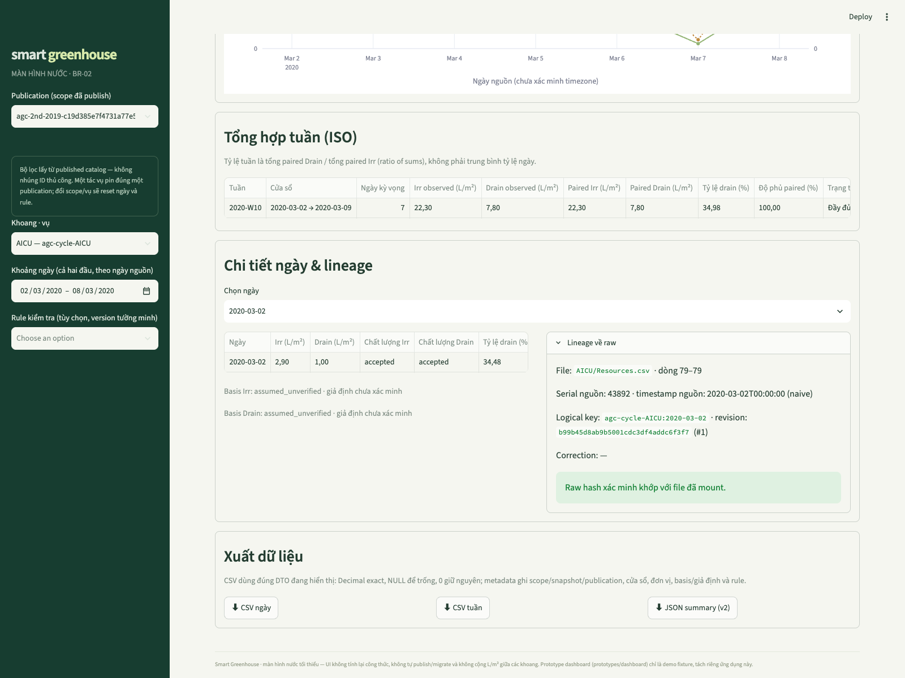
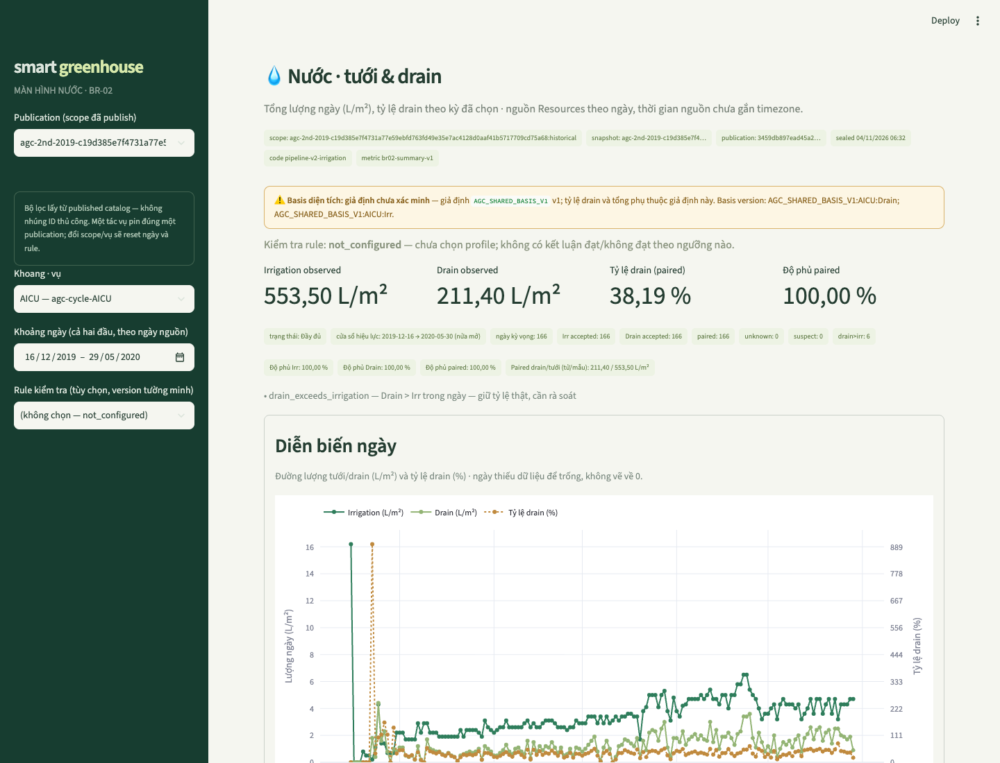

# BR-02 — Bằng chứng nghiệm thu chức năng (tưới, drain, tỷ lệ drain)

Cập nhật: 2026-11-04. Phạm vi: **chức năng BR-02** trên fixture và dữ liệu AGC thật đã publish.
Kết luận: 10/10 AC đạt bằng kiểm tra chạy được; đối soát raw → published mart/service khớp **exact Decimal**
trên cả sáu khoang; p95 truy vấn ≪ mục tiêu 2 giây. **Basis diện tích nước vẫn `assumed_unverified`** —
đây không phải nghiệm thu các BR khác hay toàn bộ project, không phải bằng chứng nông học, và không có
tuyên bố tiết kiệm nước hay lượng cây hấp thu.

## 1. Bằng chứng là gì và được nối như thế nào

Mỗi mắt xích có bằng chứng riêng, không phải danh sách unit test rời rạc:

| Mắt xích | Bằng chứng |
|---|---|
| Raw (CSV khóa checksum) | Đối soát độc lập: đọc lại `*/Resources.csv` bằng csv+Decimal (mục 3) so với tổng published — khớp exact cả 6 khoang. |
| Parser/staging/loader | Contract test T06 (fixture lỗi, hash dòng gốc); [ingestion README](../../src/greenhouse/ingestion/README.md). |
| Core/publication | [test_pipeline.py](../../tests/unit/test_pipeline.py): rerun/recovery/fault, correction append; publication chỉ đọc pointer một lần (pin by ID). |
| Water mart | [test_irrigation_mart.py](../../tests/unit/test_irrigation_mart.py): fact trong mart khớp oracle core độc lập; Decimal SQL khớp 50 chữ số half-even. |
| Query service | [test_query_adapter.py](../../tests/unit/test_query_adapter.py): AC trên service/adapter PostgreSQL thật. |
| UI | AppTest [tests/ui](../../tests/ui/test_app_ui.py) chạy `home.py` thật với DB fixture: 35% ≠ trung bình ngày, partial, NULL, >100%, gap chart, rule, basis label. |
| Export | [test_action_exports.py](../../tests/ui/test_action_exports.py): CSV/JSON tái sử dụng đúng DTO, decimal exact, metadata; tải xuống thật từ trình duyệt (mục 4). |

Máy chạy bằng chứng: `src/greenhouse/evaluation/br02.py` (committed, chạy trong container job).

## 2. Môi trường và phiên bản

| Hạng mục | Giá trị |
|---|---|
| Database / publication kiểm tra | `greenhouse_t07_195889f1a3b1` (đọc, không đổi) · publication `3459db897ead45a28177c60000bd0561` · committed `2026-11-04T06:32:36.212267+00:00` · `provisional` |
| Scope / snapshot | `agc-2nd-2019-c19d385e…:historical` · archive SHA-256 `c19d385e7f4731a77e59ebfd763fd49e35e7ac4128d0aaf41b5717709cd75a68` |
| Phiên bản pipeline | run `2cd94424d938493086bc76bd9a6f9a37` · parser `agc-parser-v1` · quality `AGC_QUALITY_V1` · code `pipeline-v2-irrigation` · mart `irrigation-mart-v1` · metric `br02-summary-v1` |
| Thời gian pipeline thật | workflow ingest→publish 240.96 s (hook mart 1.37 s) — đọc từ `meta.workflow_run`/`mart.irrigation_publication` của publication này, không chạy lại |
| Stack chạy kiểm tra | Docker Compose; Python 3.12.12; PostgreSQL 17.10; Streamlit 1.66.1; Plotly 7.1.0; psycopg 3.3.7; pytest 8.4.2 |

Máy móc/khung: kiểm tra chạy qua lệnh Docker trong [mục 7](#7-tái-tạo); chi tiết JSON:
[fixture](assets/br02-fixture-acceptance.json) · [agc](assets/br02-agc-reconciliation.json) ·
[performance](assets/br02-performance.json).

## 3. AC-01…AC-10 — kỳ vọng độc lập, quan sát, kết quả

Kỳ vọng là hằng số tính tay độc lập với code (không do service tự tính lại); quan sát lấy từ
service/adapter/mart thật trên database fixture [`test_br02_*`](../../src/greenhouse/evaluation/br02.py)
(tự tạo, tự xóa). **Chỉ Spark stage được thay bằng artifact nhỏ**; parser, staging, loader,
publication, mart, adapter, service, export là code thật — báo cáo ghi rõ điều này, không gọi là
"full end-to-end từ raw".

| AC | Kỳ vọng độc lập | Quan sát | Kết quả | Kiểm tra |
|---|---|---|---|---|
| AC-01 | 10/2 + 30/12 → tổng 40/14; tỷ lệ kỳ 35% (không phải trung bình ngày 30%) | 40/14, ratio `35`, coverage 100/100/100, `complete` | **Đạt** | runner `AC-01`; [unit AC-01](../../tests/unit/test_query_adapter.py) |
| AC-02 | Irr=Drain=0 → tổng 0, coverage 100%, ratio NULL (mẫu số 0) | 0/0, ratio NULL, coverage 100, `no_irrigation_quantity` | **Đạt** | runner `AC-02`; unit AC-02 |
| AC-03 | Ngày 2 thiếu Drain → Irr 40/Drain 2, paired 10/2, ratio 20%, paired coverage 50%, partial | đúng từng giá trị | **Đạt** | runner `AC-03`; unit AC-03; [UI partial 50%](../../tests/ui/test_app_ui.py) |
| AC-04 | Drain>Irr (5/6) → 120% giữ nguyên + cờ rà soát | ratio `120`, `drain_exceeds_irrigation_days=2` | **Đạt** | runner `AC-04`; unit AC-04; UI >100% |
| AC-05 | Không có số dùng được → tổng NULL, coverage 0% | totals NULL, coverage `0`, `unknown` | **Đạt** | runner `AC-05`; unit AC-05 |
| AC-06 | Rule demo [20,40]%: biên 20% = trong dải; 50% ngoài; giữ rule version | day ratios [20,50], [within_range, outside_range], configured, outside 1 | **Đạt** | runner `AC-06`; [rule test](../../tests/unit/test_irrigation_mart.py) |
| AC-07 | Không chọn rule → `not_configured`, không kết luận đạt/không đạt | rule_status `not_configured`, version NULL, outside NULL | **Đạt** | runner `AC-07`; unit + [UI](../../tests/ui/test_app_ui.py) |
| AC-08 | Rerun cùng snapshot → cùng publication, không nhân dữ liệu | publication_id giữ nguyên, 1 publication/scope, day_count 2; duplicate/conflict chi tiết ở [test_pipeline](../../tests/unit/test_pipeline.py) + [test_ingestion](../../tests/unit/test_ingestion.py) | **Đạt** | runner `AC-08` |
| AC-09 | Basis chưa xác minh → giữ tổng 40/14, ratio NULL, reason basis | totals giữ, ratio NULL, reasons `incompatible_or_unknown_basis` + `no_paired_days` + `partial_coverage` | **Đạt** | runner `AC-09`; [unit basis toggle](../../tests/unit/test_query_adapter.py) |
| AC-10 | CSV đúng bộ lọc/DTO/metadata: chỉ ngày 02–03/01, giá trị exact, scope/window đầy đủ | dates `[01-02, 01-04)`, giá trị khớp DTO, metadata đầy đủ | **Đạt** | runner `AC-10`; [export tests](../../tests/ui/test_action_exports.py) |

Bổ trợ: parity mart↔oracle và parity Decimal 50 chữ số có sẵn trong [test_irrigation_mart.py](../../tests/unit/test_irrigation_mart.py)
(`test_stored_fact_and_summary_match_independent_core_oracle`, `test_database_decimal_percent_matches_fifty_digit_half_even_oracle`).

## 4. Đối soát dữ liệu thật AGC (đọc, không đổi DB)

Phương pháp độc lập: đọc trực tiếp `*/Resources.csv` từ raw đã khóa bằng `csv` + `Decimal`
(không qua parser/service), ngày = Excel serial + `1899-12-30` (quy ước có version, timezone nguồn
chưa xác minh), cộng trên cửa sổ vụ `[2019-12-16, 2020-05-30)`; so với tổng published qua
service/adapter mart. Kỳ vọng tỷ lệ cũng tính riêng trong script (50 chữ số).

| Khoang | Raw Irr | Raw Drain | Ratio (50 chữ số, khớp exact) | Totals/Ratio |
|---|---:|---:|---|---|
| AICU | 553.5 | 211.4 | 38.19331526648599819331…% | khớp/khớp |
| Automatoes | 788.851818181 | 324.08 | 41.08249388932012147056…% | khớp/khớp |
| Digilog | 741.05642727 | 182.902727272 | 24.68134956278577099237…% | khớp/khớp |
| IUACAAS | 866.5800 | 296.206363636 | 34.18107545016040065545…% | khớp/khớp |
| Reference | 788.6 | 350.3 | 44.42049201115901597768…% | khớp/khớp |
| TheAutomators | 723.24 | 267.70 | 37.01399258890548089154…% | khớp/khớp |

Mỗi khoang 166 ngày raw (2019-12-16 → 2020-05-29), coverage paired 100%, status `complete`.
Tuần kiểm tra AICU `[2020-03-02, 2020-03-09)`: raw = service = **22.3 Irr / 7.8 Drain**,
ratio **34.97757847533632286995…%**, 7/7 ngày, `complete`. Chi tiết:
[br02-agc-reconciliation.json](assets/br02-agc-reconciliation.json).

Lineage ngày đầu tuần 2020-03-02 (AICU) — hai đường độc lập cùng kết quả: runner gọi
`get_lineage` qua revision đã pin → `AICU/Resources.csv` dòng 79, serial nguồn `43892`,
revision `b99b45d8ab9b5001cdc3df4addc6f3f7` (#1), **raw hash xác minh khớp file đã mount**;
browser drill-down (mục Luồng người dùng) hiển thị cùng revision/dòng/serial và badge xác minh.

### Luồng người dùng đã ghi (đáp án đã biết trước)

Bước thao tác trên app thật (browser, màn hình nước T10): chọn publication → khoang **AICU** →
khoảng ngày **02–08/03/2020** bằng calendar → đọc KPI **22,30 L/m² Irr · 7,80 L/m² Drain ·
34,98 % · 100 % paired** → mở **Lineage** của ngày 2020-03-02 (file/dòng/serial/revision, raw hash
xác minh) → xuất CSV ngày/tuần + JSON summary. Giá trị tải về khớp UI và khớp kỳ vọng độc lập ở trên.



*Chụp thật trình duyệt trên publication `3459db89…` (ngày bao cả hai đầu 02–08/03/2020): banner
basis “giả định chưa xác minh” hiển thị; KPI 22,30 / 7,80 / 34,98 % / 100 %; rule not_configured
(không có kết luận đạt/không đạt). Phiên tải xuống trong cùng thao tác:*
[CSV ngày](assets/br02-week-days-download.csv) · [CSV tuần](assets/br02-week-weekly-download.csv) ·
[JSON summary v2](assets/br02-week-summary-download.json) · [ghi chú phiên browser](assets/br02-week-browser-session.json)
(7 ngày đúng cửa sổ, `coverage_pct: irrigation=100,drain=100,paired=100`, publication ID trong metadata).



*Drill-down lineage thật trong expander: `AICU/Resources.csv` dòng 79, serial nguồn `43892`
(naive, chưa gắn timezone), revision `b99b45d8ab9b5001cdc3df4addc6f3f7` (#1), raw hash xác minh
khớp file đã mount — khớp từng trường với kết quả runner ở bảng đối soát.*



*Cùng app, cửa sổ toàn vụ: tổng 553,50 / 211,40 L/m², tỷ lệ 38,19 % — khớp đối soát raw ở bảng trên;
banner `assumed_unverified` và lý do/status hiển thị cạnh KPI. Giải thích trạng thái cho người dùng:
giá trị `—`/NULL là "không có dữ liệu dùng được" (không phải 0); basis nước là giả định user cho phép
có nhãn, chưa được xác minh từ nguồn; timezone nguồn chưa xác minh nên nhãn ngày giữ nguyên nguồn.*

## 5. Hiệu năng truy vấn (quy ước chung BR: p95 ≤ 2 giây)

Phương pháp: **lưu ý đây là mục tiêu đề xuất, chưa là cam kết**. Mỗi workload ghi riêng **lần gọi đầu tiên
của chính workload đó trên connection dùng chung** (catalog/publication và workload trước đã dùng
connection, nên đây không phải roundtrip DB đầu tiên tuyệt đối; không gọi là cold vì không xác minh được
trạng thái cache OS/DB), rồi **5 warm-up + 30 lần đo**, thống kê trên 30 giá trị. Mỗi lần gọi service
tự kiểm tra publication by-ID (đúng đường đi của app, không đọc pointer). Workload trên publication
thật, khoang AICU.

Bảng dưới lấy **trừ receipt đã commit** ([br02-performance.json](assets/br02-performance.json),
`generated_at 2026-11-04T08:31:15Z`); chạy lại cho giá trị khác nhẹ giữa các lần (môi trường chia sẻ),
p95 vẫn ≪ 2 giây ở mọi lần chạy đã quan sát.

| Workload | Lần gọi đầu | p50 | p95 | min | max | Đạt ≤2 s |
|---|---:|---:|---:|---:|---:|---|
| summary tuần 7 ngày | 1.49 ms | 0.67 ms | **0.76 ms** | 0.61 ms | 0.78 ms | ✅ |
| days tuần 7 ngày | 0.58 ms | 0.59 ms | **0.64 ms** | 0.54 ms | 0.64 ms | ✅ |
| weekly toàn vụ 166 ngày | 6.09 ms | 6.13 ms | **6.38 ms** | 5.96 ms | 6.66 ms | ✅ |

Môi trường (cùng receipt): container job `cpu_max=150000/100000` (1.5 CPU), `memory_max=2GiB`;
container DB giới hạn 0.5 CPU/512 MiB theo Compose; PostgreSQL 17.10; máy Apple Silicon arm64.
Kết quả máy có thể khác; lệnh tái tạo ở mục 7.

## 6. Phạm vi nghiệm thu và giới hạn basis

- **Đã chứng minh:** chức năng BR-02 (tổng ngày observed/paired, tỷ lệ ratio-of-sums, coverage,
  missing/unknown, rule tùy chọn, lineage, export) trên fixture có kỳ vọng độc lập và trên cửa sổ
  AGC thật đã publish; p95 truy vấn ≪ mục tiêu đề xuất.
- **Chưa chứng minh:** basis diện tích nước. `AGC_SHARED_BASIS_V1` (62.5 m²) là giả định user cho phép
  dùng có nhãn, status `assumed_unverified` — mọi output/UI/export phụ thuộc mang nhãn và ID/version.
  Ratio nước không đổi khi cả Irr và Drain dùng cùng basis; nếu dùng 96 m² thay 62.5 m², **tổng tuyệt
  đối L đổi ×1.536** (độ nhạy theo [quyết định basis](../implementation/data-decisions.md#7-br-04--quyết-định-basis-của-user)).
  Khi thiếu/tắt giả định mà chưa có basis khác: tổng observed giữ, tỷ lệ NULL (AC-09) — đường NULL
  này vẫn được kiểm giữ nguyên.
- Không có ngưỡng nông học mặc định cho AGC (rule phải chọn version tường minh; demo rule chỉ ở fixture).
- Không tuyên bố: tiết kiệm nước, lượng cây hấp thu (`Irr − Drain` không được đặt tên vậy), các BR khác
  (harvest/climate/energy/cost), hoặc project hoàn tất.
- Giới hạn đo: p95 đo sau warm-up trên cùng connection; lần đầu ghi riêng nhưng không xác minh cold
  cache; timing gồm cả bước kiểm tra publication by-ID (đường đi app thật).

## 7. Tái tạo

Yêu cầu trước (mới clone = đủ): host chỉ cần Docker/Compose — [môi trường local](../implementation/local-environment.md)
và [chuẩn bị snapshot + chạy pipeline](../implementation/dataset-snapshot.md) ghi lệnh
`snapshot` / `migrate` / `run-pipeline` đầy đủ để tạo publication có water mart (một lần cho clean flow).
Module evaluation đóng gói trong image **job** — build lại image trước khi chạy nếu vừa cập nhật code
từ commit trước:

```bash
docker compose -p smart-greenhouse build job

# 1) Fixture: đủ 10 AC trên database test_br02_* tự tạo/tự xóa (chỉ Spark stage được thay artifact)
docker compose -p smart-greenhouse run --rm job python -m greenhouse.evaluation.br02 --mode fixture

# 2) Đối soát AGC thật (chỉ đọc; DB truyền qua env, không hardcode)
docker compose -p smart-greenhouse run --rm -e PGDATABASE=greenhouse_t07_195889f1a3b1 job \
  python -m greenhouse.evaluation.br02 --mode agc --raw-root /data/raw

# 3) Hiệu năng: 5 warm-up + 30 lần đo, p95 so với mục tiêu 2 s
docker compose -p smart-greenhouse run --rm -e PGDATABASE=greenhouse_t07_195889f1a3b1 job \
  python -m greenhouse.evaluation.br02 --mode performance --runs 30

# 4) Suite UI (AppTest) và backend hiện có — cần image tương ứng
docker compose -p smart-greenhouse --profile test build test-runner ui-test
docker compose -p smart-greenhouse --profile test run --rm ui-test python -m pytest tests/ui -q
docker compose -p smart-greenhouse --profile test run --rm test-runner
```

Màn hình tương tác phục vụ luồng người dùng: `docker compose -p smart-greenhouse up -d --wait db app`
(đổi DB app bằng override env `PGDATABASE` cho riêng service app — không đổi `POSTGRES_DB` của db).
Ảnh bằng chứng được chụp từ phiên browser thật; script browser hỗ trợ không nằm trong repo —
phương pháp tái tạo chính thức là các lệnh trên và AppTest. Mọi pointer trong
[ghi chú phiên browser](assets/br02-week-browser-session.json) đã là đường dẫn tương đối tới
assets của report này và trỏ tới file tồn tại trong repo.
