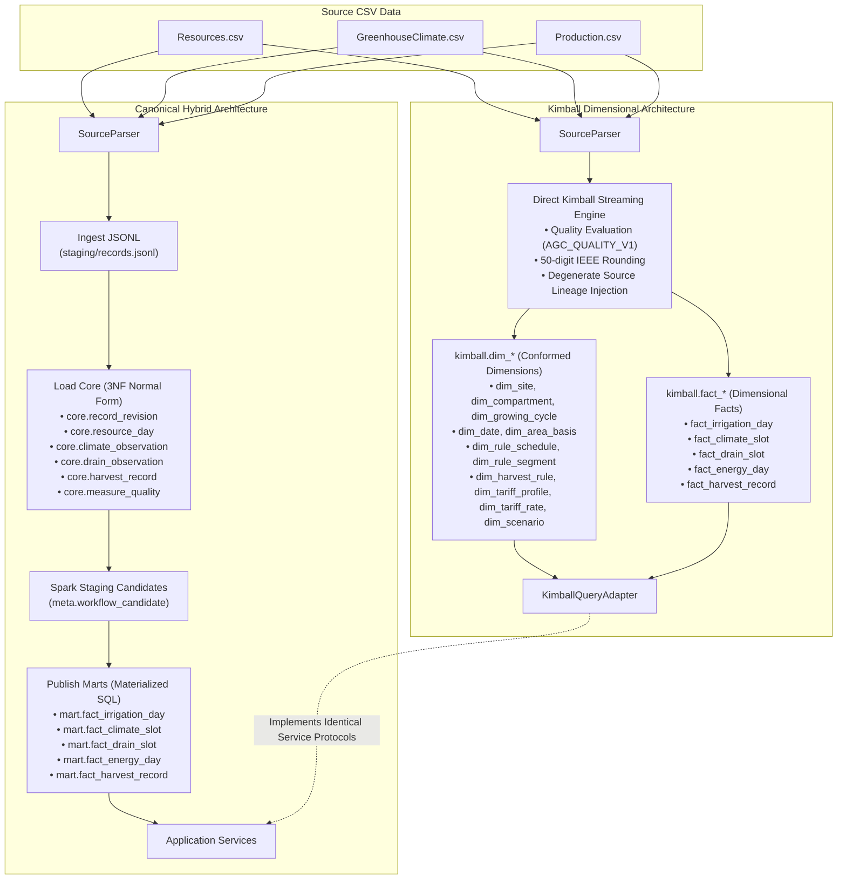
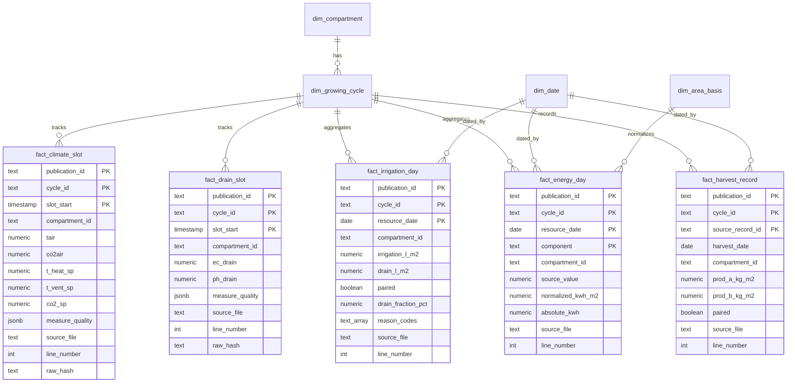

# Kimball Dimensional Alternative Architecture Evaluation

## Executive Summary

The **Kimball Dimensional Architecture** (`kimball.*`) provides a direct alternative to the canonical Hybrid Architecture. In the canonical implementation, raw source data traverses staging, batch normalization into 3NF intermediate core tables (`core.record_revision`, `core.resource_day`, `core.climate_observation`, `core.drain_observation`, `core.harvest_record`, `core.measure_quality`), and subsequent mart materialization into `mart.*`.

By contrast, the Kimball architecture populates conformed dimensions and granular fact tables directly from source files using two-pass conflict indexing and batch in-memory transformation (Python list accumulation per compartment stream prior to PostgreSQL `COPY`) without physical intermediate 3NF core tables. Degenerate provenance attributes (`source_file`, `line_number`, `line_end`, `raw_reference`, `raw_hash`, `source_time_serial`, `source_timestamp`, `revision_id`, `logical_record_key`) are embedded directly into each fact table. Note that while this eliminates intermediate database storage tables, it accumulates row tuples in memory per batch before invoking `COPY`, rather than operating as constant-memory bounded streaming.

### Key Architectural Tenets
1. **Zero Core Dependencies**: Zero physical tables in schema `core`, zero foreign keys referencing `core`, and zero remote federation extensions (`postgres_fdw`, `dblink`).
2. **Conformed Dimensions**: Shared enterprise dimensions (`dim_site`, `dim_compartment`, `dim_growing_cycle`, `dim_date`, `dim_area_basis`, `dim_measure_definition`, `dim_rule_schedule`, `dim_rule_segment`, `dim_harvest_rule`, `dim_tariff_profile`, `dim_tariff_rate`, `dim_scenario`).
3. **Exact Numeric Parity**: 100% numerical parity with canonical Hybrid marts across the evaluated historical growing window (`2019-12-16` to `2020-05-30`) for all 6 business workloads (BR-01 through BR-06) covering the asserted metric sets and area normalization bases, enforcing identical 50-significant IEEE round-half-even arithmetic for unit conversions.
4. **Truthful Provenance & Isolation**: Distinct publication and pipeline run identities (`kimball-pub-f2b6-t24-historical`, `kimball-run-f2b6-t24`), avoiding forged publication hashes while normalizing only declared runtime identity fields during parity verification.

---

## Architectural Comparison



---

## Dimensional Schema Specification

### Conformed Dimensions

| Dimension Table | Primary Key | Description |
|---|---|---|
| `kimball.dim_site` | `site_id` | Physical greenhouse location and source time basis conventions. |
| `kimball.dim_compartment` | `compartment_id` | Six experimental compartments (`AICU`, `Automatoes`, `Digilog`, `IUACAAS`, `Reference`, `TheAutomators`). |
| `kimball.dim_growing_cycle` | `cycle_id` | Analytical growing season window (`2019-12-16` to `2020-05-30`). |
| `kimball.dim_date` | `resource_date` | Calendar dimension with ISO week, day of week, day of year, month, and year. |
| `kimball.dim_measure_definition` | `measure_code` | Conformed source measure vocabulary and units across climate, drain, resource, and harvest. |
| `kimball.dim_area_basis` | `basis_version_id` | Area normalization basis metadata (`AGC_SHARED_BASIS_V1`, `62.5 m²`, `assumed_unverified`). |
| `kimball.dim_rule_schedule` | `rule_version` | Immutable rule schedule header for Climate (BR-01) and Drain (BR-03). |
| `kimball.dim_rule_segment` | Composite | Segment intervals carrying delta bounds (temperature/CO2) or target bands (EC/pH). |
| `kimball.dim_harvest_rule` | `rule_version` | Immutable harvest class-B threshold profiles (`harvest-demo-b10:<comp>:v2`). |
| `kimball.dim_tariff_profile` | `tariff_version` | Historical baseline tariff and custom scenario tariff profiles. |
| `kimball.dim_tariff_rate` | `rate_id` | Component rates (Heat, ElecHigh, ElecLow) with validity intervals. |
| `kimball.dim_scenario` | `scenario_version` | Append-only scenario definitions with idempotency request IDs. |
| `kimball.dim_scenario_rate` | `scenario_rate_id` | Rates associated with custom cost scenarios. |

### Granular Fact Tables



---

## Absence of Core Proof (`pg_catalog` Audit)

A core requirement of the Kimball architecture is total decoupling from the intermediate 3NF `core` schema. Decoupling is verified through a formal PostgreSQL catalog audit script (`greenhouse.kimball.audit`):

```sql
-- 1. Assert zero physical tables exist in schema 'core'
SELECT count(*) FROM pg_class c
JOIN pg_namespace n ON n.oid = c.relnamespace
WHERE n.nspname = 'core' AND c.relkind IN ('r', 'p');
-- Expected: 0

-- 2. Assert zero foreign keys point to schema 'core'
SELECT count(*) FROM pg_constraint con
JOIN pg_class conf ON conf.oid = con.confrelid
JOIN pg_namespace confn ON confn.oid = conf.relnamespace
WHERE con.contype = 'f' AND confn.nspname = 'core';
-- Expected: 0

-- 3. Assert zero Foreign Data Wrapper (FDW) tables exist
SELECT count(*) FROM information_schema.foreign_tables;
-- Expected: 0

-- 4. Assert zero dblink or postgres_fdw extensions exist
SELECT count(*) FROM pg_extension WHERE extname IN ('dblink', 'postgres_fdw');
-- Expected: 0
```

---

## 6-Workload Parity Verification

Parity is evaluated against the pinned canonical Hybrid publication (`892b4cd58cdf4d099510974d91fa64ab` on database `greenhouse_t07_195889f1a3b1`) across all six business requirements and all six experimental compartments:

### 1. BR-01 Climate Condition Monitoring
- **Grain**: 5-minute time slots (`[slot_start, slot_start + 5m)`).
- **Measures**: `Tair`, `CO2air`, requested setpoints (`t_heat_sp`, `t_vent_sp`, `co2_sp`), realized setpoints (`t_heat_vip`, `t_ventlee_vip`, `co2_vip`).
- **Quality**: Exact preservation of `AGC_QUALITY_V1` triplets per measure, including off-mode zero handling (`off_mode_unverified`) for CO2 setpoints.
- **Rules**: Exact schedule review matching demo temperature delta (0.5 °C) and CO2 delta (50 ppm) on both `requested` and `realized` bases.

### 2. BR-02 Irrigation & Water Management
- **Grain**: Daily aggregate per compartment (`resource_date`).
- **Measures**: Daily irrigation quantity (`L/m²`), drain quantity (`L/m²`), paired status, drain fraction percentage (`%`).
- **Precision**: Exact 50-significant round-half-even calculation via `kimball.water_percent(drain, irrigation)` matching `mart.water_percent`.
- **Reason Codes**: Exact array matching of diagnostic reason codes (`incompatible_or_unknown_basis`, `no_irrigation_quantity`, `drain_exceeds_irrigation`).

### 3. BR-03 Drain Nutrition Monitoring
- **Grain**: 5-minute time slots (`[slot_start, slot_start + 5m)`).
- **Measures**: `EC_drain_PC`, `pH_drain_PC`.
- **Quality**: Suspect zero detection on pH (`demo_zero_ph_suspect`) and nonnegative validation on EC.
- **Rules**: Target bands EC [2, 5] dS/m and pH [5.5, 6.5] evaluated on the measured basis.

### 4. BR-04 Energy Management
- **Grain**: Daily quantity per component (`heat`, `elec_high`, `elec_low`).
- **Unit Conversion**: Heat conversion from `MJ/m²/day` to `kWh/m²/day` via `ratio_sig(source_value, 3.6, 50)` maintaining exact 50-digit IEEE precision.
- **Area Normalization**: Absolute energy calculation using the uniform assumed growing area of `62.5 m²` (`assumed_unverified`).

### 5. BR-05 Harvest Quality Tracking
- **Grain**: Harvest events (`Production.csv`).
- **Measures**: `ProdA`, `ProdB` (`kg/m²`), paired status, cumulative yield summaries.
- **Completeness State**: `HarvestCompleteness` with exact file counts (`expected_files=1`, `files_present=1`, `files_loaded=1`, `files_failed=0`), accepted record counts, and truthful quarantine accounting. The `Reference` compartment contains 1 historical out-of-cycle quarantined harvest item with `out_of_cycle_unresolved` reason code matching canonical normalization disposition.

### 6. BR-06 Energy Cost & Tariffs
- **Tariff Rates**: Reference baseline rates extracted from `Economics.pdf` (Heat: 0.0083 EUR/MJ, ElecHigh: 0.08 EUR/kWh, ElecLow: 0.04 EUR/kWh).
- **Daily Cost**: Daily cost evaluation (`EUR` and `EUR/m²`) matching Hybrid output to the cent.
- **Scenarios**: Dynamic scenario creation via `execute_scenario_transaction` using transaction-scoped advisory locks on `request_id` and `scenario_id`, enforcing idempotent replay on exact retry and explicit `ValueError` rejection on conflicting payloads.

---

## Storage & Structural Characteristics

| Metric | Canonical Hybrid Architecture | Kimball Dimensional Architecture | Structural Difference |
|---|---|---|---|
| **Database Schemas** | `staging`, `core`, `config`, `meta`, `mart` | `kimball` (isolated) | Single dimensional namespace |
| **Pipeline Architecture** | Ingest JSONL -> Load Core -> Spark Staging -> Publish Marts | Direct Streaming Ingestion -> Kimball Facts & Dims | Direct ELT stream without intermediate 3NF core tables |
| **Intermediate Storage** | 3NF core tables (`core.record_revision`, `core.resource_day`, etc.) | None (0 core tables, 0 core FKs) | Total decoupling from core schema |
| **Query Path** | Application Service -> Mart Materialization | Application Service -> Kimball Fact | Equivalent direct-to-fact access |
| **Source Traceability** | Foreign keys to `core.record_revision` | Degenerate columns stored directly on fact rows + `kimball.source_file` | Self-contained line-level provenance |

> [!NOTE]
> Performance characteristics and resource comparison boundaries: This evaluation establishes architectural correctness, catalog decoupling, and numerical parity. Formal performance benchmarking is explicitly excluded from this task and handled in downstream evaluation (T25).

### Readiness Gating & Query Cost Tradeoff

The Kimball dimensional query adapter enforces full cryptographic readiness gating before exposing any publication via `publication()`, `pin_publication()`, `catalog_publications()`, or `catalog_cycles()`:
1. **Receipt Verification**: Verifies presence of all 5 required bundles (`climate`, `drain`, `irrigation`, `energy`, `harvest`) and matching bundle versions.
2. **Fact Row Count Alignment**: Cross-checks each receipt's recorded `item_count` against direct `SELECT count(*)` queries on each dimensional fact table.
3. **Cryptographic Membership Checksum**: Queries all distinct `revision_id` keys across the 5 fact tables, verifies the count against `member_count`, and computes the SHA-256 digest to compare with `membership_checksum`.

**Query Cost Tradeoff Analysis**:
- **Verification Cost**: The distinct union and SHA-256 digest calculation executes a complete scan over all distinct revision identifiers in the dimensional fact tables to verify membership integrity against tampering. Formal benchmarking of this query execution cost is reserved for downstream evaluation (T25).
- **Instance Caching Strategy**: To eliminate redundant scan overhead across repeated queries within an application session, `KimballQueryAdapter` executes this full validation on the first read and caches the validated publication reference in `self._readiness_cache` for the lifetime of that adapter instance.
- **Tamper Protection & Scope**: Any newly created adapter instance or fresh connection re-executes the complete cryptographic validation. If any fact row is added, deleted, or missing, or if publication metadata is modified, the check fails with a `ValueError` immediately. Note that because the membership checksum hashes the set of member revision identifiers, it detects any addition, deletion, or omission of member records; in-place fact value modifications sharing an identical revision ID are governed by fact table immutability and publication sealing constraints.

---

## Reproduction Instructions

These instructions are portable and runnable directly from the repository root:

### 0. Image Build & Preparation
Ensure the processing and test container images are built and up to date:

```bash
docker compose build job test-runner
```

### 1. Fresh End-to-End Pipeline Execution with Collision Guard
Run the complete Kimball pipeline directly from the verified raw snapshot into a newly created isolated database with collision protection (`greenhouse_kimball_f2b6_t24_c2_docs`), mounting canonical import and raw directories read-only:

```bash
docker compose run --rm --no-deps -T \
    -e PYTHONPATH=/workspace/src \
    -v ${GREENHOUSE_IMPORT_PATH:-./data/import}:/data/import:ro \
    -v ${GREENHOUSE_RAW_PATH:-./data/raw}:/data/raw:ro \
    -v $(pwd)/src:/workspace/src \
    -v $(pwd)/tests:/workspace/tests \
    -v $(pwd)/docs:/workspace/docs \
    job python3 -c "
from pathlib import Path
from greenhouse.settings import Settings
from greenhouse.kimball.etl import run_kimball_pipeline

run_kimball_pipeline(
    raw_root=Path('/data/raw/agc-2nd-2019/c19d385e7f4731a77e59ebfd763fd49e35e7ac4128d0aaf41b5717709cd75a68'),
    admin_settings=Settings.from_env(),
    db_name='${KIMBALL_DATABASE:-greenhouse_kimball_f2b6_t24_c2_docs}',
    create_db=True,
    archive_path=Path('/data/import/autonomous-greenhouse-challengeagc-2nd-2019.zip'),
)
"
```

### 2. Verify Decoupling via Catalog Audit
Confirm total absence of core tables, core foreign keys, foreign tables, and dblink extensions in the newly populated database:

```bash
docker compose run --rm --no-deps -T \
    -e PYTHONPATH=/workspace/src \
    -v $(pwd)/src:/workspace/src \
    test-runner python3 -c "
import os, psycopg
from greenhouse.settings import Settings
from greenhouse.kimball.audit import verify_kimball_isolation

kwargs = Settings.from_env().connection_kwargs()
kwargs['dbname'] = os.environ.get('KIMBALL_DATABASE', 'greenhouse_kimball_f2b6_t24_c2_docs')
with psycopg.connect(**kwargs) as conn:
    report = verify_kimball_isolation(conn)
    print(report)
    assert report.is_pure_kimball
"
```

### 3. Execute 6-Workload Parity Test Suite
Run the automated pytest integration suite comparing Canonical Hybrid (`${HYBRID_DATABASE:-greenhouse_t07_195889f1a3b1}`) against Kimball (`${KIMBALL_DATABASE:-greenhouse_kimball_f2b6_t24_c2_docs}`):

```bash
docker compose run --rm --no-deps -T \
    -e HYBRID_DATABASE=${HYBRID_DATABASE:-greenhouse_t07_195889f1a3b1} \
    -e KIMBALL_DATABASE=${KIMBALL_DATABASE:-greenhouse_kimball_f2b6_t24_c2_docs} \
    -e PYTHONPATH=/workspace/src \
    -v ${GREENHOUSE_RAW_PATH:-./data/raw}:/data/raw:ro \
    -v ${GREENHOUSE_IMPORT_PATH:-./data/import}:/data/import:ro \
    -v $(pwd)/src:/workspace/src \
    -v $(pwd)/tests:/workspace/tests \
    test-runner pytest tests/integration/test_kimball_parity.py -v
```
