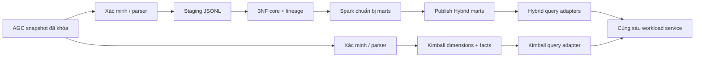

# Benchmark Hybrid và Kimball trên PostgreSQL local

## Kết quả chính

Đo trên cùng snapshot AGC, cùng PostgreSQL 17.10 và cùng giới hạn tài nguyên. Hybrid build mới mất **880.33 giây**; Kimball mất **40.35 giây**. Đây là một lần thực thi cho mỗi đường pipeline, không phải trung bình nhiều lần hay bảo đảm tốc độ trên hệ thống khác.

Các trường hợp chưa đạt: BR-01 Climate Hybrid, BR-01 Climate Kimball. Mục tiêu tham chiếu là p95 ≤2.000 ms. Kết quả vượt mục tiêu được giữ nguyên; báo cáo này không đánh dấu toàn bộ dashboard đạt SLA.

[Raw measurements](assets/t25/benchmark_results.json) chứa từng mẫu, checkpoint, checksum, thời điểm và SHA của script. [Cấu hình thực tế](assets/t25/runtime-environment.json), [script](assets/t25/benchmark_suite.py), [lệnh tái lập](assets/t25/run.sh) và [kiểm tra rebuild](assets/t25/rebuild-validation.json) đi kèm báo cáo.

## Phạm vi và cách đo

- Lượt đo được nghiệm thu: `2026-11-06T10:48:14.757881+00:00` đến `2026-11-06T11:36:12.175080+00:00`; timestamp là UTC.
- Snapshot SHA-256: `c19d385e7f4731a77e59ebfd763fd49e35e7ac4128d0aaf41b5717709cd75a68`. ZIP và từng member được xác minh trước pipeline; raw được mount read-only.
- Parser `agc-parser-v1`, quality `AGC_QUALITY_V1`, basis `AGC_SHARED_BASIS_V1`: 62,5 m², **assumed_unverified**. Thời gian nguồn AGC giữ dạng naive; không gán thành dữ liệu sensor hiện tại.
- Pipeline xử lý toàn bộ snapshot. Query latency/parity của lượt benchmark tập trung **Automatoes**, cửa sổ vụ 2019-12-16 đến 2020-05-30: 47,808 climate slots. Công nghệ ghi lấy 47,809 dòng climate thật theo `slot_start` (giới hạn tối đa 48.000), không nhân bản dữ liệu synthetic.
- Correctness rộng hơn cho sáu compartment nằm trong [báo cáo Kimball](kimball.md). Không diễn giải một compartment đo latency thành benchmark latency của mọi compartment.
- Host Apple M4, 10 logical CPU, RAM 16 GiB. Docker Desktop 29.9.2 được cấp 4 CPU và khoảng 7,62 GiB RAM. Processing **2 GiB / 1,5 CPU**, PostgreSQL **512 MiB / 0,5 CPU**. Python 3.12.12, psycopg 3.3.7, Spark 4.0.1.
- Một job benchmark chạy tại một thời điểm; app/broker và dịch vụ ngoài project vẫn tồn tại. Không restart DB, flush cache, tắt autovacuum hoặc thay caps giữa lượt chạy. Các hoạt động nền của host/engine không được kiểm soát hoàn toàn.
- Tất cả sáu đường lifecycle chạy tuần tự trong một process, theo thứ tự Hybrid rồi Kimball. Rebuild dùng DB mới nhưng có thể hưởng JVM/OS cache đã ấm; **fresh database không đồng nghĩa cold cache**.



## Pipeline: mới, rerun và rebuild

| Đường thực thi | Hybrid (giây) | Kimball (giây) | Số lần mỗi kiến trúc |
|---|---:|---:|---:|
| Build vào DB mới | 880.33 | 40.35 | 1 |
| Rerun trên DB đã publish | 183.58 | 3.73 | 1 |
| Clean rebuild từ raw vào DB khác | 926.91 | 41.54 | 1 |

Timer build/rebuild gồm xác minh nguồn, tạo DB/schema, transform, publish và metadata/rule/tariff cần dùng. Query evaluation được đo riêng. Hybrid rerun vẫn thực hiện các bước kiểm tra/chuẩn bị của workflow, rồi dùng lại publication `df3e4bcbacab45a5b86fc37d2f53c00a`. Kimball rerun **bị từ chối ghi đè publication**; thời gian từ chối không phải thời gian tái xử lý thành công và không thể xem là thắng lợi về recovery speed.

DB đo mới: `greenhouse_hybrid_bench_t25_20261106_104814` và `greenhouse_kimball_bench_t25_20261106_104814`. DB rebuild: `greenhouse_hybrid_rebuild_t25_20261106_104814` và `greenhouse_kimball_rebuild_t25_20261106_104814`. Lệnh tạo DB từ chối tên đã tồn tại. Rebuild đã qua kiểm tra read-only: số dòng core/fact bằng lần build mới, parity sáu BR giữa hai kiến trúc đạt; checksum BR-01…05 bằng lần build mới. BR-06 rebuild so baseline cost/priced days, vì lần build mới có thêm scenario what-if được tạo riêng.

Lượt đầu tiên lúc 10:35 UTC thất bại vì Docker hết đĩa trong core load; [bằng chứng thất bại](assets/t25/failed-diskfull.json) được giữ riêng và không được tính thành thời gian pipeline thành công. Sau khi được cho phép dọn build cache, thu hồi 8,267 GB và chạy lại trên DB mới. Không xóa DB của lần lỗi, image, volume hoặc DB lịch sử. Script kiểm tra headroom trước khi bắt đầu và trước rebuild; giữ checkpoint nếu bước sau lỗi.

Bước technology của lượt này ban đầu dừng vì script giả định có đúng 48.000 physical rows, trong khi bảng có 47,809. Timeline đánh giá của BR-01 có 47,808 expected slots; hai số này không đồng nghĩa. [Checkpoint trước khi sửa](assets/t25/pre-technology-checkpoint.json) giữ nguyên toàn bộ lifecycle/latency đã chạy. [Patch sửa script](assets/t25/technology-correction.patch) loại bỏ giả định sai, tách transaction metadata khỏi timer load và thêm chế độ tiếp tục có provenance.

Phần tiếp tục kiểm tra lại raw/config/caps/publication và parity checksum trước khi giữ lại các latency samples cũ; storage và technology được đo lại. Scenario của lượt lỗi nằm trong transaction đã rollback, nên phần tiếp tục tạo lại, đối soát và commit scenario trước bước technology. SHA script gốc được giữ ở từng stage được tái sử dụng; không biến checkpoint thành số đo mới.

## Latency của workload ứng dụng

Mỗi ô p95/median dùng **30 mẫu sau 5 warm-up**; p95 nearest-rank là mẫu thứ 29 sau sắp xếp. Dùng adapter đã khởi tạo và shared buffers đã được đọc qua parity/warm-up; cache kết quả climate/drain được tắt bằng `use_cache=False`. Đơn vị: **ms**.

| Workload | Hybrid median | Hybrid p95 | Kimball median | Kimball p95 | Mục tiêu Hybrid / Kimball |
|---|---:|---:|---:|---:|---|
| BR-01 Climate | 2,901.42 | 4,060.81 | 2,663.69 | 3,028.13 | Chưa đạt / Chưa đạt |
| BR-02 Water | 14.82 | 76.39 | 6.59 | 9.55 | Đạt / Đạt |
| BR-03 Drain | 1,768.26 | 1,959.90 | 1,633.14 | 1,816.71 | Đạt / Đạt |
| BR-04 Energy | 19.50 | 19.82 | 16.48 | 18.11 | Đạt / Đạt |
| BR-05 Harvest | 3.02 | 3.33 | 1.19 | 1.21 | Đạt / Đạt |
| BR-06 Cost | 9.01 | 9.19 | 7.88 | 8.02 | Đạt / Đạt |

Các phép đo là lời gọi service, không chỉ `SELECT`: BR-01/03 đọc chuỗi 5 phút và đánh giá episode cả mùa; BR-02 đọc ngày và summary; BR-04 quantities và intensity; BR-05 records, summary và completeness; BR-06 baseline pricing trên daily quantities. Một sample có thể gồm nhiều lần đọc. Không đồng nhất workload uncached cả mùa với một lần render UI có cache, một query summary đơn lẻ hoặc một cửa sổ ngắn.

Các phép đọc chuẩn bị adapter được ghi riêng dưới trường `first_touch_initialization_ms` trong JSON:

| Phép đọc chuẩn bị | Hybrid (ms) | Kimball (ms) |
|---|---:|---:|
| BR-01 Climate | 1,572.21 | 1,713.48 |
| BR-02 Water | 15.26 | 2,828.92 |
| BR-03 Drain | 414.10 | 796.79 |
| BR-04 Energy | 19.04 | 2,652.87 |
| BR-05 Harvest | 11.17 | 2,105.65 |
| BR-06 Cost | 10.19 | 8.00 |

Đây là callback `readiness_func` cụ thể của từng workload, **không phải cold database run hoặc toàn bộ first request tương đương với sample chính**. Ví dụ climate/drain chỉ đọc slots ở bước chuẩn bị, trong khi sample chính còn đánh giá episode; cost tái sử dụng energy service. Mô tả cache chung trong JSON phải được đọc cùng định nghĩa callback trong script. Cold-cache performance không được đo vì không restart hay flush DB dùng chung.

Không tối ưu bằng cách giảm số mẫu, bỏ kiểm tra correctness hoặc tăng caps. Với BR vượt mục tiêu, hướng tiếp theo có căn cứ là đo riêng phần đọc slots và tính episode, xem xét cửa sổ hẹp hoặc cache theo publication/rule/context hiện có, rồi benchmark lại cùng workload. Phép đo cache hiện có bên dưới được tách riêng; thay đổi thuật toán hoặc thiết kế cửa sổ chưa được triển khai trong task benchmark.

### Kiểm tra tối ưu cache hiện có của Hybrid

Sau khi phép đo uncached kết thúc, chạy [script cache read-only](assets/t25/cache_benchmark.py) trên cùng publication/rule/context, cùng caps. Workload vẫn đọc toàn bộ slots; chỉ phần evaluation dùng cache đã có sẵn trong service. Mỗi trường hợp có 5 warm-up và 30 samples. Kết quả evaluation đầy đủ phải bằng uncached, và kiểm tra object identity xác nhận đã hit cache.

| Workload Hybrid | Uncached p95 (ms) | Có result cache p95 (ms) | Lần cache miss đầu (ms) | Mục tiêu khi cache hit |
|---|---:|---:|---:|---|
| BR-01 Climate | 4,060.81 | 852.19 | 2,824.41 | Đạt |
| BR-03 Drain | 1,959.90 | 412.08 | 1,765.01 | Đạt |

[Raw cache measurements](assets/t25/cache-comparison.json) được giữ riêng. Đây là định lượng lợi ích của cơ chế đã tồn tại, không phải triển khai một cache mới. Cache miss vẫn phải tính lại; thay publication/rule/context cần kết quả tương ứng. Phép đo cached chạy sau lượt chính nên tỷ lệ cải thiện chỉ là so sánh tuần tự trong môi trường này.

Kimball adapter hiện không có `database_key`, nên service không kích hoạt result cache cho adapter đó. Không giả vờ bật `use_cache=True` là đã benchmark một cache Kimball, và không lấy số cache Hybrid để kết luận kiến trúc đọc nào luôn nhanh hơn.

## Correctness trước khi tính hiệu năng

Parity so sánh giá trị Decimal chính xác sau chuẩn hóa biểu diễn, quality/reason codes được chọn, daily results, metric/joint summaries, đầy đủ biên episode và chi phí baseline/scenario. Chỉ số lượng dòng bằng nhau không đủ để đánh dấu parity. Publication/runtime identity khác nhau được giữ riêng trong context; không sửa dữ liệu để ép kết quả bằng nhau. SHA bên dưới là checksum của tập trường đã assert trong script, không phải hash mọi cột của toàn database.

| BR | SHA-256 kết quả chuẩn hóa | Parity |
|---|---|---|
| BR-01 | `3929da6567812904bf5a8c9270d3f34c325699794d75f656bc4c37b5435a35e2` | Đạt |
| BR-02 | `4f706845e32824cfc1f7da35088191e1bc2bd67021f559559fdd055cba4c4cc3` | Đạt |
| BR-03 | `9bd61e7d27d94c7f8a8871c14443ceb8b5dee163c751a2e8fc9851f1c8358db9` | Đạt |
| BR-04 | `a0f1c670a895ad61dfec6e46dbd3cca2babb349b0286a2f35e80df117b0f7c3f` | Đạt |
| BR-05 | `85571cf11a2baaf47a22abcd242ee9badcda099a19304a527dc7896d3ca23887` | Đạt |
| BR-06 | `096cb5129abd17a5265168644e5fd5ffc78e611adebb6a299ec6341ae5b204a4` | Đạt |

BR-06 scenario đổi giá Heat thành 0,0095 EUR/MJ trên các DB benchmark riêng. Kết quả parity này không xác minh basis diện tích thành thực tế nông học, và không thay thế nghiệm thu sensor replay.

## Storage

Đo sau build/rerun và phần kiểm tra query, trên các DB benchmark cùng snapshot. Hybrid có 1 publication và 2 workflow; chi phí giữ lịch sử workflow là một phần của đường triển khai này. Không dùng database lịch sử có nhiều publication để phóng đại chênh lệch.

| Chỉ số | Hybrid | Kimball |
|---|---:|---:|
| Database, GiB | 3.319 | 0.623 |
| Staging của lần build mới, MiB | 386.55 | 0,00 |

Tỷ lệ database Kimball/Hybrid: **18.77%**. [Chi tiết table/index](assets/t25/storage_footprint.csv) tách từng schema. Database size không gồm WAL toàn cluster, container images hay raw chung; không coi các chi phí đó là bằng 0.

Staging Hybrid được tách theo đúng thư mục của từng đường lifecycle, không cộng rebuild vào footprint của một lần build mới:

| Đường lifecycle | Staging/artifacts (MiB) |
|---|---:|
| fresh | 386.55 |
| rerun | 386.55 |
| rebuild | 386.56 |

Kimball không sinh intermediate staging files trong pipeline này, nhưng vẫn có dữ liệu PostgreSQL, WAL, temporary state và list tích lũy trong bộ nhớ. Peak processing cgroup của process tiếp tục đo sau lỗi số dòng: **1171.84 MiB**; đây không phải peak của toàn bộ lifecycle hay riêng từng kiến trúc. Process lifecycle ban đầu đã thoát trước khi ghi peak cuối; không đủ dữ liệu để so sánh memory efficiency của hai kiến trúc.

## Công nghệ ghi: COPY và bounded INSERT

Cùng 47,809 climate records thật, cùng 25 cột/types và primary key, cùng PostgreSQL/caps. Full content digest của nguồn và từng bảng kết quả phải bằng nhau, gồm numeric không giới hạn precision, timestamp naive và JSONB canonical. NULL được phân biệt với chuỗi literal. Timer gồm load và commit, không gồm DDL, chuẩn bị nguồn hoặc đọc lại để kiểm tra; mỗi phương pháp chạy một lần.

| Phương pháp | Thời gian (ms) | Dòng/giây | Dòng đã kiểm tra | Full-content digest |
|---|---:|---:|---:|---|
| COPY | 722.58 | 66,164.20 | 47,809 | Khớp |
| INSERT, 500 dòng/batch | 4,777.61 | 10,006.90 | 47,809 | Khớp |
| INSERT, 1.000 dòng/batch | 5,737.13 | 8,333.30 | 47,809 | Khớp |

INSERT 500/COPY: 6.61 lần thời gian; INSERT 1.000/COPY: 7.94 lần. [Raw technology result](assets/t25/technology_comparison.json) giữ checksum và số đo. Đây là **temporary-table microbenchmark**, không đo throughput WAL/replication hoặc durability của bảng production; không dùng tỷ lệ này như hằng số cho mọi workload.

COPY phù hợp đường bulk load đã kiểm tra vì không phải gửi một statement INSERT nhiều tham số cho mỗi batch. Bounded INSERT vẫn hữu ích khi cần xử lý theo chunk. Chunk trong cùng transaction không tự tạo khả năng retry độc lập: muốn cô lập lỗi cần savepoint hoặc transaction riêng. Cả hai phương pháp vẫn phải kiểm tra kiểu, constraint và nội dung kết quả.

## Kết luận kiến trúc và giới hạn

- Kết luận định lượng chỉ áp dụng cho snapshot, phiên bản, thứ tự chạy, caps và các workload ghi ở trên. Pipeline/technology có n=1; 30 query samples là lặp trong một phiên đã warm, không phải 30 thử nghiệm độc lập hay confidence interval.
- Hybrid giữ 3NF core, revision, lineage và các checkpoint để kiểm tra/recovery; chi phí thực đo bao gồm duy trì chúng. Kimball bỏ intermediate core và dùng facts trực tiếp, nhưng loader hiện từ chối ghi đè publication đã có. Không suy ra khả năng correction/recovery tương đương từ parity query lịch sử.
- Tốc độ đọc không tự chứng minh toàn kiến trúc tốt hơn. Maintenance cost ở đây là phân tích thành phần/đường kiểm thử, không phải giờ công hoặc chi phí tiền đã đo.
- Chưa đo concurrent users, quy mô synthetic, cold cache, ClickHouse, SLA sensor-to-query, hoặc tác động nông học. Không đưa ra kết luận cho các trường hợp đó.

## Tái lập

Từ repository đã cấu hình `.env`, build image processing theo README và có PostgreSQL đang chạy đúng caps. Chọn thời điểm không có job test/benchmark khác:

```bash
BENCH_RUN_ID=review_20261106 bash docs/evaluation/assets/t25/run.sh
```

Lệnh dùng `--no-deps`, tạo bốn DB mới có suffix run ID, mount raw/archive read-only và ghi evidence vào `tmp/benchmarks/<run-id>`. Nếu tên DB/container hoặc evidence đã tồn tại, chọn run ID khác; không tự drop dữ liệu. Cần đủ dung lượng cho cả hai DB Hybrid, hai DB Kimball, staging và reserve. Không tăng caps giữa các kiến trúc. Thu hồi tài nguyên sau đo là thao tác riêng cần xác định đúng ownership.

Đo bổ sung cache trên database của một full run đã hoàn tất:

```bash
BENCH_MODE=cache BENCH_RUN_ID=review_cache20261106 BENCH_MEASUREMENTS_PATH="$PWD/tmp/benchmarks/review_20261106/benchmark_results.json" bash docs/evaluation/assets/t25/run.sh
```

`--smoke` chỉ dành cho baseline DB hiện có và ép read-only; không tạo scenario hoặc thay thế full benchmark. `--analysis-from` chỉ chấp nhận checkpoint đã hoàn thành đủ sáu đường lifecycle, kiểm tra lại raw manifest/publication, ghi provenance của checkpoint rồi chạy lại các bước analysis; không gọi các lifecycle cũ là phép đo mới. `--continue-from` giữ thêm latency đã hoàn tất chỉ sau khi kiểm tra lại parity digest và số mẫu; storage/technology vẫn chạy lại. Chọn thư mục output mới khi dùng wrapper để giữ evidence cũ.
