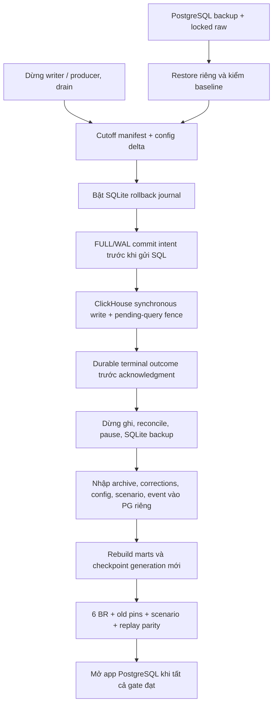

# Chuyển warehouse và quay lại PostgreSQL

Đường chạy mặc định là `compose.yaml` → `compose.clickhouse.yaml`. PostgreSQL
được mở riêng bằng `compose.postgres.yaml` khi cần đối chứng hoặc rollback.
Luôn chọn project riêng bằng `-p greenhouse-postgres` (hoặc tên fixture đã
kiểm); `-p` phải ghi đè `COMPOSE_PROJECT_NAME` native nếu cùng đọc một `.env`.
Đây là quy trình single-host, local filesystem; mọi writer ClickHouse phải dùng
cùng thư mục coordinator và POSIX lock. Không dual-write ở runtime.

## Các mốc cần giữ

1. Giữ PostgreSQL backup, raw/ZIP đã khóa, checksum, source commit và các image
   digest. Restore vào **project, database và volume mới**, kiểm tên đích trước
   mọi lệnh. Không restore đè PostgreSQL đang dùng hoặc xóa volume nguồn.
2. Dừng app/config writers và producer; collector flush ready files, Spark chạy
   hết available input rồi dừng. Đối soát pending query bằng terminal query log.
   Khóa cutoff chứa publication/config hashes, tất cả registry versions,
   scenarios, correction revisions và các stream batch receipts/envelopes.
3. Nạp delta cấu hình cuối sang bản PostgreSQL riêng. Kiểm cùng scope/snapshot
   và business DTO chính xác trước khi lập publication map. Hai engine có
   physical publication ID khác nhau; không thay ID mà bỏ kiểm nội dung.
4. Bật `cutover_journal.enable()` trên coordinator với cutoff hash và baseline
   đã kiểm. Deploy image có journal trước khi mở writer. Đặt
   `GREENHOUSE_CH_REQUIRE_CUTOVER_JOURNAL=1` cho app, job và stream của deployment
   đã cutover. Mất file hoặc sai namespace phải từ chối ghi.
5. Khi cần quay lại, dừng writer/producer, drain rồi `set_mode(...,'paused')`.
   Xác minh toàn bộ intents có terminal outcome; xuất snapshot cùng journal
   cursor/head/checksum. Dùng SQLite backup API, kiểm lại bản backup trước khi
   tiếp tục. Không copy riêng `.sqlite` trong khi còn WAL chưa checkpoint.
6. Trên PostgreSQL riêng: giữ nguyên archive native; restore typed profiles,
   tariffs và rules; replay corrections qua API có audit; rebuild publication
   và marts từ candidate membership. Sensor dùng **stream/checkpoint generation
   PostgreSQL mới**, giữ nguyên original envelopes. Không dùng checkpoint CH
   để bỏ qua event chưa nạp PostgreSQL.
7. Đối chiếu sáu BR, old pins, tất cả scenario versions/rates/request IDs,
   correction audit, replay states/cursors/checksums và original envelopes.
   Chỉ mở app PostgreSQL sau khi tất cả gate đạt. Giữ archive/journal/volume CH
   để điều tra và chuyển lại; không xóa dữ liệu sau khi đổi connection.



## Journal và trạng thái lỗi

`src/greenhouse/clickhouse/cutover_journal.py` lưu intent SQL, UTC audit time,
query ID, sequence và SHA-256 chain trong SQLite `synchronous=FULL`, WAL. Cùng
coordinator lock serialize journal và warehouse writes. `journal.py` giữ
pending query marker cho tới khi có synchronous success hoặc terminal
`system.query_log` evidence; mất ACK không có nghĩa là server chưa ghi.

Source/measure revisions, load/config/publication metadata, stream deliveries,
receipts và replay state đều được journal. Derived water/harvest/threshold/energy
mart INSERT được rebuild từ source/config đã giữ nên không nhân đôi toàn bộ
mart trong rollback journal. Pause chặn cả derived writes.

Crash giữa intent commit và pending marker có thể để lại intent chưa outcome.
Writer sau và strict export **fail closed**; không tự xóa intent hay đoán rằng
SQL chưa gửi. Nếu không có terminal query evidence, giữ mốc dừng, kiểm query ID
và semantic manifests; chỉ operator recovery có bằng chứng mới được tiếp tục.
Lỗi filesystem/SQLite làm mất khả năng ghi journal cũng phải chặn acknowledgment.
Không sửa SQLite để làm cho gate xanh.

Giữ `query_log` hoạt động. Bản local tắt periodic `metric_log` sau root cause đã
đo ở [native acceptance](../evaluation/clickhouse-acceptance.md); bảng
metric cũ được giữ nguyên. Không tăng memory limit hay bỏ semantic verification
để vượt cold-proof hoặc storage gate. Khi thiếu storage, có thể dọn Docker build
cache; không prune volumes/raw/backup/coordinator.

## Mapping và dữ liệu không được đánh mất

- PG migration `017_clickhouse_cutover_archive.sql` giữ nguyên archive và mọi
  configuration envelope theo checksum, gồm cả `native_rebuild_archive` và
  `native_rebuild_map`. Provenance được lưu rõ là archive, không giả làm cấu
  hình vận hành PostgreSQL. Unknown/drift không được silently bỏ qua.
  Archive lớn có journal SQL được giữ toàn vẹn bằng canonical JSON nén zlib,
  base64 trong JSONB; giải nén phải khớp SHA và byte count gốc. Không bỏ SQL để
  giảm kích thước. Typed configuration vẫn có bản nguyên envelope để truy vấn.
- Tariff alias chỉ được map khi toàn bộ currency, rate, unit, interval,
  scope, evidence và semantic identity bằng nhau; version/rate physical IDs
  khác được ghi riêng trong mapping. Không nới unique constraint để nhập trùng.
- Scenario map publication/context và tariff alias tường minh; giữ các trường
  còn lại, request ID, version chain, rates và author. `register_scenario`
  giữ `created_at` khi nguồn có giá trị. Một số legacy native scenario vốn
  không có timestamp: archive giữ NULL, PG import time được nhận diện riêng;
  không tuyên bố biết thời gian gốc.
- Nếu hai lineage diễn tập độc lập dùng cùng scenario/request ID với nội dung
  khác nhau, giữ bản PG đã restore và namespace **toàn bộ family native** bằng
  cutoff hash. Migration `018_clickhouse_scenario_mapping.sql` giữ original
  version/request ID, source namespace, payload hash và target IDs. Rate IDs
  được map theo parent mới; số tiền, đơn vị, interval, context và audit giữ
  nguyên. Retry lookup bằng source namespace + original request phải trả cùng
  target. Không dùng original request ID một mình để hợp nhất hai lineage.
- Giữ mọi replay pin cũ, kể cả partial, cùng current pin; original envelopes
  và **toàn bộ metadata tuple** phải khớp. Cột `observed_through` dùng normalized
  slot cursor qua `normalize_cursor`, còn raw source timestamp giữ nguyên trong
  state/envelopes. Chỉ so JSON state sẽ bỏ sót sai khác caption clock. Current
  state còn được tính lại bằng PostgreSQL reconciler.
- Raw bất biến. Correction tạo revision mới kèm actor/evidence/parent; old
  publication vẫn trỏ revision cũ. Một correction diễn tập không phải số liệu
  AGC quan sát gốc; khi trình bày dataset, chọn publication đã nghiệm thu gốc.

Nếu thêm snapshot, basis hoặc loại cấu hình nghiệp vụ mới ngoài mapping đã
kiểm, journal/archive vẫn giữ nguyên dữ liệu nhưng **không mở app PG** khi
semantic parity chưa đạt. Bổ sung translator và kiểm lại trước khi chấp nhận
rollback. Archive bảo toàn dữ liệu không thay cho chứng minh query contracts.

Nếu một fixture import sai header bất biến, giữ forensic dump đã đọc được toàn
bộ archive và dựng lại **fixture riêng** từ baseline. Không sửa/xóa pin người
dùng hoặc tắt immutable trigger để làm cho gate đạt. `repair_clock.py` có guard
project/database/volume và backup hash cho đúng môi trường diễn tập do agent tạo.

## Harness diễn tập hiện tại

`scripts/clickhouse_cutover/` là harness có identity guard cho các project riêng
đã mô tả trong evidence, không phải lệnh tự động chạy lên database tùy ý.
Setup JSON local ghi rõ project, database, đường dẫn và backup checksum.
`run.py` kiểm headroom (3 GiB cho read; 6 GiB cho rebuild), không pull image,
ghi image ID và snapshot các helper trước khi chạy. Mỗi label giữ log riêng.

```bash
# Sau khi chuẩn bị identity, restore riêng và dừng writer như các bước trên:
python3 scripts/clickhouse_cutover/run.py --label cutoff -- \
  python /cutover-tools/state.py cutoff
python3 scripts/clickhouse_cutover/run.py --label baseline -- \
  python /cutover-tools/state.py baseline
python3 scripts/clickhouse_cutover/run.py --label enable -- \
  python /cutover-tools/state.py enable
# Exercise qua API native: commands, correction, sensor, rebuild.
python3 scripts/clickhouse_cutover/run.py --label pause -- \
  python /cutover-tools/fence.py pause
# Truyền publication mới đã complete; không tự lấy lại pin cũ.
python3 scripts/clickhouse_cutover/run.py --label export-delta -- \
  python /cutover-tools/state.py freeze --publication NEW_COMPLETE_PUBLICATION
python3 scripts/clickhouse_cutover/run.py --label reverse-inputs -- \
  python /cutover-tools/rollback.py inputs
python3 scripts/clickhouse_cutover/run.py --label reverse-rebuild -- \
  python /cutover-tools/rollback.py rebuild
python3 scripts/clickhouse_cutover/run.py --label reverse-verify -- \
  python /cutover-tools/rollback.py verify
```

Không chạy lại label/archive đã có; giữ log lỗi và chọn label mới. Khi tiếp tục
workflow đã tạo, PG rebuild dùng resume và kiểm artifact; native rebuild giữ
workflow/base load/config pins. Không xóa checkpoint để làm lại cùng generation.

Kết quả diễn tập, downtime và digest thực tế được ghi trong evidence của đợt
cutover. Các lệnh/giới hạn trên là điều kiện vận hành; không suy ra thời gian
cutover ngắn từ warm query benchmark.
