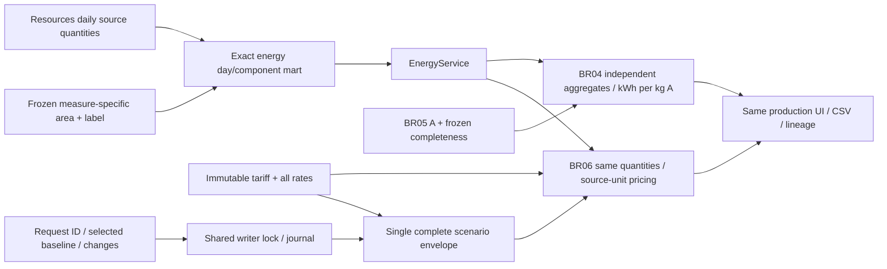

# BR-04/06 ClickHouse — lượng năng lượng và scenario bất biến

Hai BR dùng chung `energy-mart-v1` / `energy-quantity-v1`, cùng EnergyService,
EnergyIntensityService và EnergyCostService với PostgreSQL. Màn hình production,
CSV/JSON và công thức không được nhân bản ở UI hoặc adapter.

## Lượng năng lượng

Nguồn hiện có là Resources theo ngày: Heat_cons (MJ/m²/day), ElecHigh/ElecLow
(kWh/m²/day). Đây đã là năng lượng trong khoảng ngày nguồn; tổng theo kỳ cộng
các khoảng ngày, không coi chúng là công suất tức thời rồi nhân thêm số giờ.
Heat đổi MJ → kWh bằng chia 3,6 với 50 chữ số có nghĩa, half-even, đúng contract
hiện có. Lượng tuyệt đối nhân với diện tích được ghim riêng cho từng measure;
chia cho sản lượng loại A chỉ sau khi hai tập đã tổng hợp độc lập.

`energy_header` ghim config; `energy_cycle` ghim cửa sổ vụ; `energy_measure` có
grain publication/cycle/day/component, source exact text + Decimal256 projection,
quality/applicability/reason, revision/correction, basis ID và các lượng đã đổi.
Derived quantities giữ exact text vì kết quả 50 chữ số có thể không biểu diễn
lossless trong scale38. `energy_basis` giữ typed scope/measure/window/status/area
và toàn bộ EffectiveAreaBasis provenance. Reader dựng lại EnergyQuantity, kiểm
ngược công thức từ source/area. Validator seal đối soát toàn bộ rows từ load và
config đã pin, không chỉ tin một receipt có header.

AGC_SHARED_BASIS_V1 là giả định 62,5 m² của user, giữ nhãn chưa xác minh. Một
basis ID dùng chung với harvest phải cùng measure/area/status/window/assumption;
ProdA đã có basis phải được giữ đủ frozen provenance. Khi Resources không có
basis, lượng nguồn còn xem được nhưng không phát sinh tổng kWh tuyệt đối hoặc
kWh/kg A chính thức. Production complete với A=0 vẫn có mẫu số 0; ratio là NULL.
Reference unresolved vẫn incomplete, không được xếp hạng như vụ hoàn chỉnh.

Accepted energy âm bị contract từ chối trước khi seal; không tự đổi quality
policy AGC_V1 hoặc lấy trị tuyệt đối. Numeric parse invalid/missing giữ verdict
và không đóng góp; các component hợp lệ cùng ngày vẫn hiện observed quantity.

## Giá và scenario

Tariff lưu toàn bộ profile/rates trong immutable configuration envelope, kiểm
currency/unit, parent version, rate IDs và interval overlap. AGC_2020_REFERENCE_V1
là giá tham khảo lịch sử trong Economics.pdf: heat 0,0083 EUR/MJ, điện high/low
0,08/0,04 EUR/kWh. Đây không là hóa đơn thật hoặc giá hiện hành.

Một cost_scenario envelope chứa đồng thời header, rates, changes, frozen
publication, analysis context và command. Không có thời điểm reader thấy header
mà thiếu rates. Rate factory phải trả đầy đủ rates đúng kết quả derive từ baseline
bất biến; reader cũng kiểm lại điều này. Unsupported/partial import bị từ chối
trước ghi.

Cùng shared writer lock bảo vệ check request ID, cấp version và append envelope.
Repository dùng journal chung; outcome chưa biết phải reconcile trước lượt ghi
khác. Request giống nhau trả cùng scenario; cùng ID khác nội dung bị từ chối.
Hai request sửa cùng scenario cấp hai ordinal khác nhau. Append giữ publication,
snapshot, scope, baseline và analysis context; rate/version cũ không đổi. Header
và rates không có transaction SQL đa bảng, vì cả revision là một row tự đủ.

UI dùng đúng coordinator mount chung với CLI (xem
[quy định môi trường](clickhouse-thresholds.md#rules-và-thao-tác-lưu)). Save và
reopen không cần PostgreSQL; nhánh PostgreSQL tiếp tục commit như trước.

## Chạy

```bash
python -m greenhouse.clickhouse.energy_run \
  --raw /data/raw/agc-2nd-2019/SNAPSHOT_SHA --output /candidate/output \
  --coordinator /candidate/coordinator --scope SNAPSHOT_SCOPE \
  --workflow-id energy-first --agc-shared-basis --register-agc-tariff
```

Chạy qua ch-client trong Compose candidate với raw mount read-only và candidate
mount chung như [BR02](clickhouse-water.md). CLI mặc định nạp tất cả nguồn ba loại
Resources/Production/GreenhouseClimate. `--base-load LOAD_ID` tái dùng một load
bất biến được chọn tường minh, kiểm audit/source selection, không chọn current
pointer. `--climate-start/end` cần khớp selection khi dùng bounded base load.
Config/mapping phải dùng version mới nếu nội dung thay đổi (`--energy-version` cho
energy; API có cả bốn version args). Một envelope workflow riêng giữ nguyên
base-load input, kể cả khi correction làm publication chọn membership mới, nên
retry vẫn dùng cùng đầu vào và cùng publication.

## Kiểm chứng

[Bằng chứng](../evaluation/assets/clickhouse-energy-cost/manifest.json): 46 CH/UI
tests và 24 hồi quy UI PostgreSQL đạt; 12 cửa sổ AGC khớp Decimal chính xác.
Workflow retry giữ nguyên publication/load. Artifacts gồm suite,
PG SELECT-only reference, raw oracle và workflow retry. Fixture tính tay có
4.687,5 kWh / 187,5 kg A = 25 kWh/kg A; tăng giá điện 20% đổi tổng từ 180,875
sang 198,375 EUR, giữ lượng tiêu thụ. Fault cases gồm rate factory thiếu rates,
mất ACK sau INSERT, same-ID drift, import version sai và concurrent request/
version allocation. Missing heat, A=0, Resources basis unknown, shared basis drift
và late correction giữ NULL/immutable pin đúng contract.

AGC đối soát toàn bộ Resources/Production của sáu khoang, cả hai ngày và toàn
166 ngày. Climate/drain của môi trường rehearsal vẫn chỉ có source-window hai
ngày; không tuyên bố full backfill sáu BR/sensor trước T38, benchmark trước T49
hoặc bộ video trước T51.


