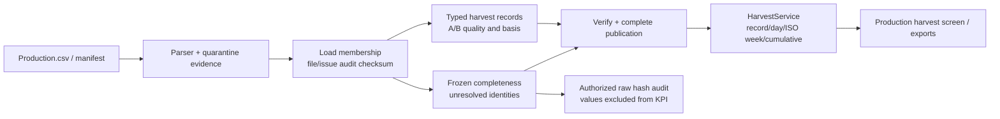

# BR-05 ClickHouse — record grain và completeness

T44 thêm typed harvest mart vào cùng publication với water. Raw/parser, quality
policy, HarvestService/DTO, công thức share/cumulative và màn hình Streamlit hiện
có được giữ. Default project vẫn PostgreSQL đến T39; ClickHouse cung cấp water
và harvest, các màn hình khác tiếp tục theo task tương ứng.

## Dữ liệu đã ghim

`load_file` lưu metadata từng file (status/counts/consumability và core_selected);
`load_issue` lưu audit gốc của mọi record không accepted trong phần nguồn được
nạp. Load receipt có audit checksum ngoài checksum membership. Reader từ chối
file/issue metadata bị thiếu hoặc mâu thuẫn. Correction tạo membership mới và
mang theo audit gốc, không sửa load/publication đã công bố.

Publication reader chọn đúng registry theo required_bundles bất biến và kiểm
mọi receipt. Bản water-only cũ vẫn đọc được; bản mới water+harvest dùng cùng
PublicationRef/versions ở cả hai service. Unknown bundle/version bị từ chối,
không tự bỏ qua để đọc một phần. Config của bundle phải thuộc config pins; audit
phải thuộc chính load đã pin, không được chọn audit một lần nạp khác.

## Tables và quy tắc

- `harvest_measure` có grain publication/source-record/measure, typed date/key,
  revision/correction, exact Decimal cùng projection lossless, quality/applicability,
  unit và dimension attributes. Record key dựa trên source ID, không gộp các
  record cùng ngày trong mart. Parser v1 vẫn giữ chính sách conflict theo ngày
  đã áp dụng ở baseline; thay key mart không tự chấp nhận conflict upstream.
- `harvest_cycle` và `harvest_header` pin cycle/config/load.
- `harvest_state` lưu boolean/counters typed và completeness envelope, gồm danh
  sách unresolved identity không chứa giá trị thu hoạch bị loại.

Snapshot complete khi file Production expected có mặt, đã nạp consumable vào
core, không có unresolved quarantine/conflict và mọi core record paired A/B.
Missing file có zero record count nhưng nguồn unknown; không tạo record ảo.
Một measure thiếu/invalid vẫn giữ measure còn lại usable và cumulative A tương
ứng. Ngày không event chỉ là known 0 trong snapshot complete; còn lại NULL.

Numeric correction cần actor/evidence/previous revision. Như baseline, correction
có full typed measure map và clear lexical numeric issues ở revision mới; raw
quarantine audit vẫn giữ. Chỉ invalid_numeric ở ProdA/B được giải quyết khi
revision đã pin làm measure đó accepted. Out-of-cycle/conflict và issue khác
không tự được xóa bởi correction số. Reference giữ nguyên ngày nguồn và trạng
thái chưa xác nhận, phần dữ liệu hợp lệ vẫn có thể hiển thị tổng observed.

Audit UI phải chọn identity trong frozen unresolved set, kiểm file/record hash
trước khi hiện token raw. Thiếu/drifted raw trả unverified với lý do và không
hiện giá trị raw. Những token đã xem không đi ngược vào KPI.

## Chạy

Image chuẩn bị như hướng dẫn [môi trường](clickhouse-local-environment.md).
CLI có thể nạp cả Resources/Production vào project candidate:

```bash
python -m greenhouse.clickhouse.harvest_run \
  --raw /data/raw/agc-2nd-2019/SNAPSHOT_SHA --output /candidate/output \
  --coordinator /candidate/coordinator --scope SNAPSHOT_SCOPE \
  --workflow-id harvest-first --agc-shared-basis
```

Chạy lệnh trên qua `docker compose ... run ch-client` với raw mount đọc-only và
candidate/coordinator volume chung như [luồng nước](clickhouse-water.md). AGC
shared-basis defaults chỉ dùng cho locked snapshot; generic config/fixture có
API riêng. Cùng workflow retry giữ load/config/publication, không backfill ngầm.
App profile cần ch-app và ch-web để mở localhost; warehouse/app vẫn backend internal.



## Kết quả đã kiểm

[Bằng chứng và checksum](../evaluation/assets/clickhouse-harvest/manifest.json):
33 kiểm thử ClickHouse/UI đạt, gồm correction, missing file, audit checksum,
known-zero/NULL và giữ nguyên publication cũ. Nguồn AGC có 139 Production accepted
và một quarantine; 996 Resources được tái sử dụng trong publication chung.
12 đối soát (sáu khoang × hai cửa sổ) khớp Decimal chính xác với CSV oracle và
PostgreSQL đọc trong transaction read-only. Chromium thực mở Digilog/Reference,
xuất 23 record với A=13.51, B=0.70322 kg/m²; raw CSV giữ local. Reference vẫn
incomplete nhưng giữ các tổng observed hợp lệ. Retry workflow giữ nguyên
publication/load; water-only publication cũ tiếp tục đọc được. Đây là smoke
BR05, chưa phải bộ video T51 hay full backfill sáu BR.
