# ClickHouse sensor sink và replay publication

T47 giữ simulator, MQTT QoS1, durable outbox, SQLite collector spool và raw-ready
JSONL hiện có. Spark `foreachBatch` có backend ClickHouse riêng; không cần biến
môi trường hoặc kết nối PostgreSQL. Các kiểu slot, replay state, chọn membership
và duration/episode engine dùng chung với đường PostgreSQL.

## Điểm hoàn tất dữ liệu

`stream_delivery` lưu nguyên collector record (bao gồm exact payload bytes base64),
disposition/reason, replay/event/hash và ordinal trong micro-batch. `stream_batch`
chỉ được ghi sau khi count, ordinal, decoded verdict và SHA-256 khớp toàn bộ
batch. Dòng của một lần ghi dở không có receipt không được dùng cho publication.
Physical copies giống nhau sau retry được DISTINCT ở reader; không đợi merge.

Batch identity gồm stream ID, checkpoint generation, batch ID, replay scope và
configuration version/hash. Canonical digest sort transport records nên thứ tự
partition không đổi identity. Reuse batch ID khác content bị từ chối; cùng
checkpoint generation không được đổi scope/config, kể cả lần đầu mới ghi dở và
chưa có receipt. Journal dùng query ID để reconcile kết quả INSERT chưa rõ trước
lượt ghi kế tiếp. Shared writer lock giữ commit batch và publish trong cùng lượt
coordinator; không có transaction giả lập bằng cách bỏ qua outcome chưa biết.

`replay_member` giữ identity/hash/source slot và envelope đã chọn. `replay_seal`
ghim config, batch receipts, state và membership hash; `replay_pointer` append
một generation mới chỉ sau khi reader verify seal thành công. Reader pin một
publication ID, kiểm lại các batch/config/members đã ghim; event đến trễ hoặc
conflict tạo publication khác. Không đọc những row hiện tại để sửa pin cũ.

Manifest completion cần checksum chuỗi payload/outbox IDs, contiguous cursor và
control sequence, không missing/conflict/quarantine. PUBACK và collector receipt
chỉ là xác nhận transport/durability, chưa phải warehouse receipt. Conflict không
chọn first arrival. Source snapshot/file checksum khác cấu hình bị loại khỏi
membership, ghi scope conflict. Raw-ready malformed không có replay ID vẫn được
hạch toán quarantine vào scope mà stream đã khai báo; không phát sinh KPI từ đó.

## Config và checkpoint

Replay có scope khác lịch sử. Đăng ký immutable config từ một historical
publication ClickHouse đã verify: snapshot/archive/file hashes, cycle, quality
policy và source publication/config identity được giữ. Config hiện hỗ trợ
AGC_QUALITY_V1; clock là source-naive, không tự thêm timezone. Rule lịch sử chỉ
map sang replay sau một lựa chọn tường minh và kiểm snapshot/compartment, giữ
nguyên version/label/evidence.

Ví dụ qua ch-client, với candidate/coordinator mount chung như
[BR01/03](clickhouse-thresholds.md#rules-và-thao-tác-lưu):

```bash
python -m greenhouse.clickhouse.replay_config \
  --source-publication HISTORICAL_PUBLICATION_ID \
  --replay-id demo29 --scope-id SNAPSHOT_REPLAY_SCOPE \
  --compartment-id AICU --config-version replay-v1 \
  --coordinator /candidate/coordinator
```

`ch-broker` và `ch-stream` nằm trên backend internal trong Compose candidate.
Chọn các biến GREENHOUSE_CH_STREAM_ID, GENERATION, REPLAY_ID, REPLAY_SCOPE_ID,
REPLAY_CYCLE_ID, REPLAY_COMPARTMENT_ID và REPLAY_CONFIG_VERSION tường minh. Cấu
hình stream scope/cycle/policy phải khớp config vừa đăng ký. Mount raw-ready và
checkpoint bằng GREENHOUSE_CH_READY_PATH / GREENHOUSE_CH_CHECKPOINT_PATH; path
checkpoint mới riêng cho ClickHouse. Xem [simulator/collector](../../src/greenhouse/sensor/README.md)
cho các lệnh phát/nhận không đổi.

```bash
docker compose -f compose.clickhouse.yaml --profile sensor build ch-stream
docker compose -f compose.clickhouse.yaml -p greenhouse-ch-dev --profile sensor \
  up -d --wait --no-build --pull never clickhouse ch-broker
docker compose -f compose.clickhouse.yaml -p greenhouse-ch-dev --profile sensor \
  run --rm --no-deps --pull never ch-stream
```

CLI `python -m greenhouse stream --backend clickhouse` nhận `--coordinator` và
`--replay-config-version`. Dùng `--available-now` cho replay đóng. Marker của
checkpoint có backend, endpoint không chứa password, source directory,
stream/generation và config scope/version/hash. Marker PostgreSQL cũ không được
nhận trên backend mới; generation/config đổi cũng bị từ chối trước Spark chạy.
Không trỏ checkpoint PostgreSQL vào ClickHouse rồi xem các batch cũ là đã nạp.

## Đánh giá và phục hồi

Replay chỉ đánh giá từ đầu vụ đến min(cursor + 5 phút, cycle end). Tương lai sau
cursor không đi vào coverage. CO₂ SP0, pH suspect, missing và rule boundaries đi
qua cùng typed inputs/engine như batch. Late delivery được recompute trên pin
mới; original/clipped episode metadata không ghép từ các batch riêng rẽ.

[Evidence và checksum](../evaluation/assets/clickhouse-sensor/manifest.json): 50
CH/UI checks đạt (59 discovered, 9 integration chạy riêng); packaged stream CLI
recovery đạt; 32 sensor và 2 replay UI hồi quy PostgreSQL đạt. Các ca thực gồm:

- Real MQTT → SQLite spool/raw-ready → Spark → ClickHouse: 30 event, 150 phút,
  temp out50, EC out50, pH suspect5, joint out45; metrics/episodes/quality khớp
  mart batch và kỳ vọng tính tay. Không có PG env trong runner.
- Real driver death ngay sau DB publication, trước Spark checkpoint: process mới
  resume rồi reopen, giữ một batch/ba delivery/một event; sai backend/generation
  checkpoint bị từ chối.
- ClickHouse stop/start khi batch đang chờ: checkpoint không advance; cùng
  generation resume sau restart. INSERT thành công nhưng mất ACK được journal
  reconcile trước retry; pin complete cũ giữ nguyên sau late conflict.
- Broker stop/start cùng restart collector/publisher từ SQLite đã giữ: 25 event
  còn pending được gửi tiếp; raw-ready cũ giữ hash; cuối cùng đủ 30 event và
  manifest/checksum. Lỗi mất kết nối của process cũ được ghi nhận, process mới
  phải hoàn tất không lỗi.
- Sáu fault cases qua MQTT thật: duplicate, conflict, delayed/out-of-order, drop,
  malformed bytes, invalid schema. Có oracle độc lập sáu slot; raw quarantine
  giữ exact bytes và gap/conflict không thành KPI đầy đủ.

Harness restart chỉ thao tác project test mới và dọn volumes của đúng lượt khi
pass; fail giữ project để chẩn đoán. Không dọn database/broker người dùng.

```bash
./scripts/rehearse_clickhouse_sensor.sh
```

Đây là nghiệm thu correctness/fault trên fixture nhỏ; full AGC batch–stream và
migration versions còn ở T38, workload/p95 ở T49, backup/restore ở T50, video ở
T51. UI replay/overview/quality toàn bộ backend được chốt riêng trong T48.

```mermaid
flowchart LR
    SIM["Simulator / durable outbox"] --> MQTT["MQTT QoS1"]
    MQTT --> SPOOL["SQLite spool / raw bytes before ACK"]
    SPOOL --> READY["Atomic raw-ready JSONL"]
    READY --> SPARK["Spark foreachBatch / CH checkpoint"]
    SPARK --> LOCK["Shared writer lock + query-ID journal"]
    LOCK --> DELIVERY["Stream delivery / unsealed prefix"]
    DELIVERY --> RECEIPT["Verified batch receipt"]
    RECEIPT --> PLAN["Cursor / manifest / conflicts / source pins"]
    PLAN --> SEAL["Immutable members + verified replay seal"]
    SEAL --> POINTER["Append current pointer generation"]
    SEAL --> ENGINE["Same BR01/03 slots and episode engine"]
    ENGINE --> RESULT["Pinned replay result / exports"]
```


