# BR-01/03 trên ClickHouse

T45 chuyển dữ liệu khí hậu và EC/pH drain sang typed slot mart. Hai màn hình
production, DTO, bộ đánh giá duration/episode và các công thức coverage vẫn dùng
chung với PostgreSQL. Requested/realized là các lần đánh giá riêng; drain giữ
context `drain_process_computer`, basis `measured`.

## Dữ liệu và publication

`threshold_header`, `threshold_cycle`, `threshold_measure` phân biệt bundle
`climate`/`drain`. Grain measure là publication/cycle/slot/measure. Mỗi measure có
exact Decimal text, projection Decimal256 nếu lossless, status/applicability/reason
và revision/correction identity. Clock là microsecond nguồn naive; không tự gán
UTC. `slot_start` lấy từ grid đã được parser xác minh (sai số serial ≤0,5 giây),
khác với raw timestamp được giữ trong lineage. Giữ cả sample ở biên đóng vụ
trong mart; read nửa mở không cộng sample đó vào thời lượng.

Validator tính lại mart từ đúng load/config đã pin, kiểm count/checksum và từ
chối thiếu verdict, grain conflict, source ngoài cycle hoặc source selection.
Registry kiểm đủ water/harvest/climate/drain; publication water-only cũ vẫn đọc
được. Các bundle dùng cùng publication/load, kể cả bối cảnh nước trong màn hình
drain. Reader không fallback sang raw/core hoặc PostgreSQL để lấp KPI.

Nguồn ghi theo lô tối đa 512 record, measure chunks 4096. Journal vẫn ghi từng
lệnh cùng query ID và fence outcome chưa biết; source measures được ghi trước
revision. Retry có thể gặp physical copies giống nhau nhưng canonical SELECT
DISTINCT không nhân record. Xung đột content/ordinal bị từ chối. Canonical measure
validation truy vấn tối đa 512 revision mỗi lượt và vẫn so toàn bộ exact values,
projection, null reason. Correction dùng API ordinal/previous-revision có audit.

## Rules và thao tác lưu

`rule_schedule` là một immutable configuration envelope chứa toàn bộ header và
segments đã được contract kiểm order/overlap. Ghi một row làm revision khả dụng
cùng lúc; không có header thiếu segments. Request identity toàn cục cho rule
version chặn tái dùng khác scope/content. Profile EC/pH do kỹ sư tạo dùng chung
constructor/validation với PostgreSQL, giữ label `user_unverified`, provenance,
explicit version và không sửa publication. UI lưu, tự chọn và mở lại revision.

App và CLI ghi phải mount **cùng coordinator directory** cho cùng database, như
ADR-003. Chuẩn bị thư mục trước (user trong image UID 10001 cần quyền ghi):

```bash
mkdir -p tmp/clickhouse-state/coordinator
chmod 777 tmp/clickhouse-state tmp/clickhouse-state/coordinator
export GREENHOUSE_CH_STATE_PATH="$PWD/tmp/clickhouse-state"
# ch-client mutations also mount "$GREENHOUSE_CH_STATE_PATH:/candidate".
```

Compose ch-app mount `/candidate`; `GREENHOUSE_CH_COORDINATOR` mặc định
`/candidate/coordinator`. Thư mục thiếu/sai quyền trả lỗi lưu, không tự tạo một
coordinator độc lập. Read-only service actions không cần khóa ghi.

## Chạy lịch sử

```bash
python -m greenhouse.clickhouse.threshold_run \
  --raw /data/raw/agc-2nd-2019/SNAPSHOT_SHA --output /candidate/output \
  --coordinator /candidate/coordinator --scope SNAPSHOT_SCOPE \
  --workflow-id threshold-first --agc-shared-basis
```

Lệnh qua `docker compose ... run ch-client` với raw mount read-only và shared
candidate directory như [luồng nước](clickhouse-water.md). Mặc định chọn toàn bộ
GreenhouseClimate. Rehearsal nhỏ có `--climate-start`/`--climate-end` (ISO datetime
nguồn, nửa mở). Selection được ghi trong config pin và frozen file audit, số row
ngoài selection hạch toán `deferred_source_window`. Các slot ngoài selection vẫn
unknown, không thành known 0 hoặc coverage đầy đủ. Muốn nạp rộng hơn phải tạo
config version/workflow mới qua API; không thay payload của version cũ.

Engine dùng đủ chu kỳ để xây original episode rồi mới clip kỳ báo cáo; không
chạy riêng từng batch/partition để ghép duration. Sample thiếu, non-OUT hoặc
segment content đổi làm ngắt episode. Suspect/invalid che input cho đánh giá,
không đổi giá trị frozen; pH suspect không loại EC cùng slot. CO₂ setpoint 0 giữ
`sp0_off_mode`, không là vi phạm/valid.

Cache evaluation mang namespace `clickhouse` + endpoint không chứa password,
publication/versions, cycle/window/basis và chữ ký nội dung rule. Không dùng
chung key với PostgreSQL. Raw lineage kiểm manifest/file/record hash trước khi
trả về source reference.

## Kiểm chứng

[Bằng chứng](../evaluation/assets/clickhouse-thresholds/manifest.json): 39 kiểm thử
ClickHouse/UI và 100 hồi quy UI PostgreSQL đạt; 18 nhóm/36 metric duration,
902 episode nội cửa sổ AGC khớp chính xác. Retry giữ nguyên publication/load.
Manifest ghi phạm vi
và checksum của suite, AGC và PostgreSQL read-only reference. Fixture tính tay
bao gồm mẫu đảo thứ tự, đoạn qua nửa đêm, biên rule/window/cycle, sample thiếu,
CO₂ off-mode, invalid/suspect, correction đến muộn, pin cũ và profile retry/drift.
AGC rehearsal chọn 02–03/03/2020: 3.456 nguồn khí hậu trên sáu khoang, cộng
water/harvest hiện có; chưa là full backfill T38. Oracle raw độc lập so giá trị,
quality và duration. Chỉ các AGC episode nằm hoàn toàn trong source window được
so original span; episode vượt biên source selection cần full backfill T38.
Đây chưa phải bộ video T51 hoặc benchmark T49.

```mermaid
flowchart LR
    RAW["GreenhouseClimate.csv"] --> PARSER["Verified 5-minute grid / raw audit"]
    PARSER --> CORE["Revision load / immutable selection"]
    CORE --> CLIMATE["Climate measures + quality"]
    CORE --> DRAIN["Drain EC/pH + quality"]
    CLIMATE --> PUB["Verify all required bundles / seal"]
    DRAIN --> PUB
    RULE["Whole immutable schedule revision"] --> ENGINE["Shared full-cycle duration / episodes"]
    PUB --> ENGINE
    ENGINE --> CLIP["Requested window / bounded detail"]
    CLIP --> UI["Production UI / CSV / lineage"]
    UI --> PROFILE["Engineer profile command"]
    PROFILE --> RULE
```


