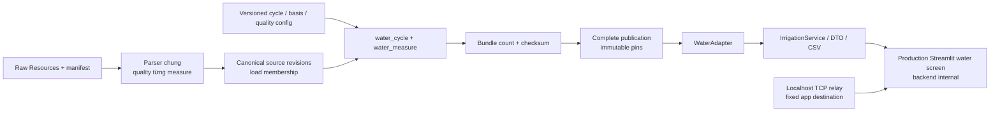

# BR-02 trên ClickHouse — candidate local

T43 chuyển luồng Resources → typed mart → cùng IrrigationService/DTO → dashboard
Streamlit và CSV/JSON. PostgreSQL vẫn là mặc định cho project đến cutover T39;
backend ClickHouse hiện cung cấp màn hình nước. Các BR còn lại có task riêng.

## Chạy và kiểm lại

Chuẩn bị ZIP/raw snapshot theo README, Docker và các image; không cần PGHOST,
PGDATABASE, PGUSER hay PGPASSWORD để chạy candidate:

```bash
docker compose -f compose.clickhouse.yaml build ch-client ch-app
docker compose -f compose.clickhouse.yaml pull clickhouse
./scripts/rehearse_clickhouse_water.sh
```

Wrapper tạo project mới, kiểm network internal, nạp toàn bộ 996 ngày Resources
của sáu khoang từ snapshot đã khóa, build/publish water bundle, so oracle từ CSV
và chạy AppTest trên home.py thật. Những record Climate/Production khác được
staging/accounting nhưng không đưa vào core của luồng nước này; không tuyên bố
đã hoàn thành full warehouse sáu BR. Sau lượt, app/server được dừng, DB/outputs
và coordinator giữ trong project/thư mục được in ra để có thể xem lại.

Các service `ch-app`/`ch-ui-test` dùng image UI cùng entrypoint với PostgreSQL;
`GREENHOUSE_BACKEND=clickhouse` chọn connection và adapter tường minh. Raw mount
đọc-only phục vụ lineage. App và warehouse chỉ nối backend internal; `ch-web` relay TCP đích cố định nối thêm frontend để mở cổng dashboard localhost. Relay truyền cả HTTP/WebSocket, không cung cấp forward-proxy protocol. App egress được kiểm riêng; relay là thành phần vận chuyển localhost, không được mô tả như container đã chặn mọi egress. Runtime không gọi cloud.

## Schema và semantics

- `water_measure`: grain `(scope, publication, cycle, date, measure)`; typed keys,
  revision, quality, applicability, reason, đơn vị; Decimal exact string cùng
  projection Decimal256 chỉ khi lossless. Basis metadata là immutable dimension
  attributes, không thay toàn bộ facts bằng JSON.
- `water_cycle`: cửa sổ ngày nửa mở và mapping khoang/vụ đã pin.
- `water_header`: snapshot và version water config. Receipt kiểm số semantic
  day/cycle và checksum tất cả fact/dimension rows so với canonical source.
- Configuration envelope giữ quality definition, cycles, basis windows, units và
  evidence; validator từ chối overlap hoặc reference sai. AGC_QUALITY_V1 phải
  khớp definition baseline, không chỉ có cùng tên. Hai thuộc tính metadata cố định
  `missing=per_measure` và `out_of_target_is_quality=false` có default tường minh;
  các danh sách nonnegative/suspect/off-mode phải khai báo đúng.

Những dòng chỉ sai numeric ở một measure nhưng có ngày hợp lệ vẫn vào core,
đồng thời còn quarantine evidence: measure sai là invalid, measure khác vẫn có
thể accepted. Conflict cùng key, lỗi cấu trúc và thời gian không hợp lệ không
được lấy tùy ý làm winner. Đây là hành vi baseline PostgreSQL đã triển khai.

Không cộng trực tiếp bảng append-only: reader dùng DISTINCT và verifier so đúng
grain/content, từ chối conflict. WaterService hiện hành giữ ratio of paired sums,
NULL/0, calendar gaps, accepted coverage, clip theo cycle, rule version và nhãn
basis. Cùng payload correction cần actor/evidence/previous revision; publication
mới chọn latest revisions của đúng source key set, lưu load membership mới;
publication/load cũ giữ nguyên. Workflow retry giữ load/config/pins, không nạp lại
raw rồi đổi publication ngầm. Các rule query-time được chọn version tường minh.

AGC shared 62,5 m² giữ nguyên nhãn **giả định chưa xác minh**, opt-in qua
`--agc-shared-basis`, theo quyết định user và data-decisions §7. Không tự coi
đây là diện tích Resources đã được xác nhận từ nguồn.

## Kiểm chứng và giới hạn

Suite `tests/clickhouse` gồm fixture accepted/NULL/invalid/negative/missing-day,
correction và old publication, retry, CSV và raw lineage, plus production UI
filter/date/rule/chart/download. Chạy trong UI image qua service `ch-ui-test` trên
project test mới; unit/DB tests yêu cầu GREENHOUSE_CH_INTEGRATION=1, UI tests
thêm GREENHOUSE_CH_UI_TEST=1. Không chạy cleanup trên project người dùng.

Rehearsal AGC đối soát độc lập CSV và PostgreSQL bằng SELECT read-only; raw file
hash/physical line span được kiểm khi xem lineage. Tổng pipeline nạp 996 Resource
records không là số lượng telemetry Climate hoặc mọi row của warehouse. Đối soát
full six-BR/sensor, performance và backup/restore ClickHouse thuộc T38/T49/T50.
AppTest kiểm điều khiển/UI/data; browser walkthrough/video riêng thuộc T51.

## Kiểm trình duyệt thật

Sau khi mở lại project rehearsal theo `project.txt`:

```bash
GREENHOUSE_CH_APP_PORT=18582 docker compose -f compose.clickhouse.yaml -p PROJECT_NAME --profile app up -d --wait --no-build --pull never clickhouse ch-app ch-web
APP_URL=http://127.0.0.1:18582 node tools/walkthrough/check-water.cjs
```

Helper dùng dependency Playwright đã pin ở `tools/walkthrough`; cài/browser chuẩn
bị theo README của công cụ nếu chưa có. Nó chọn Automatoes, kiểm KPI toàn vụ,
xác nhận code backend ClickHouse trên trang, tải CSV thật và chụp screenshot.
Đây là smoke browser, chưa phải sáu video walkthrough T51.

Docker 29 trong lượt kiểm không publish port của container chỉ ở mạng internal.
Một frontend bridge tắt masquerade cũng chưa chặn được app egress trên Docker
Desktop đã kiểm. Vì vậy bản hiện tại giữ app/warehouse internal và chỉ relay
localhost nối frontend; không tuyên bố cấu hình bridge thất bại trước đó đã đạt.
[Docker bridge options](https://docs.docker.com/engine/network/drivers/bridge/) là
tham khảo cấu hình; bằng chứng runtime và browser quyết định kết quả tại máy thử.


