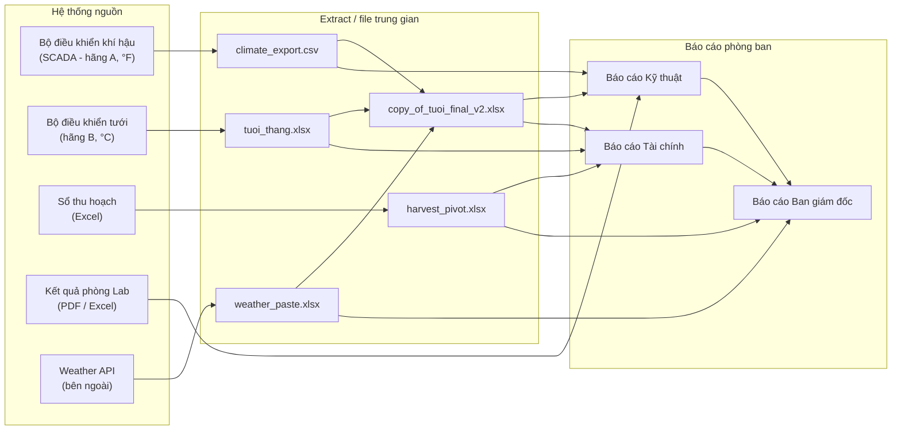
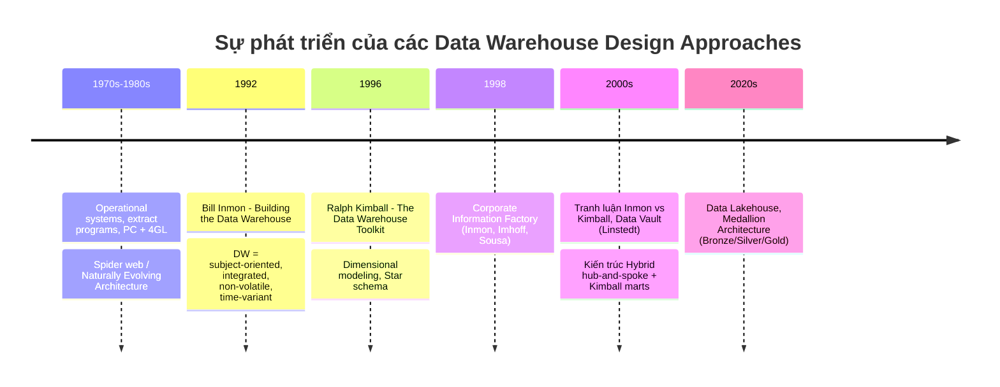
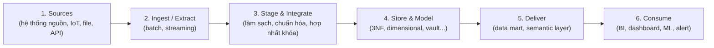
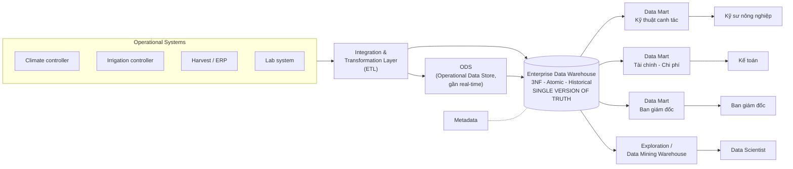
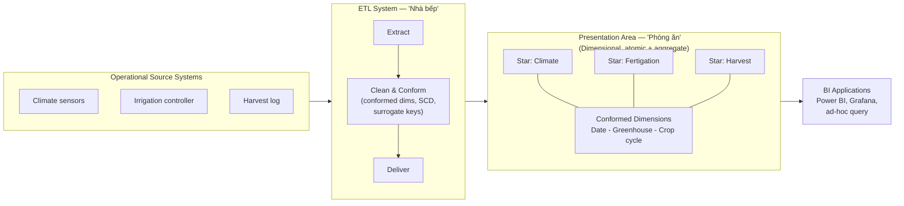
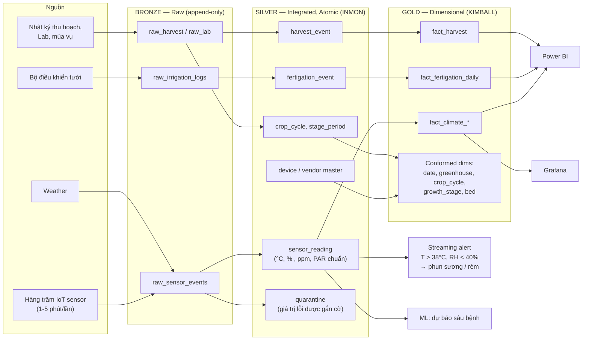
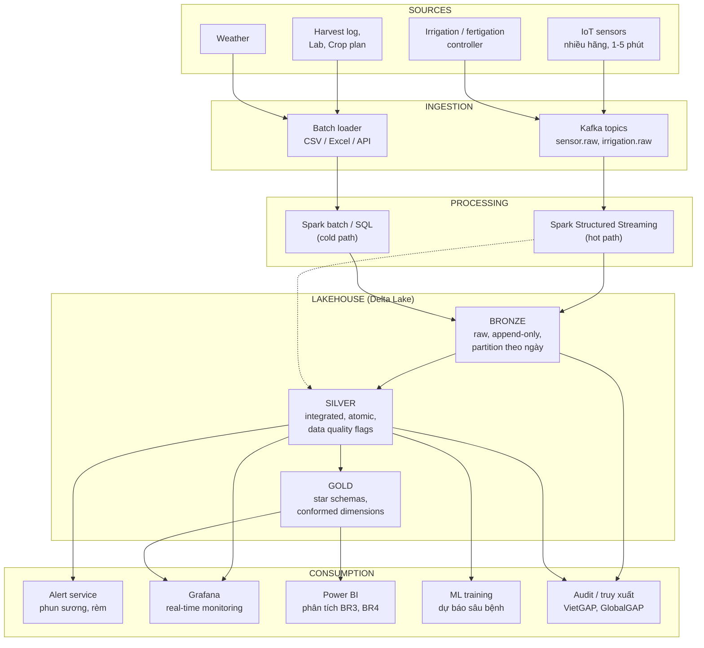
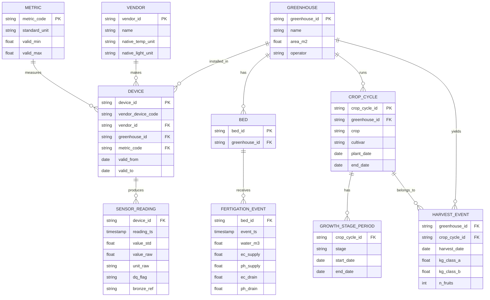
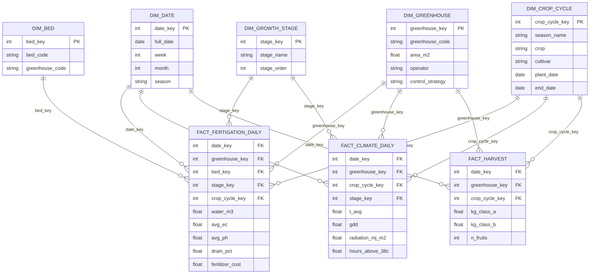
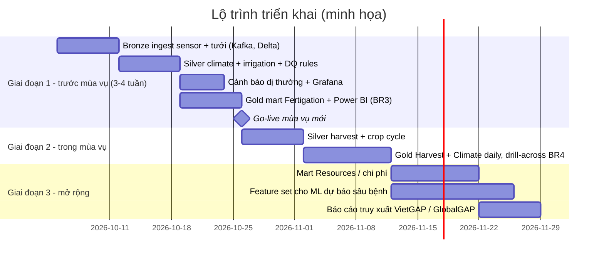

# Data Warehouse Design Approaches — Inmon, Kimball, Hybrid (Medallion)
## & Áp dụng cho *Smart Greenhouse Management System* (Domain: Agriculture)

> Research notes cho môn Data Engineering. Sơ đồ viết bằng **Mermaid** (xem được trên GitHub, VS Code + Mermaid extension, Obsidian, Notion, hoặc dán vào https://mermaid.live). Bản PNG của 10 sơ đồ có sẵn trong thư mục `dwh_diagrams/` để dùng cho slide.

---

## Mục lục

1. [Đặt vấn đề & Bối cảnh lịch sử](#1-đặt-vấn-đề--bối-cảnh-lịch-sử)
2. [Bản chất của một Design Approach](#2-bản-chất-của-một-design-approach)
3. [Top-down Approach — Inmon](#3-top-down-approach--inmon)
4. [Bottom-up Approach — Kimball](#4-bottom-up-approach--kimball)
5. [Hybrid Approach & Kiến trúc Medallion](#5-hybrid-approach--kiến-trúc-medallion-lakehouse)
6. [So sánh 3 approaches](#6-so-sánh-3-approaches)
7. [Case Study: Smart Greenhouse Management System](#7-case-study-smart-greenhouse-management-system)
8. [Kết luận](#8-kết-luận)
9. [Tài liệu tham khảo](#9-tài-liệu-tham-khảo)

---

## 1. Đặt vấn đề & Bối cảnh lịch sử

### 1.1. Vì sao không nên thiết kế Data Warehouse "tùy hứng"?

Trước khi khái niệm Data Warehouse ra đời (thập niên 1970–1980), doanh nghiệp chủ yếu có các **hệ thống tác nghiệp (operational systems)** — mỗi hệ thống phục vụ một ứng dụng riêng. Khi nhu cầu phân tích xuất hiện, cách làm phổ biến là viết **extract program**: chương trình đọc dữ liệu từ hệ thống nguồn, lọc theo tiêu chí, rồi ghi ra một file khác để phân tích. Sự bùng nổ của PC, công cụ 4GL và spreadsheet khiến *ai cũng có thể tự extract*.

Inmon (Building the Data Warehouse, Ch.1) gọi môi trường phát triển tự phát này là **"Naturally Evolving Architecture"** — hình thành khi tổ chức xử lý kiến trúc phần cứng/phần mềm với thái độ *laissez-faire* (để mặc tự phát). Kết quả là: *extract của extract, rồi extract của extract của extract…* Inmon dẫn ví dụ có tổ chức lớn chạy tới khoảng **45.000 extract mỗi ngày**.

### 1.2. Hiện tượng "The Spider Web" (Mạng nhện)

Khi vẽ các luồng extract chồng chéo giữa hệ thống nguồn, phòng ban, file trung gian và báo cáo, bức tranh trông giống một **mạng nhện**: không ai nắm được dữ liệu đi từ đâu tới đâu, qua bao nhiêu bước biến đổi.

Minh họa "mạng nhện" trong bối cảnh một trang trại nhà kính *chưa có* Data Warehouse:

### 1.3. Hệ quả 1 — "Lack of Data Credibility" (Mất độ tin cậy của dữ liệu)

Ví dụ kinh điển của Inmon: hai phòng ban cùng mang báo cáo tới cuộc họp — một bên nói hoạt động **giảm 15%**, bên kia nói **tăng 10%**. Ban lãnh đạo không biết tin ai, và rốt cuộc phải ra quyết định dựa trên *"chính trị và cá tính"* thay vì dữ liệu.

**Phiên bản nhà kính:** Phòng Kỹ thuật báo cáo *"lượng nước tưới Nhà kính 2 tháng này tăng 10%"*, Phòng Tài chính (dựa trên hóa đơn nước) báo *"giảm 15%"*.

Inmon chỉ ra **5 nguyên nhân gốc rễ**:

| # | Nguyên nhân (Inmon) | Bản chất | Ví dụ trong nhà kính |
|---|---|---|---|
| 1 | **No time basis of data** | Dữ liệu được extract ở các thời điểm khác nhau, trong khi dữ liệu luôn thay đổi | Kỹ thuật export lúc 6h sáng, Tài chính export lúc 18h → "trung bình ngày" khác nhau |
| 2 | **Algorithmic differential** | Mỗi bên dùng thuật toán/tiêu chí lọc khác nhau | Một bên tính nhiệt độ TB 24h, bên kia chỉ tính ban ngày; một bên loại cảm biến lỗi, bên kia không |
| 3 | **Levels of extraction** | Extract nhiều tầng làm sai lệch cộng dồn | CSV → pivot → copy sang file khác → báo cáo (mỗi tầng làm tròn / lọc thêm) |
| 4 | **Problem of external data** | Dữ liệu bên ngoài được đưa vào mà mất danh tính, nguồn gốc | Dán dữ liệu thời tiết từ API vào Excel, không ghi nguồn, không rõ múi giờ |
| 5 | **No common source of data from the beginning** | Không có nguồn chung được đồng bộ | Sản lượng lấy từ sổ thu hoạch vs lấy từ phiếu xuất kho bán hàng |

### 1.4. Hệ quả 2 & 3 — Productivity và "From Data to Information"

- **Problems with productivity:** Để làm một báo cáo toàn doanh nghiệp, phải đi tìm dữ liệu trong nhiều hệ thống, nhiều công nghệ, nhiều kỹ năng khác nhau. Điều tệ nhất: *công sức làm báo cáo thứ nhất không giúp gì cho báo cáo thứ hai* — mỗi lần lại làm lại từ đầu.
- **Inability to go from data to information:** Một câu hỏi đơn giản như *"năm nay khác 5 năm trước thế nào?"* không trả lời được vì (1) các ứng dụng không được thiết kế để tích hợp và (2) hệ thống tác nghiệp chỉ giữ dữ liệu hiện tại / lịch sử ngắn.
  - *Nhà kính:* Bộ điều khiển khí hậu chỉ giữ log vài tháng → không thể so sánh điều kiện môi trường giữa các mùa vụ (đúng yêu cầu BR4, BR6 của project).

### 1.5. Góc nhìn của Kimball về cùng vấn đề

Trong *The Data Warehouse Toolkit* (Ch.1), Kimball & Ross mô tả vấn đề qua **tiếng nói của người dùng nghiệp vụ**: "chúng tôi thu thập hàng tấn dữ liệu nhưng không truy cập được", "cần slice and dice dữ liệu mọi cách", "chỉ cho tôi thấy điều gì quan trọng", và đặc biệt: **"chúng tôi dành cả buổi họp để tranh cãi ai có số đúng thay vì ra quyết định"** — chính là *lack of data credibility* dưới góc nhìn người dùng.

Từ đó Kimball đặt ra các **mục tiêu của hệ thống DW/BI**: thông tin dễ truy cập; trình bày nhất quán; thích ứng với thay đổi; kịp thời; an toàn (bảo vệ tài sản thông tin); là nền tảng tin cậy cho ra quyết định; và phải được cộng đồng nghiệp vụ chấp nhận sử dụng.

Kimball cũng cảnh báo một "mạng nhện" phiên bản khác: **Independent Data Mart Architecture** — mỗi phòng ban tự xây data mart riêng, tự ETL riêng, không dùng chung dimension → các mart "stovepipe" cho ra số liệu mâu thuẫn nhau. Đây chính là lý do Kimball đưa ra **Conformed Dimensions & Bus Architecture** (Mục 4).

### 1.6. Hoàn cảnh ra đời các Design Approaches (timeline)

### 1.7. Tại sao nên dùng Design Approach?

Một Design Approach là **"bản thiết kế có kỷ luật"** thay cho sự tự phát. Nó giải quyết trực tiếp các vấn đề trên:

| Vấn đề (spider web) | Design approach giải quyết bằng |
|---|---|
| No time basis | Load theo lịch/đồng bộ, mọi bản ghi có timestamp (time-variant) |
| Algorithmic differential | Định nghĩa metric/nghiệp vụ một lần, dùng chung (integrated / conformed) |
| Levels of extraction | Luồng dữ liệu một chiều, số tầng xác định trước (source → staging → DW → mart) |
| External data | Metadata, lineage, lưu nguồn gốc |
| No common source | Single version of truth (EDW của Inmon / conformed dimensions của Kimball) |
| Productivity | Tầng dữ liệu tái sử dụng — báo cáo thứ 2 xây trên nền của báo cáo thứ nhất |
| Data → Information | Lưu lịch sử dài hạn, dữ liệu đã tích hợp, mô hình thân thiện truy vấn |

---

## 2. Bản chất của một Design Approach

Một Design Approach **phải định nghĩa được toàn bộ vòng đời của dữ liệu** — từ lúc lấy từ nguồn cho đến khi end user sử dụng:

Mỗi approach phải trả lời được **3 câu hỏi cốt lõi**:

1. **Xây Warehouse từ đâu?** — Từ mô hình dữ liệu toàn doanh nghiệp, hay từ một quy trình nghiệp vụ cụ thể?
2. **Theo quy trình nào?** — Thiết kế tổng thể trước rồi mới triển khai, hay triển khai từng phần rồi ghép lại?
3. **Phục vụ ai trước?** — Tổ chức / IT (sự nhất quán) hay người dùng nghiệp vụ (giá trị sớm)?

**Các approach tồn tại** (không đầy đủ): Independent Data Marts (anti-pattern), Top-down (Inmon/CIF), Bottom-up (Kimball Bus Architecture), Hybrid (hub-and-spoke + Kimball marts), Data Vault 2.0, Anchor Modeling, Federated DW, và gần đây là Data Mesh (tiếp cận tổ chức hơn là mô hình dữ liệu).

Tài liệu này tập trung vào **3 approach nổi bật nhất**: **Top-down (Inmon)**, **Bottom-up (Kimball)** và **Hybrid** — vì hai approach đầu là hai trường phái gốc, và Hybrid là cách ngành công nghiệp thực sự triển khai ngày nay (dưới tên Medallion/Lakehouse).

---

## 3. Top-down Approach — Inmon

### 3.1. Triết lý: *Enterprise-first*

Bill Inmon ("cha đẻ của Data Warehouse") cho rằng: **phải xây dựng một kho dữ liệu tích hợp cho toàn doanh nghiệp trước**, làm *single version of truth*, rồi mới từ đó sinh ra các data mart cho từng phòng ban. Nói cách khác: *"integrate before you decorate"*.

Định nghĩa kinh điển (Inmon, Ch.2):

> A data warehouse is a **subject-oriented, integrated, nonvolatile, and time-variant** collection of data in support of management's decisions.

| Đặc tính | Ý nghĩa | Ví dụ nhà kính |
|---|---|---|
| **Subject-oriented** | Tổ chức theo chủ đề nghiệp vụ, không theo ứng dụng | Chủ đề: *Nhà kính, Thiết bị, Mùa vụ, Môi trường, Tưới-dinh dưỡng, Thu hoạch* — thay vì "dữ liệu của phần mềm SCADA" |
| **Integrated** | Thống nhất mã hóa, tên gọi, đơn vị đo giữa các nguồn | °F và °C → °C; lux và W/m² → một đơn vị; mã thiết bị các hãng → một mã chung |
| **Non-volatile** | Nạp vào rồi chỉ đọc, không update từng bản ghi; thay đổi được lưu thành bản ghi mới | Không sửa số đo cũ; hiệu chỉnh → thêm bản ghi mới có đánh dấu |
| **Time-variant** | Mọi bản ghi gắn với thời điểm; lưu lịch sử dài (5–10 năm) | Lưu 3–5 năm cho VietGAP/GlobalGAP |

### 3.2. Kiến trúc CIF (Corporate Information Factory)

Inmon mô tả **Architected Environment** gồm 4 mức: *Operational → Atomic/Data Warehouse → Departmental (Data Mart) → Individual*. CIF (Inmon, Imhoff & Sousa, 1998) phát triển thành kiến trúc "hub-and-spoke":

Điểm then chốt: data mart trong CIF là **dependent data marts** — *chỉ* được nạp từ EDW, không bao giờ nạp trực tiếp từ nguồn → đảm bảo mọi phòng ban nhìn cùng một số liệu.

### 3.3. Bản chất 3NF (Third Normal Form)

EDW của Inmon được mô hình hóa theo **ERD chuẩn hóa (3NF)**, xuất phát từ **corporate data model** (mô hình dữ liệu toàn doanh nghiệp). Lý do:

- **Loại bỏ dư thừa** → mỗi sự thật (fact) chỉ lưu một chỗ, không mâu thuẫn.
- **Trung lập với câu hỏi** → EDW không được tối ưu cho một báo cáo nào, nên có thể phục vụ cả những câu hỏi *chưa biết trước* trong tương lai.
- **Ổn định trước thay đổi nghiệp vụ** → thêm phòng ban mới chỉ cần thêm data mart, không sửa lõi.

Ví dụ nhỏ (3NF): `GREENHOUSE (greenhouse_id, name, area_m2)` — `DEVICE (device_id, greenhouse_id, vendor_id, metric_code)` — `VENDOR (vendor_id, name, unit_system)` — `SENSOR_READING (device_id, ts, value)`. Để biết "nhiệt độ trung bình Nhà kính 2" phải join 3–4 bảng → **không thân thiện với người dùng cuối**, vì vậy cần data mart phía sau.

### 3.4. Mức nguyên tử (Atomic Granularity)

**Granularity** = mức độ chi tiết của đơn vị dữ liệu. Inmon coi đây là quyết định thiết kế quan trọng nhất vì nó ảnh hưởng tới *khối lượng dữ liệu* và *loại câu hỏi trả lời được*.

- **Granularity thấp (atomic)** = chi tiết nhất: từng lần đo cảm biến 5 phút, từng lần tưới.
- **Granularity cao** = đã tổng hợp: nhiệt độ trung bình theo ngày.

EDW lưu ở **mức nguyên tử**: dữ liệu đã tổng hợp thì *không thể* "giải nén" ngược lại, còn dữ liệu nguyên tử thì luôn tổng hợp lên được. Inmon cũng đề xuất **dual levels of granularity** (giữ cả dữ liệu chi tiết lẫn dữ liệu tóm tắt nhẹ) khi khối lượng quá lớn.

### 3.5. Quy trình xây dựng

1. Xây **corporate data model** (các subject area và quan hệ).
2. Thiết kế EDW 3NF theo mô hình đó.
3. Xây ETL tích hợp từ các nguồn → EDW (theo từng subject area — Inmon cũng khuyến nghị làm *lặp*, không phải big-bang).
4. Sinh các dependent data mart theo nhu cầu phòng ban.

### 3.6. Ưu điểm & Hạn chế

| Ưu điểm | Hạn chế |
|---|---|
| **Single version of truth** — nhất quán toàn doanh nghiệp, giải quyết triệt để *lack of credibility* | **Time-to-value chậm** — phải có mô hình doanh nghiệp trước, lâu mới có báo cáo đầu tiên |
| Lưu lịch sử nguyên tử, non-volatile → tốt cho **kiểm toán, truy xuất nguồn gốc, ML** | **Chi phí đầu tư ban đầu cao**, cần đội ngũ data modeler giỏi |
| Linh hoạt với câu hỏi chưa biết trước; thêm mart mới dễ | EDW 3NF **khó truy vấn trực tiếp** cho người dùng nghiệp vụ → vẫn phải xây mart |
| Ít dư thừa dữ liệu trong lõi | Tốn thêm một tầng lưu trữ + ETL (EDW → mart) |
| Tách bạch rõ operational và analytical | Rủi ro dự án lớn: nghiệp vụ thay đổi trong lúc đang mô hình hóa |

---

## 4. Bottom-up Approach — Kimball

### 4.1. Triết lý: *Process-first*

Ralph Kimball tiếp cận từ **quy trình nghiệp vụ (business process)** và **người dùng**: chọn một quy trình quan trọng nhất (ví dụ: *tưới – bón phân*), xây mô hình dimensional cho nó, giao giá trị ngay; sau đó thêm dần các quy trình khác. Các phần được gắn kết với nhau bằng **conformed dimensions** trên **bus architecture**, nên tổng thể vẫn là một DW doanh nghiệp — *"the data warehouse is the union of its data marts"* (dữ liệu được tích hợp qua chiều dùng chung).

### 4.2. Kiến trúc Kimball DW/BI

Kimball chia hệ thống thành 4 thành phần (Toolkit, Ch.1) và dùng **ẩn dụ nhà hàng**: *ETL là nhà bếp* (khách không vào), *Presentation Area là phòng ăn* (nơi món ăn được trình bày đẹp, đúng chuẩn).

Khác biệt quan trọng so với Inmon: **không có tầng EDW 3NF** mà người dùng không truy cập. Staging trong ETL là *vùng tạm*, không phải kho tích hợp lâu dài; dữ liệu nguyên tử được lưu **ngay trong fact tables** của presentation area.

### 4.3. Mô hình Dimensional — Star Schema

- **Fact table:** lưu *số đo* (measurements) của một sự kiện nghiệp vụ, ở một *grain* xác định. VD: lượng nước tưới (m³), EC, pH.
- **Dimension table:** lưu *ngữ cảnh mô tả* — ai, cái gì, ở đâu, khi nào. VD: ngày, nhà kính, luống, giai đoạn sinh trưởng.
- **Star schema:** fact ở giữa, dimension xung quanh, **phi chuẩn hóa (denormalized)** → ít join, dễ hiểu, truy vấn nhanh, phù hợp kéo-thả trên BI.
- **Snowflake schema:** chuẩn hóa dimension thành nhiều bảng con — Kimball *không khuyến khích* vì làm phức tạp truy vấn.
- **Slowly Changing Dimensions (SCD):** Type 1 (ghi đè), Type 2 (thêm dòng mới, lưu lịch sử), Type 3 (thêm cột giá trị cũ)… VD: cảm biến chuyển từ Nhà kính 1 sang Nhà kính 3 → SCD Type 2 cho `dim_device`.

### 4.4. Quy trình thiết kế 4 bước (Four-Step Dimensional Design Process)

| Bước | Nội dung | Ví dụ (BR3 — tưới & dinh dưỡng) |
|---|---|---|
| 1. **Select the business process** | Chọn quy trình nghiệp vụ | Tưới – bón phân (fertigation) |
| 2. **Declare the grain** | Một dòng fact đại diện cho cái gì | 1 dòng = 1 luống × 1 ngày |
| 3. **Identify the dimensions** | Ngữ cảnh mô tả | Date, Greenhouse, Bed, Growth stage, Crop cycle |
| 4. **Identify the facts** | Số đo | water_m3, avg_ec, avg_ph, drain_pct, fertilizer_cost |

### 4.5. Conformed Dimensions & Bus Architecture

- **Conformed dimension:** dimension được định nghĩa **một lần** trong ETL và **dùng chung** cho nhiều fact table (cùng khóa, cùng thuộc tính, cùng ý nghĩa). Nhờ đó có thể **drill-across**: ghép kết quả từ hai quy trình độc lập.
- **Enterprise Bus Architecture:** "xa lộ" chung gồm các conformed dimensions; mỗi quy trình nghiệp vụ mới chỉ việc "cắm" vào bus.
- **Bus Matrix:** công cụ lập kế hoạch — hàng là quy trình nghiệp vụ, cột là dimension; ô đánh dấu = quy trình dùng dimension đó. Đây là cách Kimball kết hợp *lập kế hoạch tổng thể (top-down)* với *triển khai từng phần (bottom-up)*.

(Bus Matrix cụ thể cho Smart Greenhouse ở Mục 7.8.)

### 4.6. Các "ngộ nhận" về Dimensional Modeling (Toolkit, Ch.1)

Kimball phản bác 5 myths: (1) chỉ dành cho dữ liệu tổng hợp — *sai, fact table nên lưu mức atomic*; (2) chỉ dành cho phòng ban — *sai, tổ chức theo quy trình nghiệp vụ, không theo phòng ban*; (3) không scale — *sai*; (4) chỉ cho câu hỏi biết trước — *sai*; (5) không tích hợp được — *sai, nhờ conformed dimensions*. Điều này quan trọng khi so sánh công bằng với Inmon.

### 4.7. Ưu điểm & Hạn chế

| Ưu điểm | Hạn chế |
|---|---|
| **Time-to-value nhanh** — có dashboard sau vài tuần | Phụ thuộc **kỷ luật conformed dimensions**; nếu buông lỏng → trượt về *independent data marts* (spider web của mart) |
| Mô hình **trực quan**, người dùng nghiệp vụ hiểu được | Không có tầng tích hợp bền vững độc lập với báo cáo; logic làm sạch nằm trong ETL từng luồng |
| **Hiệu năng truy vấn tốt** (ít join), hợp BI kéo-thả | Mô hình gắn với câu hỏi đã biết → câu hỏi mới có thể phải thiết kế fact mới |
| Triển khai **gia tăng, Agile**, rủi ro thấp | Fact/dimension bị *cập nhật* (SCD1, late-arriving) → không đảm bảo tuyệt đối tính bất biến cho kiểm toán |
| Bus matrix cho lộ trình rõ ràng | Không giữ dữ liệu *thô nguyên bản* trước làm sạch → khó truy vết khi thanh tra |

---

## 5. Hybrid Approach & Kiến trúc Medallion (Lakehouse)

### 5.1. Mô hình Lai: Inmon Staging/Core + Kimball Marts

Chính Kimball & Ross trong Toolkit (Ch.1) đã mô tả kiến trúc **"Hybrid Hub-and-Spoke and Kimball Architecture"**: dùng một tầng lõi tích hợp kiểu Inmon (atomic, chuẩn hóa, non-volatile) làm nền, nhưng tầng phục vụ người dùng được xây theo **Kimball dimensional + conformed dimensions**.

Ý tưởng: **mỗi tầng dùng approach giỏi nhất cho vai trò của tầng đó**.

- Tầng lõi cần *nhất quán, bất biến, lịch sử, nguyên tử* → **Inmon**.
- Tầng người dùng cần *dễ hiểu, nhanh, giao giá trị theo từng quy trình* → **Kimball**.

### 5.2. Hybrid trong kỹ thuật dữ liệu hiện đại = Medallion Architecture

Kiến trúc Medallion (phổ biến bởi Databricks trên nền Lakehouse) chính là hiện thân của Hybrid:

| Tầng Medallion | Định nghĩa (Databricks) | Tương ứng approach | Vai trò trong Smart Greenhouse |
|---|---|---|---|
| **Bronze** | Dữ liệu thô, giữ nguyên định dạng nguồn, append-only | *Staging / landing* + tính **non-volatile** của Inmon | Nhận dữ liệu sensor thô (°F/°C lẫn lộn, giá trị ảo…) |
| **Silver** | Dữ liệu đã làm sạch, validate, khử trùng lặp, chuẩn hóa | **Inmon**: integrated, subject-oriented, atomic | Chuẩn hóa đơn vị, lọc outlier, hợp nhất mã thiết bị; lưu atomic 3–5 năm |
| **Gold** | Dữ liệu tinh chỉnh cho phân tích; Databricks khuyến nghị dùng **dimensional model** | **Kimball**: star schema, conformed dimensions | Fact/Dimension cắm vào Power BI / Grafana |

### 5.3. Ưu điểm & Hạn chế của Hybrid

| Ưu điểm | Hạn chế |
|---|---|
| Kết hợp **nhất quán + bất biến** (Inmon) với **dễ dùng + nhanh** (Kimball) | **Nhiều tầng hơn** → nhiều pipeline, nhiều chi phí lưu trữ/compute hơn |
| Bronze giữ dữ liệu gốc → **reprocess** được khi phát hiện lỗi làm sạch | Cần quản trị rõ: logic nào ở Silver, logic nào ở Gold (tránh trùng lặp) |
| Silver phục vụ đồng thời BI, ML, audit | Nếu thiết kế Silver quá "hoàn hảo" ngay từ đầu → rơi lại vào điểm yếu chậm của Inmon |
| Gold triển khai cuốn chiếu theo bus matrix → vẫn **Agile** | Độ trễ end-to-end cao hơn nếu chỉ chạy batch (cần streaming cho luồng nóng) |
| Phù hợp tự nhiên với Lakehouse (Delta Lake / Iceberg, time travel) | Đòi hỏi đội ngũ hiểu cả hai trường phái |

---

## 6. So sánh 3 approaches

### 6.1. Trả lời 3 câu hỏi cốt lõi

| Câu hỏi | Top-down (Inmon) | Bottom-up (Kimball) | Hybrid (Medallion) |
|---|---|---|---|
| **Xây từ đâu?** | Corporate data model → EDW | Một business process quan trọng nhất | Tầng Bronze/Silver chung (mỏng) + mart của process quan trọng nhất |
| **Theo quy trình nào?** | Thiết kế tổng thể → EDW → dependent marts | 4-step design, lặp theo bus matrix | Ingest thô → chuẩn hóa theo subject → mart theo process, lặp |
| **Phục vụ ai trước?** | Tổ chức/IT (sự nhất quán) | Người dùng nghiệp vụ (giá trị sớm) | Cả hai: lõi cho tổ chức/audit/ML, Gold cho người dùng |

### 6.2. Bảng so sánh chi tiết

| Tiêu chí | Inmon | Kimball | Hybrid / Medallion |
|---|---|---|---|
| Triết lý | Enterprise-first | Process-first | Layer-appropriate |
| Mô hình lõi | 3NF (ERD) | Dimensional (star) | Raw → 3NF-like/integrated → Star |
| Granularity lưu trữ | Atomic ở EDW | Atomic trong fact + aggregate | Atomic ở Bronze & Silver, atomic + aggregate ở Gold |
| Data mart | Dependent (từ EDW) | Là chính DW (qua conformed dims) | Gold, sinh từ Silver |
| Single version of truth | EDW | Conformed dimensions | Silver (dữ liệu) + conformed dims (ngữ nghĩa) |
| Time-to-value | Chậm (tháng–năm) | Nhanh (tuần) | Nhanh–trung bình |
| Chi phí ban đầu | Cao | Thấp | Trung bình |
| Dễ dùng cho end user | Thấp (cần mart) | Cao | Cao (Gold) |
| Kiểm toán / truy xuất nguồn gốc | Tốt | Trung bình | Rất tốt (có cả dữ liệu thô) |
| Linh hoạt câu hỏi mới | Cao | Trung bình | Cao |
| Phục vụ ML | Tốt | Trung bình (dữ liệu đã được "định hình" cho BI) | Tốt (Silver) |
| Real-time / streaming | Không phải trọng tâm (ODS hỗ trợ một phần) | Không phải trọng tâm | Tự nhiên (Bronze/Silver streaming) |
| Rủi ro chính | Dự án kéo dài, nghiệp vụ đổi | Mart silo nếu mất kỷ luật | Phức tạp vận hành, trùng logic |
| Phù hợp khi | Tổ chức lớn, nhiều phòng ban, quy định chặt | Cần kết quả nhanh, team nhỏ | Dữ liệu IoT/big data, cần cả BI, ML, audit |

---

## 7. Case Study: Smart Greenhouse Management System

### 7.1. Bối cảnh & Stakeholders

Trang trại nhà kính công nghệ cao với hàng trăm cảm biến IoT từ nhiều nhà cung cấp, cần hệ thống dữ liệu phục vụ: vận hành thời gian thực, tối ưu tưới – dinh dưỡng, đánh giá năng suất, chứng nhận xuất khẩu và AI.

| Nhóm người dùng | Nhu cầu chính | BR liên quan |
|---|---|---|
| Nhân viên vận hành nhà kính | Cảnh báo tức thời, điều khiển phun sương / rèm | BR1 |
| Kỹ sư dữ liệu / IT | Dữ liệu sạch, thống nhất từ nhiều hãng | BR2 |
| Kỹ sư nông nghiệp | Dashboard tưới & dinh dưỡng theo giai đoạn sinh trưởng | BR3 |
| Ban giám đốc | So sánh năng suất giữa nhà kính, mùa vụ | BR4, BR5 |
| Thanh tra VietGAP / GlobalGAP | Truy xuất nhật ký môi trường, tưới, bón phân | BR6 |
| Data Scientist | Dữ liệu sạch, atomic để huấn luyện mô hình sâu bệnh | BR6 |

### 7.2. Dataset

**Base dataset:** [Autonomous Greenhouse Challenge (AGC) — 2nd Edition](https://www.kaggle.com/datasets/piantic/autonomous-greenhouse-challengeagc-2nd-2019) (Wageningen University & Research).

- Cây trồng: **cà chua cherry**, trồng trong **6 compartment nhà kính** (mỗi compartment ~96 m²) tại Bleiswijk, Hà Lan; thí nghiệm kéo dài ~6 tháng (theo bài báo mô tả: 16/12/2019 – 29/05/2020).
- 5 compartment do 5 đội AI điều khiển (The Automators, AiCU, IUA.CAAS, Digilog, Automatoes) + 1 compartment tham chiếu do các chuyên gia trồng trọt Hà Lan điều khiển thủ công.
- Dữ liệu trao đổi và đo ở **chu kỳ 5 phút**; gồm khí hậu trong/ngoài nhà kính, tưới, trạng thái thiết bị, setpoint, tiêu thụ tài nguyên, thu hoạch, thông số cây trồng, chất lượng quả, phân tích mẫu nước tưới/nước thoát, cảm biến giá thể (slab).

Nhóm file chính (mỗi đội một thư mục — *nên đối chiếu tên cột với file thực tế*):

| File | Tần suất | Nội dung (ví dụ cột) | Dùng cho |
|---|---|---|---|
| `GreenhouseClimate.csv` | 5 phút | Tair, Rhair, CO2air, HumDef, Tot_PAR, lamps, screens, ventilation, pipe temp, EC/pH drain, lượng tưới | BR1, BR2, BR3, BR6 |
| `Weather.csv` | 5 phút | Nhiệt độ, ẩm độ ngoài trời, bức xạ toàn phần, gió, mưa | BR4 |
| `Resources.csv` | Ngày | Nhiệt tiêu thụ, điện, CO2, nước tưới, nước thoát | BR3, chi phí |
| `Production.csv` | Theo lần thu hoạch | Sản lượng quả loại A / loại B (kg/m²), số quả | BR4 |
| `CropParameters.csv` | Tuần | Tốc độ vươn thân, độ dày thân, số chùm quả, mật độ | BR3 (giai đoạn sinh trưởng) |
| `LabAnalysis.csv` | Định kỳ | EC, pH, ion dinh dưỡng của nước tưới & nước thoát | BR3, BR6 |
| `GrodanSens.csv` | Liên tục | Độ ẩm, EC, nhiệt độ giá thể | BR2, BR3 |
| `TomQuality.csv` | ~2 tuần | Brix, độ chua, độ cứng, trọng lượng quả | BR4 |

**Backup datasets** theo từng BR (đã chọn trong bảng yêu cầu): smart-greenhouse-iot-dataset-for-rl (BR1), iot-agriculture-2024 (BR2), irrigation-water-requirement-prediction (BR3), AGC 2nd (BR4), greenhouse-plant-growth-metrics (BR5), crop-yield-prediction (BR6).

**Lưu ý dữ liệu (trung thực khi trình bày):**
- AGC 2nd chỉ có **1 mùa vụ** → BR4 "so sánh giữa các mùa vụ" cần ghép thêm dataset khác hoặc coi mỗi compartment/đội là một đơn vị so sánh; phần "giữa các nhà kính" thì AGC đáp ứng tốt (6 compartment).
- AGC không có sẵn nhãn **giai đoạn sinh trưởng** và **luống** → cần bảng `growth_stage_period` do kỹ sư định nghĩa (theo ngày trồng, ngày ra hoa chùm đầu, ngày thu hoạch đầu) và dùng dataset BR3 cho mức luống.
- Đa hãng (°F/°C, lux/W/m², giá trị ảo) cho BR2: AGC tương đối sạch → dùng iot-agriculture-2024 hoặc **tiêm lỗi có kiểm soát** (inject) vào dữ liệu để chứng minh tầng Silver hoạt động — và dùng chính phần lỗi đã biết đó để đo độ chính xác làm sạch.

### 7.3. Phân tích 6 Business Requirements → yêu cầu kiến trúc

| BR | Tên | Yêu cầu kiến trúc rút ra | Thuộc tính dữ liệu cốt lõi | Tầng đáp ứng |
|---|---|---|---|---|
| **BR1** | Giám sát vi khí hậu real-time & cảnh báo | Ingestion tốc độ cao, time-series, xử lý streaming | Velocity, append-only | Bronze (streaming) + Silver streaming → Alert |
| **BR2** | Làm sạch, khử nhiễu, chuẩn hóa đa nguồn | Tầng kiểm soát chất lượng & chuẩn hóa **tập trung** | *Integrated* (Inmon) | Silver |
| **BR3** | Tối ưu tưới & dinh dưỡng theo giai đoạn | Mô hình đa chiều, kéo-thả mượt | Dimensional (Kimball) | Gold — star Fertigation |
| **BR4** | Tương quan môi trường ↔ năng suất | Drill-across 2 quy trình độc lập | **Conformed dimensions** (Kimball) | Gold — bus matrix |
| **BR5** | Go-live trong 3–4 tuần, cuốn chiếu | Phát triển gia tăng | Incremental / Agile (Kimball) | Toàn kiến trúc — Gold theo từng process |
| **BR6** | Lưu nguyên tử bất biến 3–5 năm (VietGAP, ML) | Non-volatile, time-variant, atomic, không tổng hợp trước | Định nghĩa DW của **Inmon** | Bronze + Silver (append-only, insert-only) |

### 7.4. Ma trận đáp ứng: vì sao phải là Hybrid?

✅ đáp ứng tốt · ⚠️ đáp ứng một phần / phải bổ sung · ❌ mâu thuẫn với approach

| BR | Pure Inmon | Pure Kimball | Hybrid (Medallion) |
|---|---|---|---|
| BR1 Real-time | ⚠️ CIF thiên về batch; ODS hỗ trợ một phần | ⚠️ ETL thiên về batch | ✅ Bronze/Silver streaming |
| BR2 Chuẩn hóa tập trung | ✅ Integration layer + EDW | ⚠️ Làm sạch trong ETL từng luồng, không có tầng tích hợp lưu trữ độc lập | ✅ Silver |
| BR3 Star schema kéo-thả | ⚠️ Phải xây thêm dependent mart | ✅ | ✅ Gold |
| BR4 Conformed dimensions | ⚠️ Nhất quán nhờ EDW nhưng mart ra đời muộn | ✅ Bus matrix | ✅ Gold + bus matrix |
| BR5 Go-live 3–4 tuần | ❌ Cần corporate data model trước | ✅ | ✅ (Bronze/Silver mỏng + 1 mart) |
| BR6 Atomic, bất biến 3–5 năm | ✅ | ⚠️ Fact atomic có, nhưng không giữ dữ liệu thô; SCD1/late-arriving làm dữ liệu bị cập nhật | ✅ Bronze + Silver |

**Kết luận phân tích:** các BR **kéo về hai phía ngược nhau** — BR2 và BR6 đòi hỏi đặc tính của Inmon (integrated, non-volatile, atomic), trong khi BR3, BR4, BR5 đòi hỏi đặc tính của Kimball (dimensional, conformed, incremental); BR1 đòi hỏi năng lực streaming mà cả hai approach gốc không đặt trọng tâm. **Không approach thuần túy nào đáp ứng đủ 6 BR** → chọn **Hybrid, hiện thực hóa bằng Medallion Architecture**.

### 7.5. Kiến trúc đề xuất (tổng thể)

Gợi ý công nghệ (từ danh sách môn học): **Kafka** (ingest) + **Spark Streaming** (xử lý) + **Databricks / Delta Lake** (Lakehouse, time travel, ACID) + Power BI / Grafana. *Giải pháp thay thế để so sánh:* xem Mục 7.11.

**Ước lượng khối lượng** (minh họa, để biện luận chọn Lakehouse): 500 sensor × 1 bản ghi/phút = 720.000 bản ghi/ngày ≈ 263 triệu/năm ≈ **1,3 tỷ bản ghi trong 5 năm** (chưa tính nhiều metric mỗi bản ghi) → cần lưu trữ cột (Parquet/Delta), partition theo ngày, chi phí lưu trữ rẻ.

### 7.6. Tầng Bronze — nhận dữ liệu thô (BR1, BR6)

- **Append-only**, giữ nguyên payload gốc (JSON/CSV), không sửa, không xóa.
- Thêm metadata kỹ thuật: `ingest_ts`, `source_system`, `vendor`, `file_name / kafka_offset`, `payload_hash`.
- Partition theo `ingest_date`; retention ≥ 5 năm (BR6) — có thể chuyển sang storage tier rẻ sau 1 năm.
- Vai trò: *bằng chứng gốc* cho thanh tra, và cho phép **reprocess** Silver khi phát hiện rule làm sạch sai.

Ví dụ `bronze.raw_sensor_events`: `ingest_ts | kafka_offset | vendor | device_code | payload (JSON) | payload_hash`.

### 7.7. Tầng Silver — chuẩn hóa & làm sạch theo tinh thần Inmon (BR2, BR6)

**Mô hình (subject-oriented, gần 3NF):**

**Quy tắc chất lượng dữ liệu (Data Quality rules):**

| Nhóm rule | Ví dụ | Xử lý |
|---|---|---|
| Quy đổi đơn vị | °F → °C: `(F − 32) × 5/9` | Lưu `value_std` (chuẩn) **và** `value_raw`, `unit_raw` (truy vết) |
| Quy đổi ánh sáng | lux ↔ W/m² (hệ số *xấp xỉ*, phụ thuộc phổ nguồn sáng; với ánh sáng mặt trời thường ~100–120 lux ≈ 1 W/m²) — hoặc quy tất cả về PAR (µmol/m²/s) | Ghi rõ hệ số dùng trong metadata |
| Kiểm tra miền vật lý | Độ ẩm không khí/đất ∈ [0, 100]%; nhiệt độ nhà kính ∈ [−10, 60]°C | Ngoài miền (VD 180%, −50°C) → `dq_flag = INVALID`, đưa vào **quarantine** |
| Đột biến (spike) | ΔT > 5°C trong 5 phút | `dq_flag = SUSPECT` |
| Cảm biến "đứng" | Cùng một giá trị N lần liên tiếp | `dq_flag = STUCK` |
| Pin yếu | Kết hợp mức pin thấp + giá trị bất thường | `dq_flag = DEVICE_FAULT`, báo bảo trì |
| Trùng lặp | Trùng `(device_id, reading_ts)` | Khử trùng lặp |
| Hợp nhất mã thiết bị | Mã thiết bị các hãng → `device_id` chung (bảng mapping, SCD theo `valid_from/valid_to`) | Chuẩn hóa khóa |
| Căn chỉnh thời gian | Chuyển về UTC (hiển thị Asia/Ho_Chi_Minh), gán bucket 5 phút | Chuẩn hóa thời gian |
| Thiếu dữ liệu | Khoảng trống giữa các lần đo | Gắn cờ; **không nội suy ở Silver** — chỉ nội suy ở Gold/feature ML |

**Nguyên tắc quan trọng cho BR6:** *không xóa và không ghi đè* giá trị lỗi — chỉ **gắn cờ**. Dữ liệu Silver luôn ở mức nguyên tử, không tổng hợp trước. Truy xuất trạng thái dữ liệu tại một thời điểm bằng điều kiện `ingest_ts <= thời điểm` trên Bronze/Silver append-only. *Lưu ý:* Delta Lake time travel chỉ phù hợp debug/rollback ngắn hạn (lịch sử bị dọn theo retention và `VACUUM`), không dùng làm cơ chế lưu trữ 3–5 năm — xem `DWH_Hybrid_Approach_Deep_Dive.md` mục 7.5.

**Liên kết BR1 ↔ BR2:** luật cảnh báo (T > 38°C, RH < 40%) phải chạy **sau** bước chuẩn hóa đơn vị — nếu chạy trên Bronze, một cảm biến báo 100°F (≈ 37,8°C, bình thường) sẽ bị hiểu nhầm là 100°C. Đồng thời chỉ bắn cảnh báo khi điều kiện kéo dài ≥ 2 chu kỳ đo và bản ghi không bị gắn cờ lỗi → tránh kích hoạt phun sương vì giá trị ảo do pin yếu.

### 7.8. Tầng Gold — Dimensional model theo Kimball (BR3, BR4)

**Bus Matrix:**

| Business process ↓ / Dimension → | Date | Time (5′) | Greenhouse | Bed | Device | Crop cycle | Growth stage | Quality class |
|---|---|---|---|---|---|---|---|---|
| Đo vi khí hậu (Climate monitoring) | ✔ | ✔ | ✔ | | ✔ | ✔ | ✔ | |
| Tưới – dinh dưỡng (Fertigation) | ✔ | | ✔ | ✔ | | ✔ | ✔ | |
| Tiêu thụ tài nguyên (Resources) | ✔ | | ✔ | | | ✔ | ✔ | |
| Thu hoạch (Harvest) | ✔ | | ✔ | | | ✔ | ✔ | ✔ |
| Chất lượng quả (Fruit quality) | ✔ | | ✔ | | | ✔ | ✔ | ✔ |

→ **Conformed dimensions** dùng chung: `dim_date`, `dim_greenhouse`, `dim_crop_cycle`, `dim_growth_stage`. Đây chính là "cầu nối" cho BR4.

**Khai báo grain:**

| Fact table | Loại | Grain (1 dòng = …) | Measures chính | BR |
|---|---|---|---|---|
| `fact_climate_reading` | Transaction | 1 nhà kính × 1 mốc 5 phút | temp_c, rh_pct, co2_ppm, par, vent_pct | BR1 (Grafana) |
| `fact_climate_daily` | Periodic snapshot | 1 nhà kính × 1 ngày | t_min, t_max, t_avg, GDD, radiation_mj_m2, hours_above_38c | BR4 |
| `fact_fertigation_daily` | Periodic snapshot | 1 luống × 1 ngày | water_m3, avg_ec, avg_ph, drain_pct, fertilizer_cost | BR3 |
| `fact_harvest` | Transaction | 1 nhà kính × 1 lần thu hoạch | kg_class_a, kg_class_b, n_fruits | BR4 |
| `fact_crop_cycle_summary` | Accumulating snapshot | 1 nhà kính × 1 mùa vụ | yield_t_ha, pct_class_a, cum_radiation, cum_GDD, total_water_m3 | BR4 |

**Star schema (BR3 và BR4 dùng chung dimension):**

**Ví dụ tính toán cho BR4 (drill-across qua conformed dimensions):**

- *Nhiệt độ tích lũy (GDD):* `GDD_ngày = max(0, (T_max + T_min)/2 − T_base)`, với cà chua thường dùng `T_base ≈ 10°C`; cộng dồn trong vụ.
- *Bức xạ tích lũy:* mỗi lần đo 5 phút có bức xạ `I` (W/m²) → năng lượng `I × 300 s` (J/m²); cộng dồn rồi chia 10⁶ → MJ/m².
- *Năng suất:* AGC ghi sản lượng theo kg/m² → **1 kg/m² = 10 tấn/ha**. *Tỷ lệ quả loại 1* = `kg_class_a / (kg_class_a + kg_class_b)`.
- Truy vấn drill-across: tính riêng từ `fact_climate_daily` và `fact_harvest` theo `(greenhouse, crop_cycle)`, rồi ghép theo conformed dimension — **không join trực tiếp hai fact table** với nhau (tránh nhân bản dòng).

### 7.9. Truy vết: từ BR đến thành phần kiến trúc

| BR | Bronze | Silver | Gold | Consumption |
|---|---|---|---|---|
| BR1 | `raw_sensor_events` (streaming) | `sensor_reading` (streaming, đã chuẩn hóa) | `fact_climate_reading` | Alert service, Grafana |
| BR2 | Giữ bản gốc để đối chiếu | DQ rules, `device` mapping, quarantine | — | Báo cáo chất lượng dữ liệu |
| BR3 | `raw_irrigation_logs` | `fertigation_event`, `growth_stage_period` | Star `fact_fertigation_daily` | Power BI (kỹ sư nông nghiệp) |
| BR4 | `raw_harvest`, weather | `harvest_event`, `crop_cycle` | `fact_climate_daily` + `fact_harvest` + conformed dims | Power BI (ban giám đốc) |
| BR5 | Ingest chung cho mọi sensor | Chỉ các subject cần cho sprint | Từng mart theo bus matrix | Phát hành theo sprint |
| BR6 | Toàn bộ payload gốc 3–5 năm | Atomic, append-only, insert-only | — | Thanh tra, ML training |

### 7.10. Lộ trình triển khai cuốn chiếu (BR5)

Nguyên tắc: *Bronze và Silver xây "mỏng" nhưng đúng chuẩn* (chỉ các subject cần cho vụ mới — khí hậu & tưới), Gold xây theo từng hàng của bus matrix. Như vậy vẫn giữ được Time-to-Value của Kimball mà không mất nền tảng Inmon.

### 7.11. Giải pháp thay thế & tiêu chí đánh giá (theo yêu cầu môn học)

Môn học yêu cầu so sánh với **ít nhất 1 giải pháp thay thế**. Đề xuất:

| | Giải pháp chính | Giải pháp thay thế |
|---|---|---|
| Approach | Hybrid / Medallion | Pure Kimball (star schema trực tiếp từ ETL) |
| Công nghệ gợi ý | Kafka + Spark Streaming + Databricks Delta Lake | Batch ETL + BigQuery hoặc Redshift |
| Kỳ vọng | Đáp ứng đủ 6 BR | Nhanh & rẻ hơn, nhưng yếu ở BR1, BR2, BR6 |

**Tiêu chí đánh giá** (khớp với "tính đúng đắn, hiệu suất, hiệu quả khai thác" trong DE_Requirements):

| Nhóm | Chỉ số | Cách đo |
|---|---|---|
| Tính đúng đắn | % lỗi đã tiêm được phát hiện (recall) và % dữ liệu tốt bị gắn cờ nhầm | Tiêm lỗi có kiểm soát (°F, 180%, −50°C) vào dataset |
| Tính đúng đắn | Đối soát số dòng Bronze → Silver → Gold; tổng sản lượng Gold khớp với số liệu gốc AGC | Reconciliation query |
| Hiệu suất | Độ trễ sensor → cảnh báo (mục tiêu < 1 chu kỳ đo) | Timestamp đầu vào vs thời điểm bắn alert |
| Hiệu suất | Thời gian phản hồi dashboard (p95) cho truy vấn BR3, BR4 | Benchmark truy vấn |
| Hiệu suất | Throughput ingest (bản ghi/giây) | Load test giả lập hàng trăm sensor |
| Hiệu quả khai thác | Số BR trả lời được; số nhóm người dùng phục vụ; khả năng truy xuất lại dữ liệu tại một thời điểm (truy vấn theo `ingest_ts`) | Demo theo kịch bản |

---

## 8. Kết luận

- Thiết kế DW tùy hứng dẫn tới **spider web** và **lack of data credibility** — đây là lý do các design approach ra đời.
- **Inmon (Top-down)** mạnh ở *nhất quán, tích hợp, nguyên tử, bất biến* nhưng chậm; **Kimball (Bottom-up)** mạnh ở *dễ dùng, nhanh, gia tăng* nhưng phụ thuộc kỷ luật conformed dimensions và yếu hơn về kiểm toán dữ liệu gốc.
- Với Smart Greenhouse, 6 BR **đồng thời** đòi hỏi đặc tính của cả hai trường phái (BR2, BR6 → Inmon; BR3, BR4, BR5 → Kimball) cộng thêm streaming (BR1) → **Hybrid** là lựa chọn hợp lý, và trong kỹ thuật dữ liệu hiện đại được hiện thực hóa bằng **Medallion Architecture**: **Bronze** (thô, bất biến) → **Silver** (tích hợp, nguyên tử — Inmon) → **Gold** (star schema, conformed dimensions — Kimball).
- Điểm cần thận trọng khi trình bày: Hybrid không "miễn phí" — thêm tầng, thêm chi phí vận hành; cần giữ Silver "mỏng" theo từng subject để không đánh mất tốc độ triển khai (BR5).

---

## 9. Tài liệu tham khảo

**Sách gốc**
- W. H. Inmon — *Building the Data Warehouse*, 4th ed., Wiley, 2005 (Ch.1: The Spider Web, Lack of Data Credibility, Problems with Productivity, From Data to Information, The Architected Environment; Ch.2: định nghĩa DW, Granularity). [O'Reilly](https://www.oreilly.com/library/view/building-the-data/9780764599446/)
- W. H. Inmon, C. Imhoff, R. Sousa — *Corporate Information Factory*, Wiley, 1998.
- R. Kimball, M. Ross — *The Data Warehouse Toolkit*, 3rd ed., Wiley, 2013 (Ch.1: Goals of DW/BI, Kimball's DW/BI Architecture, Independent Data Mart Architecture, Hub-and-Spoke CIF Inmon Architecture, Hybrid Hub-and-Spoke and Kimball Architecture, Dimensional Modeling Myths; Ch.2: Four-Step Dimensional Design Process). [Mục lục (TIB)](https://www.gbv.de/dms/tib-ub-hannover/74588184x.pdf)

**Kimball Group / Databricks**
- [Enterprise Data Warehouse Bus Architecture — Kimball Group](https://www.kimballgroup.com/data-warehouse-business-intelligence-resources/kimball-techniques/kimball-data-warehouse-bus-architecture/)
- [Four-Step Dimensional Design Process — Kimball Group](https://www.kimballgroup.com/data-warehouse-business-intelligence-resources/kimball-techniques/dimensional-modeling-techniques/four-4-step-design-process/)
- [What is the medallion lakehouse architecture? — Databricks Docs](https://docs.databricks.com/aws/en/lakehouse/medallion)

**Dataset**
- [Autonomous Greenhouse Challenge (AGC) — 2nd Edition — Kaggle](https://www.kaggle.com/datasets/piantic/autonomous-greenhouse-challengeagc-2nd-2019)
- [Autonomous Greenhouse Challenge, Second Edition (2019) — WUR Research Portal](https://research.wur.nl/en/datasets/autonomous-greenhouse-challenge-second-edition-2019/)
- Hemming et al. — [Cherry Tomato Production in Intelligent Greenhouses—Sensors and AI for Control of Climate, Irrigation, Crop Yield, and Quality — Sensors (MDPI), 2020](https://www.mdpi.com/1424-8220/20/22/6430)

**So sánh approaches**
- [Kimball vs Inmon vs Data Vault 2.0 — TalkingSchema](https://talkingschema.ai/blog/compare-inmon-kimball-datavault)
- [Comparative study of data warehouses modeling approaches: Inmon, Kimball and Data Vault — ResearchGate](https://www.researchgate.net/publication/312486486_Comparative_study_of_data_warehouses_modeling_approaches_Inmon_Kimball_and_Data_Vault)

*Ghi chú: Các trích dẫn từ sách được diễn giải lại (paraphrase) bằng tiếng Việt; nên đối chiếu số trang theo ấn bản nhóm sử dụng khi đưa vào báo cáo. Tên cột dataset là minh họa — cần kiểm tra lại với file CSV thực tế.*
