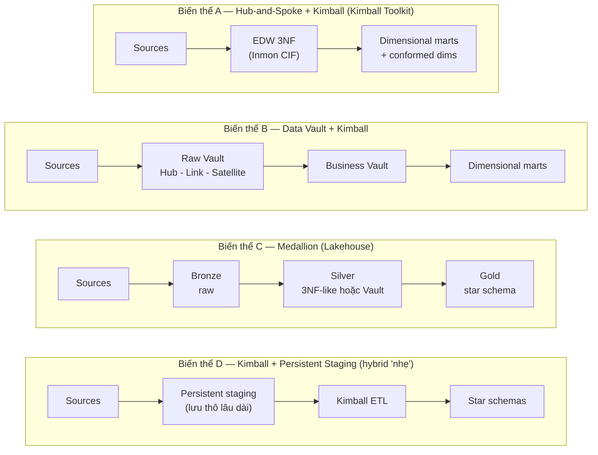
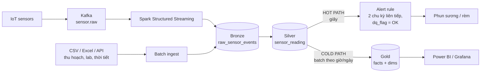
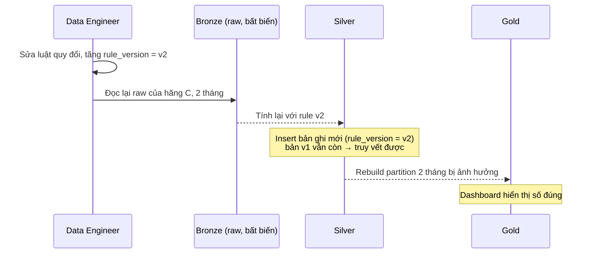
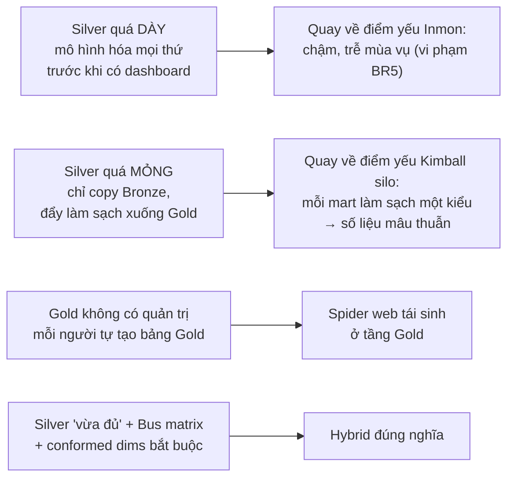

# Hybrid Approach — Phân tích chuyên sâu
## (Inmon core + Kimball marts → Medallion Architecture) & áp dụng cho Smart Greenhouse

> Tài liệu bổ sung cho `DWH_Design_Approaches_SmartGreenhouse.md`. Sơ đồ viết bằng Mermaid; bản PNG nằm trong `dwh_diagrams/` (file `11_*` → `14_*`).

---

## 1. Hybrid là gì — và vì sao nó xuất hiện

### 1.1. Định nghĩa

**Hybrid Approach** là cách thiết kế Data Warehouse **chia kiến trúc thành nhiều tầng, mỗi tầng áp dụng triết lý của trường phái phù hợp nhất với mục đích của tầng đó**:

- Tầng lõi (core) — nơi dữ liệu được **ghi vào, tích hợp, lưu lâu dài** → theo **Inmon**: integrated, subject-oriented, non-volatile, time-variant, atomic.
- Tầng phục vụ (presentation) — nơi dữ liệu được **đọc bởi người dùng** → theo **Kimball**: dimensional, star schema, conformed dimensions, triển khai theo từng business process.

### 1.2. Nhận xét then chốt: Inmon và Kimball thực ra *bất đồng ít hơn* người ta nghĩ

Nếu đặt hai kiến trúc cạnh nhau, sẽ thấy:

| Điểm | Inmon (CIF) | Kimball |
|---|---|---|
| Tầng người dùng truy vấn | Data mart — **thường là dimensional** | Presentation area — **dimensional** |
| Tầng lõi | EDW 3NF, lưu trữ lâu dài | *Không có* — chỉ có ETL staging tạm |
| Mức chi tiết ở tầng người dùng | Thường tổng hợp theo phòng ban | **Atomic** (Kimball nhấn mạnh) |

→ Hai trường phái **đồng ý ở tầng trên** (người dùng cần mô hình dimensional), và **bất đồng ở tầng dưới**: *có cần một tầng tích hợp lưu trữ bền vững riêng hay không?*

Hybrid trả lời: **có** — nhưng tầng đó không được làm chậm việc giao giá trị cho người dùng. Chính Kimball & Ross đã mô tả kiến trúc này trong *The Data Warehouse Toolkit* (Ch.1) với tên **"Hybrid Hub-and-Spoke and Kimball Architecture"**: dùng EDW chuẩn hóa kiểu CIF làm nền, và đưa truy vấn của người dùng sang tầng presentation dimensional có conformed dimensions.

### 1.3. Hai nguyên tắc thiết kế cốt lõi của Hybrid

**Nguyên tắc 1 — Tách "tối ưu ghi" và "tối ưu đọc":**

| | Tầng lõi (Inmon) | Tầng phục vụ (Kimball) |
|---|---|---|
| Tối ưu cho | **Ghi** (write-optimized): nạp nhanh, không trùng lặp, không mâu thuẫn | **Đọc** (read-optimized): ít join, dễ hiểu, nhanh |
| Mô hình | Chuẩn hóa (3NF-like / Data Vault) | Phi chuẩn hóa (star schema) |
| Thay đổi | Append-only, bất biến | Có thể rebuild, overwrite (SCD1) |
| Câu hỏi phục vụ | *Mọi* câu hỏi, kể cả chưa biết | Câu hỏi của *một* quy trình nghiệp vụ |

**Nguyên tắc 2 — Tách "luật doanh nghiệp" và "luật của từng dự án":**

Blog kỹ thuật của Databricks về mô hình hóa trên Lakehouse diễn đạt rất rõ: tầng Silver gom dữ liệu từ nhiều nguồn để tạo **"enterprise view"** của các thực thể/giao dịch chính, dùng mô hình **gần 3NF hoặc Data Vault**, chỉ áp dụng biến đổi **"just-enough"**; còn tầng Gold dùng **Kimball star schema**, nơi áp dụng các luật chất lượng và ETL **"project-specific"**.

> **Silver = sự thật đúng với *mọi* người dùng. Gold = sự thật được *nhìn theo góc* của một quy trình / một nhóm người dùng.**

Đây là câu nên nhớ nhất khi trình bày Hybrid.

---

## 2. Các biến thể của Hybrid



| Biến thể | Tầng lõi | Ưu điểm | Nhược điểm | Phù hợp khi |
|---|---|---|---|---|
| **A. Hub-and-Spoke + Kimball** | EDW 3NF | Nhất quán cao, mô hình quen thuộc | Chậm như Inmon ở giai đoạn đầu; chi phí của cả hai | Doanh nghiệp đã có sẵn EDW |
| **B. Data Vault + Kimball** | Raw/Business Vault | Chịu thay đổi nguồn cực tốt, audit mặc định | Rất nhiều bảng, học khó, tốn công | Nhiều nguồn biến động, quy định rất chặt |
| **C. Medallion** | Bronze + Silver | Có dữ liệu thô để replay; hợp streaming & ML; công cụ hỗ trợ tốt | Nhiều pipeline; dễ "phình" Gold nếu thiếu quản trị | Dữ liệu IoT / big data trên Lakehouse |
| **D. Kimball + Persistent Staging** | Chỉ lưu thô | Rẻ, nhanh, vẫn replay được | Không có tầng tích hợp; làm sạch lặp lại ở mỗi mart | Team nhỏ, ít nguồn, ít yêu cầu audit |

### 2.1. Lựa chọn cho Smart Greenhouse: **Biến thể C — Medallion, Silver dạng "3NF-lite"**

Lý do *không* chọn Data Vault cho Silver:

- Số hệ thống nguồn **ít và tương đối ổn định** (sensor, bộ điều khiển tưới, sổ thu hoạch, lab, thời tiết) — lợi thế lớn nhất của Data Vault (chịu nguồn biến động) không phát huy nhiều.
- BR5 yêu cầu go-live trong **3–4 tuần** — số bảng Hub/Link/Satellite và độ phức tạp của Business Vault sẽ đe dọa tiến độ.
- BR6 (bất biến, lịch sử) vẫn đạt được bằng **Bronze append-only + Silver insert-only** mà không cần Satellite.

Lý do *không* chọn biến thể D:

- BR2 đòi hỏi **tầng làm sạch & chuẩn hóa tập trung**. Với D, logic quy đổi °F/°C, lọc outlier, hợp nhất mã thiết bị phải lặp lại trong ETL của từng mart → rủi ro mỗi mart làm sạch một kiểu (quay lại *algorithmic differential* của spider web).

Biến thể D vẫn rất đáng dùng làm **giải pháp thay thế** để so sánh trong báo cáo (xem Mục 8).

---

## 3. Giải phẫu từng tầng

### 3.1. Bảng đặc tả 3 tầng

| Thuộc tính | 🥉 Bronze | 🥈 Silver | 🥇 Gold |
|---|---|---|---|
| **Trường phái** | Staging + non-volatile (Inmon) | Integrated, atomic (Inmon) | Dimensional (Kimball) |
| **Câu hỏi trả lời** | "Nguồn đã gửi gì, lúc nào?" | "Sự thật đã chuẩn hóa là gì?" | "Nghiệp vụ X đang thế nào?" |
| **Mô hình** | Giống nguồn (JSON/CSV + metadata) | Thực thể – quan hệ, gần 3NF | Star schema, fact + conformed dims |
| **Grain** | Từng message / từng dòng file | Từng lần đo, từng sự kiện (atomic) | Khai báo theo từng fact (5 phút, ngày, lần thu hoạch, mùa vụ) |
| **Schema** | Lỏng (schema-on-read) | Chặt (schema enforcement, kiểu dữ liệu, khóa) | Chặt, thiết kế cho BI |
| **Thao tác ghi** | **Append-only** | **Insert-only** (MERGE chỉ nhánh *not matched*) | Rebuild / overwrite theo partition |
| **Có được sửa/xóa?** | Không bao giờ | Không (sửa = bản ghi mới + cờ) | Được — vì luôn tái tạo được từ Silver |
| **Luật áp dụng** | Không (chỉ thêm metadata kỹ thuật) | Luật **doanh nghiệp** (đơn vị, miền giá trị, mã thiết bị) | Luật **dự án** (GDD, tổng hợp, chi phí, gán giai đoạn) |
| **Người dùng** | Data engineer, kiểm toán | Data engineer, data scientist, alert service, kiểm toán | Kỹ sư nông nghiệp, ban giám đốc, BI tool |
| **Lưu trữ** | ≥ 5 năm (chuyển storage tier rẻ sau ~1 năm) | ≥ 5 năm | Phiên bản hiện hành + snapshot cuối mỗi mùa vụ |
| **Độ trễ mục tiêu** | Giây (streaming) | < 1 chu kỳ đo cho luồng nóng | Phút–giờ (batch), trừ fact 5 phút cho Grafana |

### 3.2. Vì sao Gold được phép "không bất biến" mà không vi phạm BR6?

Đây là điểm tinh tế và là **lợi thế lớn nhất của Hybrid so với Kimball thuần**:

- Trong Kimball thuần, fact/dimension **là nơi duy nhất** lưu dữ liệu. Khi áp dụng SCD Type 1 (ghi đè) hay sửa dữ liệu đến muộn, lịch sử gốc **mất vĩnh viễn** → mâu thuẫn với BR6.
- Trong Hybrid, Gold chỉ là **dữ liệu dẫn xuất (derived)**. Sự thật gốc nằm ở Bronze/Silver (bất biến). Gold có thể ghi đè, thiết kế lại, thậm chí xóa đi và build lại → **tự do tối ưu cho người dùng mà không đánh đổi khả năng kiểm toán**.

> Hybrid "mua" sự linh hoạt của tầng Gold bằng tính bất biến của tầng Silver/Bronze.

### 3.3. Ranh giới trách nhiệm: logic nào đặt ở tầng nào?

Đây là quyết định thiết kế quan trọng nhất của Hybrid. Đặt sai tầng sẽ dẫn đến một trong hai lỗi (Mục 6).

| Logic nghiệp vụ | Tầng | Lý do |
|---|---|---|
| Ghi nhận payload gốc, `ingest_ts`, offset, hash | Bronze | Bằng chứng gốc, phục vụ replay & thanh tra |
| Quy đổi °F → °C, lux → đơn vị chuẩn | Silver | Đúng với *mọi* người dùng — không ai muốn °F |
| Kiểm tra miền vật lý (độ ẩm 180%, −50°C) → gắn cờ | Silver | Luật vật lý, không phụ thuộc báo cáo |
| Hợp nhất mã thiết bị các hãng → `device_id` | Silver | Master data dùng chung |
| Bảng giai đoạn sinh trưởng (`growth_stage_period`) | Silver | Định nghĩa của kỹ sư, dùng chung cho mọi phân tích |
| Luật cảnh báo T > 38°C, RH < 40% | Hot path đọc Silver stream | Cần dữ liệu **đã chuẩn hóa** nhưng không thể chờ batch Gold |
| Gán `stage_key` vào từng dòng fact | Gold | Là cách *nhìn* theo quy trình |
| Tính GDD (với T_base = 10°C), bức xạ tích lũy | Gold | Công thức mang tính dự án, tham số có thể thay đổi |
| Tổng hợp theo ngày / mùa vụ | Gold | Silver phải giữ atomic (BR6) |
| Nội suy giá trị thiếu | Gold / feature ML | Không được "bịa" dữ liệu vào tầng sự thật |
| Quy đổi chi phí phân bón (VNĐ) | Gold (mart Tài chính) | Chỉ một nhóm người dùng cần |

**Mẹo kiểm tra nhanh:** hỏi *"Nếu hai phòng ban khác nhau cùng cần logic này, họ có muốn cùng một kết quả không?"* — Có → Silver. Không nhất thiết / phụ thuộc tham số → Gold.

---

## 4. Luồng dữ liệu và cơ chế nạp

### 4.1. Hot path và Cold path



- Toàn bộ pipeline dùng **một** engine (Spark) cho cả streaming và batch → tránh phải viết cùng một luật làm sạch hai lần (vấn đề kinh điển của kiến trúc Lambda). Cách làm này gần với **Kappa**: mọi dữ liệu đi qua cùng một luồng, backfill = chạy lại luồng đó trên dữ liệu cũ.
- Cảnh báo đọc **Silver** chứ không đọc Bronze (chưa chuẩn hóa đơn vị) và không đọc Gold (quá chậm).

### 4.2. Nạp tăng dần (incremental) và tính idempotent

| Tầng | Cơ chế | Đảm bảo |
|---|---|---|
| Bronze | Append mỗi message / file mới (checkpoint offset Kafka, danh sách file đã nạp) | Không mất, không nạp trùng file |
| Silver | `MERGE ... WHEN NOT MATCHED THEN INSERT` theo khóa `(device_id, reading_ts)` | **Idempotent**: chạy lại không tạo trùng; không bao giờ UPDATE |
| Gold | Tính lại các **partition ngày bị ảnh hưởng** rồi ghi đè partition đó | Kết quả luôn khớp Silver |

### 4.3. Dữ liệu đến muộn (late-arriving data)

Cảm biến mất kết nối Wi-Fi 3 giờ rồi gửi bù dữ liệu:

1. Bronze nhận bình thường (`ingest_ts` = lúc gửi bù, `reading_ts` = lúc đo thật).
2. Silver insert các bản ghi mới theo `reading_ts` — không ảnh hưởng bản ghi cũ.
3. Hot path dùng **watermark** (VD 10 phút): dữ liệu quá trễ không kích hoạt cảnh báo (vì sự kiện đã qua), nhưng vẫn được lưu.
4. Gold: job batch phát hiện ngày bị ảnh hưởng → tính lại `fact_climate_daily` của ngày đó.

**Late-arriving dimension:** thiết bị mới lắp chưa có trong bảng master → gán `device_key = -1` ("Unknown") ở Gold; khi master được cập nhật, rebuild partition liên quan. Silver vẫn lưu `vendor_device_code` gốc nên không mất thông tin.

### 4.4. Reprocessing — "siêu năng lực" của Hybrid

**Tình huống:** Sau 2 tháng vận hành, phát hiện cảm biến ánh sáng của hãng C dùng hệ số quy đổi sai.



- **Kimball thuần:** dữ liệu gốc không còn (bộ điều khiển chỉ lưu vài tháng) → *không sửa được*, hoặc phải chấp nhận số sai.
- **Hybrid:** replay từ Bronze, và vẫn giữ được cả hai phiên bản để giải thích với thanh tra *vì sao số liệu thay đổi*.

---

## 5. Hybrid giải quyết các mâu thuẫn Inmon – Kimball như thế nào

| Mâu thuẫn | Inmon nói | Kimball nói | Hybrid dung hòa bằng cách |
|---|---|---|---|
| Nhất quán vs Tốc độ | Tích hợp toàn bộ trước | Giao giá trị trước | Silver chỉ tích hợp **subject cần cho sprint**; Gold giao theo từng process |
| Chuẩn hóa vs Phi chuẩn hóa | 3NF | Star schema | 3NF-lite ở Silver, star ở Gold |
| Lịch sử nguyên tử vs Dễ dùng | EDW atomic, người dùng không đụng | Fact atomic cho người dùng | Atomic ở Silver *và* fact 5 phút ở Gold; aggregate ở Gold |
| Enterprise-first vs Process-first | Corporate data model trước | Business process trước | Bus matrix định hướng tổng thể, triển khai theo process; Silver mở rộng theo nhu cầu |
| Bất biến vs Linh hoạt | Non-volatile | SCD, cập nhật được | Bronze/Silver bất biến, Gold tự do (vì rebuild được) |
| Single version of truth ở đâu? | EDW | Conformed dimensions | **Dữ liệu**: Silver; **ngữ nghĩa**: conformed dims ở Gold |

---

## 6. Chi phí, rủi ro và anti-patterns

### 6.1. Chi phí thực

- **Lưu trữ nhiều bản:** cùng một lần đo xuất hiện ở Bronze, Silver và (có thể) Gold. *Ước lượng thô* cho 500 sensor, 1 lần/phút, 5 năm (≈ 1,3 tỷ bản ghi): Bronze JSON nén vài chục đến vài trăm GB; Silver dạng cột (Parquet/Delta) nén nhỏ hơn nhiều. Với giá object storage hiện nay, chi phí này nhỏ so với giá trị replay và audit — nhưng nhóm nên **đo thực tế** trên AGC để đưa số liệu vào báo cáo.
- **Nhiều pipeline hơn** → nhiều job cần giám sát, test, tài liệu hóa.
- **Độ trễ** tăng qua mỗi tầng → phải có hot path riêng cho BR1.
- **Kỹ năng:** đội cần hiểu cả mô hình 3NF lẫn dimensional.

### 6.2. Hai cách "làm hỏng" Hybrid



### 6.3. Anti-patterns cần tránh

| Anti-pattern | Hậu quả | Cách phòng |
|---|---|---|
| Dashboard đọc thẳng Bronze/Silver | Người dùng thấy °F lẫn °C, dữ liệu lỗi | BI chỉ được cấp quyền vào Gold |
| Xóa bản ghi lỗi ở Silver | Mất bằng chứng cho VietGAP (BR6) | Chỉ gắn `dq_flag`, đưa vào quarantine |
| Tổng hợp theo ngày ngay ở Silver | Không thể quay lại mức 5 phút (vi phạm BR6, hại ML) | Silver luôn atomic |
| Hai fact join trực tiếp với nhau | Nhân bản dòng, số sai | Drill-across qua conformed dims |
| Mỗi mart tự tạo `dim_greenhouse` riêng | Mất khả năng so sánh (BR4) | Conformed dims dùng chung, tạo 1 lần |
| Luật cảnh báo chạy trên Bronze | Cảnh báo giả do °F / giá trị ảo | Alert đọc Silver, chỉ bản ghi `OK` |
| Không version luật làm sạch | Không giải thích được vì sao số thay đổi | Cột `rule_version` ở Silver |

### 6.4. Khi nào **không** nên dùng Hybrid

- Chỉ **một nguồn**, dữ liệu sạch, chỉ phục vụ BI, không yêu cầu audit → Kimball thuần là đủ và rẻ hơn.
- Rất nhiều nguồn **thay đổi liên tục**, quy định pháp lý nặng → cân nhắc Hybrid biến thể B (Data Vault ở lõi).
- Đội 1–2 người, dự án ngắn hạn, không cần streaming → biến thể D.

---

## 7. Áp dụng chi tiết cho Smart Greenhouse

### 7.1. Danh mục bảng theo tầng

| Tầng | Bảng | Grain | Cách nạp | BR |
|---|---|---|---|---|
| Bronze | `bronze.raw_sensor_events` | 1 message sensor | Streaming append | 1, 6 |
| Bronze | `bronze.raw_irrigation_logs` | 1 message bộ điều khiển tưới | Streaming append | 3, 6 |
| Bronze | `bronze.raw_files` (harvest, lab, weather, crop params) | 1 dòng file gốc | Batch append | 4, 6 |
| Silver | `silver.device`, `silver.vendor`, `silver.metric` | Master data | Batch, SCD theo `valid_from/valid_to` | 2 |
| Silver | `silver.sensor_reading` | 1 thiết bị × 1 thời điểm đo | Streaming insert-only | 1, 2, 6 |
| Silver | `silver.quarantine_reading` | 1 bản ghi bị gắn cờ lỗi | Streaming insert-only | 2, 6 |
| Silver | `silver.fertigation_event` | 1 lần tưới / 1 luống | Streaming insert-only | 3, 6 |
| Silver | `silver.harvest_event`, `silver.lab_sample` | 1 lần thu hoạch / 1 mẫu | Batch insert-only | 4, 6 |
| Silver | `silver.crop_cycle`, `silver.growth_stage_period` | 1 mùa vụ / 1 giai đoạn | Batch | 3, 4 |
| Gold | `dim_date`, `dim_greenhouse`, `dim_bed`, `dim_crop_cycle`, `dim_growth_stage`, `dim_device` | Conformed dims | Rebuild | 3, 4 |
| Gold | `fact_climate_reading` | 1 nhà kính × 5 phút | Micro-batch | 1 |
| Gold | `fact_climate_daily` | 1 nhà kính × 1 ngày | Batch theo partition | 4 |
| Gold | `fact_fertigation_daily` | 1 luống × 1 ngày | Batch theo partition | 3 |
| Gold | `fact_harvest` | 1 nhà kính × 1 lần thu hoạch | Batch | 4 |
| Gold | `fact_crop_cycle_summary` | 1 nhà kính × 1 mùa vụ | Accumulating snapshot | 4 |

### 7.2. Theo chân một bản ghi qua 3 tầng (walk-through)

**Bản ghi 1 — cảm biến hãng B, dùng °F:**

| Bước | Dữ liệu |
|---|---|
| Nguồn gửi | `{"dev":"B-17","val":101.3,"unit":"F","ts":"2026-10-12T13:05:00+07:00","bat":3.9}` |
| **Bronze** | Lưu nguyên JSON + `ingest_ts`, `kafka_offset`, `vendor = B`, `payload_hash` |
| **Silver** | `device_id = GH2-TEMP-03` (tra bảng mapping), `value_std = 38.5 °C`, `value_raw = 101.3`, `unit_raw = F`, `dq_flag = OK`, `rule_version = v1` |
| **Hot path** | 38.5 > 38 và bản ghi trước (13:00) cũng > 38 → **kích hoạt phun sương Nhà kính 2** |
| **Gold** | Góp vào `fact_climate_reading` (13:05, GH2), và `hours_above_38c` của `fact_climate_daily` ngày 12/10 |

*Nếu chạy cảnh báo trên Bronze:* 101.3 bị hiểu là °C → vẫn báo nhưng *vì lý do sai*; còn một cảm biến báo `95°F` (35°C, bình thường) sẽ bị báo nhầm là nóng khủng khiếp.

**Bản ghi 2 — cảm biến độ ẩm đất pin yếu:**

| Bước | Dữ liệu |
|---|---|
| Nguồn gửi | `{"dev":"A-204","val":180,"unit":"%","bat":2.1}` |
| **Bronze** | Lưu nguyên (bằng chứng: thiết bị đã gửi giá trị này) |
| **Silver** | 180 ∉ [0, 100] → `dq_flag = INVALID`, pin 2.1V → `DEVICE_FAULT`; ghi vào `quarantine_reading` |
| **Hot path** | Bỏ qua (không kích hoạt tưới dựa trên giá trị ảo); gửi thông báo bảo trì thiết bị |
| **Gold** | Không tham gia trung bình; được đếm vào chỉ số chất lượng dữ liệu (DQ dashboard) |

### 7.3. Code minh họa (Spark SQL trên Databricks)

**Silver — chuẩn hóa, gắn cờ, insert-only (idempotent):**

```sql
MERGE INTO silver.sensor_reading AS t
USING (
  SELECT
    d.device_id,
    to_timestamp(b.payload:ts)                        AS reading_ts,
    CASE WHEN b.payload:unit = 'F'
         THEN (CAST(b.payload:val AS DOUBLE) - 32) * 5 / 9
         ELSE CAST(b.payload:val AS DOUBLE) END        AS value_std,
    CAST(b.payload:val AS DOUBLE)                     AS value_raw,
    b.payload:unit                                    AS unit_raw,
    CASE
      WHEN d.device_id IS NULL                              THEN 'UNKNOWN_DEVICE'
      WHEN CAST(b.payload:bat AS DOUBLE) < 2.5              THEN 'DEVICE_FAULT'
      WHEN value_std NOT BETWEEN m.valid_min AND m.valid_max THEN 'INVALID'
      ELSE 'OK' END                                   AS dq_flag,
    'v1'                                              AS rule_version,
    b.payload_hash                                    AS bronze_ref
  FROM bronze.raw_sensor_events b
  LEFT JOIN silver.device d
         ON d.vendor_id = b.vendor
        AND d.vendor_device_code = b.payload:dev
        AND to_timestamp(b.payload:ts) BETWEEN d.valid_from AND d.valid_to
  LEFT JOIN silver.metric m ON m.metric_code = d.metric_code
  WHERE b.ingest_date >= date_sub(current_date(), 1)   -- chỉ xử lý dữ liệu mới
) AS s
ON  t.device_id = s.device_id
AND t.reading_ts = s.reading_ts
AND t.rule_version = s.rule_version
WHEN NOT MATCHED THEN INSERT *;     -- không có nhánh UPDATE → Silver bất biến
```

*(Ghi chú: Databricks SQL cho phép tham chiếu alias `value_std` trong cùng SELECT; nếu engine khác không hỗ trợ, tách thành CTE.)*

**Gold — fact ngày cho BR4 (luật dự án: GDD, bức xạ tích lũy):**

```sql
INSERT OVERWRITE gold.fact_climate_daily
PARTITION (date_key)
SELECT
  f.greenhouse_key,
  f.crop_cycle_key,
  f.stage_key,
  MIN(f.temp_c)                                           AS t_min,
  MAX(f.temp_c)                                           AS t_max,
  AVG(f.temp_c)                                           AS t_avg,
  GREATEST(0, (MAX(f.temp_c) + MIN(f.temp_c)) / 2 - 10)   AS gdd,              -- T_base = 10°C
  SUM(f.radiation_w_m2 * 300) / 1e6                       AS radiation_mj_m2,  -- 5 phút = 300 s
  SUM(CASE WHEN f.temp_c > 38 THEN 5 ELSE 0 END) / 60.0   AS hours_above_38c,
  f.date_key
FROM gold.fact_climate_reading f
WHERE f.date_key IN (SELECT date_key FROM ops.affected_dates)  -- chỉ tính lại ngày bị ảnh hưởng
GROUP BY f.date_key, f.greenhouse_key, f.crop_cycle_key, f.stage_key;
```

### 7.4. Phân quyền theo tầng

| Vai trò | Bronze | Silver | Gold |
|---|---|---|---|
| Data engineer | Đọc/ghi | Đọc/ghi | Đọc/ghi |
| Data scientist (ML sâu bệnh) | — | **Đọc** | Đọc |
| Alert service | — | Đọc (stream) | — |
| Kỹ sư nông nghiệp | — | — | **Đọc** (mart Fertigation, Climate) |
| Ban giám đốc | — | — | **Đọc** (mart Harvest, Summary) |
| Thanh tra VietGAP / GlobalGAP | Đọc qua *audit view* | Đọc qua *audit view* | — |

### 7.5. Về lưu trữ lịch sử 3–5 năm (BR6) — lưu ý kỹ thuật

- **Không dựa vào Delta Lake time travel** cho yêu cầu nhiều năm: time travel phụ thuộc lịch sử transaction log và các file cũ, vốn bị dọn theo cấu hình retention và lệnh `VACUUM` (mặc định chỉ giữ ở mức ngày, không phải năm). Time travel phù hợp để *debug/rollback ngắn hạn*.
- Tính bất biến dài hạn nên đạt bằng **thiết kế dữ liệu**: Bronze append-only, Silver insert-only có `ingest_ts` và `rule_version` → trạng thái tại bất kỳ thời điểm nào đều truy vấn được bằng điều kiện `ingest_ts <= :thời_điểm`.
- Có thể bổ sung **snapshot cuối mỗi mùa vụ** (bảng sao chép tĩnh) cho hồ sơ chứng nhận.

---

## 8. Chứng minh Hybrid bằng thực nghiệm (cho phần Đánh giá)

So sánh **Hybrid (Medallion)** với **giải pháp thay thế — Kimball + Persistent Staging (biến thể D)** hoặc **Kimball thuần**, trên cùng dataset AGC (có tiêm lỗi):

| Thí nghiệm | Cách làm | Kỳ vọng Hybrid | Kỳ vọng giải pháp thay thế |
|---|---|---|---|
| E1. Reprocess | Đổi hệ số quy đổi ánh sáng, tính lại 2 tháng | Replay từ Bronze, giữ cả v1 và v2 | Kimball thuần: không làm được nếu nguồn đã mất; D: làm được nhưng không có version |
| E2. Audit | "Cho xem giá trị gốc của cảm biến X lúc 13:05 ngày 12/10" | Truy từ Gold → Silver `bronze_ref` → Bronze payload | Chỉ có giá trị đã làm sạch |
| E3. Nhất quán | Hai mart cùng tính "nhiệt độ TB ngày Nhà kính 2" | Bằng nhau (cùng Silver) | Có thể khác nhau nếu mỗi ETL làm sạch khác |
| E4. Độ chính xác làm sạch | Tiêm N lỗi đã biết | Recall / precision của `dq_flag` | Tương tự nhưng lặp logic ở mỗi mart |
| E5. Time-to-first-dashboard | Đo số ngày đến dashboard BR3 | Chậm hơn một chút | Nhanh hơn |
| E6. Hiệu năng truy vấn | p95 truy vấn BR3/BR4 trên Power BI | Tương đương (cùng star schema) | Tương đương |
| E7. Độ trễ cảnh báo | Sensor → alert | < 1 chu kỳ đo | Phụ thuộc lịch batch |

Kết quả E5 là **điểm yếu cần thừa nhận** của Hybrid — trình bày thẳng thắn sẽ thuyết phục hơn.

---

## 9. Câu hỏi thường gặp khi thuyết trình (chuẩn bị Q&A)

**Hybrid có phải chỉ là "Kimball có thêm staging"?**
Không. Staging của Kimball là vùng *tạm*, không có luật tích hợp doanh nghiệp và không phải nơi lưu lịch sử. Silver là tầng *lưu trữ bền vững đã tích hợp* — đúng định nghĩa DW của Inmon (subject-oriented, integrated, non-volatile, time-variant).

**Medallion là Data Lake hay Data Warehouse?**
Medallion là một *pattern tổ chức tầng* trên nền Lakehouse. Silver thỏa 4 đặc tính DW của Inmon, Gold là dimensional DW của Kimball → về bản chất nó thực hiện đầy đủ chức năng của một DW, chỉ khác nền tảng lưu trữ.

**Tại sao Silver không dùng Data Vault?**
Vì nguồn ít và ổn định, và BR5 yêu cầu go-live 3–4 tuần. Data Vault mạnh khi nguồn biến động nhiều; ở đây chi phí phức tạp lớn hơn lợi ích. Bronze + Silver insert-only đã đảm bảo BR6.

**Lưu 3 bản dữ liệu có lãng phí không?**
Chi phí lưu trữ rẻ hơn nhiều so với chi phí mất dữ liệu gốc (không replay được, không chứng minh được với thanh tra). Gold có thể giữ ở mức tổng hợp và rebuild khi cần.

**Tại sao cảnh báo chạy trên Silver mà không phải Gold?**
Gold là batch (chậm), Bronze chưa chuẩn hóa đơn vị (sai). Silver là tầng duy nhất vừa *đúng* vừa *đủ nhanh*.

**Hybrid có tạo lại spider web không?**
Có thể — nếu tầng Gold không được quản trị. Vì vậy Gold bắt buộc dùng conformed dimensions theo bus matrix, và BI chỉ được đọc Gold.

---

## 10. Tóm tắt

- Hybrid tồn tại vì Inmon và Kimball **giải quyết hai vấn đề khác nhau**: Inmon lo *ghi đúng và giữ lâu*, Kimball lo *đọc dễ và giao nhanh*.
- Medallion là cách hiện thực Hybrid hiện đại: **Bronze** (bằng chứng gốc) → **Silver** (sự thật doanh nghiệp, Inmon) → **Gold** (góc nhìn nghiệp vụ, Kimball).
- Giá trị lớn nhất: **Gold linh hoạt vì Silver bất biến**, và **replay được từ Bronze**.
- Rủi ro lớn nhất: Silver quá dày (chậm), Silver quá mỏng (silo), Gold thiếu quản trị (spider web tái sinh).
- Với Smart Greenhouse: chọn **Medallion + Silver 3NF-lite**, hot path đọc Silver cho BR1, Gold theo bus matrix cho BR3–BR4, triển khai theo sprint cho BR5, Bronze/Silver insert-only cho BR6.

---

## Tài liệu tham khảo

- R. Kimball, M. Ross — *The Data Warehouse Toolkit*, 3rd ed., Wiley, 2013 — Ch.1: *Hybrid Hub-and-Spoke and Kimball Architecture*. [Mục lục (TIB)](https://www.gbv.de/dms/tib-ub-hannover/74588184x.pdf)
- W. H. Inmon — *Building the Data Warehouse*, 4th ed., Wiley, 2005. [O'Reilly](https://www.oreilly.com/library/view/building-the-data/9780764599446/)
- [Different Data Warehousing Modeling Techniques and How to Implement them on the Databricks Lakehouse Platform — Databricks Blog](https://www.databricks.com/blog/2022/06/24/data-warehousing-modeling-techniques-and-their-implementation-on-the-databricks-lakehouse-platform.html)
- [What is the medallion lakehouse architecture? — Databricks Docs](https://docs.databricks.com/aws/en/lakehouse/medallion)
- [Part 2: Alternative DW/BI Architectures — Medium (tóm tắt Kimball Toolkit)](https://medium.com/@varshineevenkatesan/part-2-alternative-dw-bi-architectures-776d4fa42c3d)
- [Kimball Technical DW/BI System Architecture — Kimball Group](https://www.kimballgroup.com/data-warehouse-business-intelligence-resources/kimball-techniques/technical-dw-bi-system-architecture/)
