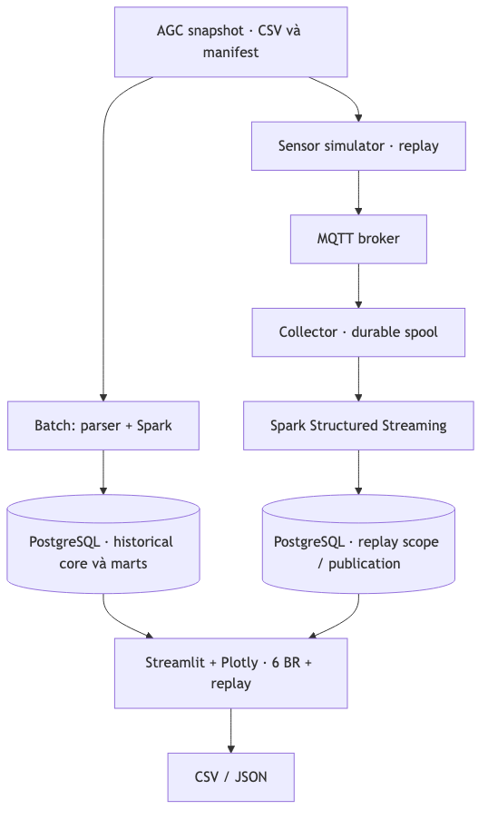

# 1. Bối cảnh và yêu cầu

Nhà kính tạo ra chuỗi đo khí hậu, tưới, năng lượng và bản ghi thu hoạch ở các
độ hạt khác nhau. Người vận hành cần tìm khoảng thời gian điều kiện bất thường;
kỹ sư canh tác cần xem EC/pH và bối cảnh tưới; quản lý cần xem sản lượng, năng
lượng và độ nhạy của chi phí. Tách riêng các bảng tính gây khó đối chiếu nguồn,
đơn vị và cửa sổ thời gian. Project xây dựng hệ thống chạy local cho các tác vụ
đó, với snapshot bất biến, kiểm tra chất lượng, warehouse và dashboard.

Sáu yêu cầu nghiệp vụ (BR), tương ứng hai yêu cầu cho mỗi thành viên trong nhóm
ba người, được đặc tả cùng công thức và tiêu chí nghiệm thu trong `docs/br/`.
Danh tính nhóm và phân công cụ thể cần được nhóm xác nhận trước khi nộp.

| BR | Người dùng chính | Câu hỏi / kết quả |
|---|---|---|
| 01 | Kỹ sư canh tác | Tìm đợt nhiệt độ/CO₂ ngoài điều kiện, duration và coverage. |
| 02 | Người vận hành tưới | Xem tưới, drain và tỷ lệ theo ngày, tuần, vụ. |
| 03 | Kỹ sư dinh dưỡng | Tìm đợt EC/pH drain ngoài mục tiêu và dữ liệu nghi lỗi. |
| 04 | Quản lý vận hành | Tính kWh trên kg sản phẩm loại A khi đủ điều kiện. |
| 05 | Quản lý sản xuất | Theo dõi sản lượng A/B, tỷ lệ loại B và lũy kế. |
| 06 | Quản lý ngân sách | So sánh baseline và kịch bản thay đổi biểu giá. |

# 2. Dữ liệu và ngữ nghĩa

Nguồn là [Autonomous Greenhouse Challenge 2nd edition 2019–2020](https://www.kaggle.com/datasets/piantic/autonomous-greenhouse-challengeagc-2nd-2019/). Snapshot ZIP
được khóa SHA-256 `c19d385e7f4731a77e59ebfd763fd49e35e7ac4128d0aaf41b5717709cd75a68`;
manifest lưu checksum từng file. Inventory có 45 file, gồm 43 CSV và 2 PDF,
622.899 dòng CSV. `GreenhouseClimate.csv` có grain khoang × slot năm phút;
`Resources.csv` theo ngày và `Production.csv` theo record thu hoạch. Weather và
các nguồn đo khác không tự nhập vào KPI. Nguồn, inventory và quyết định dữ liệu
được ghi ở `docs/implementation/dataset-snapshot.md`, `data-inventory.md`,
`data-decisions.md`.

Thời gian nguồn được giữ dạng naive vì timezone chưa được xác minh. Giá trị 0,
NULL, invalid và suspect có ý nghĩa khác nhau; quality được gắn theo từng measure.
Ngày không có event thu hoạch không tự động là ngày thu 0. Bản ghi Reference
ngoài vụ được cách ly, không tự sửa năm. Tỷ lệ chỉ công bố khi tử và mẫu cùng
tập hợp lệ, basis tương thích và mẫu khác 0.

Diện tích dùng chung 62,5 m² trong BR-02/04/06 là giả định `AGC_SHARED_BASIS_V1`
`assumed_unverified`; sensitivity 96/62,5 = 1,536. Rule demo, biểu giá lịch sử (từ `Economics.pdf` trong snapshot)
và kịch bản có version và nhãn; không phải ngưỡng canh tác được xác minh, hóa đơn
thực tế hay dự báo. Các giới hạn này đi cùng kết quả, không được hiểu là kết luận
nông học.

# 3. Thiết kế kỹ thuật và ứng dụng

Giải pháp chính Hybrid giữ raw trên filesystem, staging theo run, PostgreSQL
core có revision/lineage/quality và dimensional marts được publish bất biến.
Ứng dụng chọn publication, khoang và cửa sổ; KPI, drill-down và export dùng cùng
identity. Batch đọc dữ liệu lịch sử. Simulator phát lại Climate vào MQTT; collector
ghi bền trước ACK; Structured Streaming xử lý raw-ready và checkpoint rồi publish
replay scope riêng. Không cộng replay với lịch sử. Resources và Production không
được nội suy thành telemetry năm phút. Không có điều khiển thiết bị thật.

PostgreSQL 17.10 cung cấp transaction, constraint và truy vấn relational cho
core, mart và metadata trong một máy; PySpark 4.0.1 hỗ trợ batch và micro-batch;
Mosquitto/Python thực hiện sensor replay, còn Streamlit/Plotly cung cấp UI.
Docker Compose đóng gói runtime local. ClickHouse là lựa chọn khảo sát tương lai,
chưa triển khai. Phiên bản và lệnh cụ thể có trong README và `requirements*.lock`.

| Nghiệp vụ | Grain và công thức quan trọng | Chặn kết quả sai |
|---|---|---|
| Khí hậu / drain | Slot 5 phút; episode ngắt qua gap/rule; duration trên slot hợp lệ. | Coverage, quality từng measure, basis/rule version. |
| Nước | Tổng paired drain / tổng paired irrigation × 100. | Không lấy trung bình tỷ lệ ngày; mẫu 0 → NULL. |
| Thu hoạch | B / (A+B) trên cùng record paired. | Giữ record grain, quarantine và completeness. |
| Năng lượng | Tổng kWh kỳ / tổng kg A kỳ. | Tổng hợp hai nguồn riêng trước khi ghép; gate basis/completeness. |
| Chi phí | Tổng theo ngày/component của lượng × giá hiệu lực. | Chặn rate overlap/gap; scenario giữ nguyên lượng và version. |

Dashboard có sáu màn hình BR, tổng quan, chất lượng và replay. Ngữ cảnh historical
được chuyển giữa màn hình khi publication/vụ/cửa sổ còn khả dụng; rule và scenario
được ghi version riêng. Bảng chất lượng cho biết các quyết định measure và lý do;
chi tiết quarantine thể hiện phạm vi lần nạp. CSV/JSON giữ version, cửa sổ,
nguồn và NULL thay vì biến thiếu thành 0.

# 4. Phương án thay thế và thiết kế đánh giá

Phương án so sánh là Kimball gọn trên cùng PostgreSQL: parser/cleaning cùng hợp
đồng tạo dimension/fact trực tiếp từ staging chuẩn hóa, không giữ lớp core vật lý
riêng như Hybrid. Cả hai dùng cùng raw, rules, units, quality và query workloads;
không cố ý làm suy yếu phương án thay thế. Hybrid có chi phí duy trì core,
revision và lineage; Kimball gọn hơn nhưng loader hiện từ chối ghi đè publication,
không chứng minh recovery/correction tương đương. Parity sáu BR và điều kiện so
sánh được công bố trong `docs/evaluation/kimball.md`.

Đánh giá chia ba trục: correctness bằng fixture có đáp án độc lập, đối soát raw
và fault/recovery; performance bằng lifecycle, storage và sáu workload; hiệu quả
khai thác bằng tác vụ UI có đáp án trước. `scripts/test_local.sh` chạy lại unit,
contract, UI và sensor acceptance; `scripts/test_effectiveness.sh` chạy sáu
walkthrough tự động. Mỗi báo cáo ghi publication, source, lệnh và giới hạn.

# 5. Kết quả

Correctness: một lượt local có 419 backend, 97 UI và 19 sensor/fault/recovery
test đạt. Raw reconciliation của các BR được dẫn trong
`docs/evaluation/correctness.md`. Ví dụ fixture nước 40 L/m² tưới và 14 L/m²
drain cho tỷ lệ 35% trên cùng tập paired; năng lượng 500 kWh / 100 kg loại A
cho 5 kWh/kg. Chúng là kiểm thử phần mềm, không chứng minh năng suất hay tiết
kiệm của một trang trại thật.

Walkthrough UI AGC trên publication `df3e4bcbacab45a5b86fc37d2f53c00a`,
Automatoes ngày 02–03/03/2020 đã đối soát trực tiếp CSV raw: tưới/drain
9,36/3,89 L/m², tỷ lệ 41,56%; năng lượng 308,078 kWh và chi phí 17,60 EUR
với diện tích 62,5 m² giả định và biểu giá lịch sử. Phần còn lại của walkthrough
kiểm điều hướng/ngữ cảnh; không phải oracle mới cho mọi KPI. Đây là một cửa sổ
cụ thể, không đại diện toàn bộ vụ.

Performance đo trên Apple M4, RAM 16 GiB; Docker được cấp 4 CPU, khoảng 7,62 GiB;
DB 0,5 CPU/512 MiB; processing 1,5 CPU/2 GiB. Cùng snapshot AGC, mỗi đường
build một lần, workload query dùng 30 mẫu sau 5 warm-up trên Automatoes. Các
con số không phải cold-cache hay benchmark nhiều máy.

| Chỉ số | Hybrid | Kimball |
|---|---:|---:|
| Build vào DB mới (giây; một lượt) | 880,33 | 40,35 |
| Database sau build (GiB) | 3,319 | 0,623 |
| BR-01 climate p95 uncached (ms) | 4.060,81 | 3.028,13 |
| BR-02 water p95 (ms) | 76,39 | 9,55 |
| BR-03 drain p95 (ms) | 1.959,90 | 1.816,71 |
| BR-04 energy p95 (ms) | 19,82 | 18,11 |
| BR-05 harvest p95 (ms) | 3,33 | 1,21 |
| BR-06 cost p95 (ms) | 9,19 | 8,02 |

Trong benchmark gốc, BR-01 ở cả hai kiến trúc **chưa đạt** mục tiêu tham chiếu
p95 ≤ 2.000 ms. Một cặp đo follow-up trên Hybrid cùng workload ghi p95 trước
2.450,09 ms, sau tối ưu engine 1.770,93 ms, với 18 fingerprint khí hậu/drain
khớp trên sáu khoang. Đây là một lượt riêng, không thay số cũ hay đảm bảo SLA;
chi tiết `docs/evaluation/rule-engine-optimization.md`. Kimball chưa được đo lại.
Kimball rerun bị từ chối ghi đè, không được gọi là rerun thành công. Storage không gồm
WAL, image hoặc raw chung. COPY so với bounded INSERT được đo trên temporary table
riêng, không suy rộng thành throughput production. Xem raw measurements và các
ngoại lệ trong `docs/evaluation/performance.md`.

Sensor synthetic 30 event trong một lượt có published-to-queryable p50 1.212,57 ms,
p95 1.491,60 ms; đây không phải SLA. Fault matrix kiểm duplicate/conflict,
late, pause/resume và restart broker/collector/DB/Spark trên dịch vụ test riêng.
Diễn tập backup synthetic phục hồi PostgreSQL, SQLite WAL/SHM và Spark checkpoint;
Spark chỉ xử lý batch tiếp theo, checksum khớp. Lượt sau khôi phục outbox, spool,
raw-ready và checkpoint qua bốn named volumes synthetic; một retained message
broker cũng được khôi phục. Chưa chứng minh toàn bộ trạng thái broker, outputs
hoặc AGC và sensor thực.

Effectiveness: sáu walkthrough AppTest có đáp án trước đều pass. Bộ Playwright
ngày 07/11 có sáu video 1080p, 93 bước và 19 file xuất, tất cả luồng đạt; có
chú thích tiếng Việt và BR06 lưu/mở lại scenario trên database demo riêng.
Checksum, kết quả và khung hình minh chứng ở `docs/evaluation/assets/playwright-t26/`.
**Chưa có người
tham gia**, thời gian test không phải thời gian người dùng và chưa có phản hồi hay
đánh giá khả năng giải thích coverage. Protocol, dữ liệu fixture và kết quả ở
`docs/evaluation/usability.md`. Không suy ra hiệu quả vận hành thực tế.

# 6. Kết luận và công việc còn lại

Project chứng minh luồng từ nguồn AGC tới sáu nhóm phân tích và một đường sensor
replay local, cùng cơ chế publication, kiểm tra chất lượng và truy vết. Kết quả
đối soát và benchmark hỗ trợ so sánh ở phạm vi được đo; trade-off Hybrid/Kimball
không thể kết luận chỉ từ tốc độ SELECT.

Trước khi nộp cần: chạy lại toàn AGC từ môi trường sạch/offline khi đủ dung lượng; diễn tập backup/
restore đầy đủ; hoàn thiện video 20–30 phút và metadata nhóm. BR-01 vượt p95 ở benchmark gốc, còn lượt follow-up sau tối ưu đạt trong điều kiện đo; cần lặp lại và không suy rộng thành SLA. Không kết luận
project làm giảm tài nguyên hoặc tăng lợi nhuận nếu không có dữ liệu thực nghiệm.

**Tài liệu chính:** `DE_Requirements.pdf`; `docs/br/`; `readme.md`;
`docs/implementation/requirements-matrix.md`; `docs/evaluation/correctness.md`,
`performance.md`, `usability.md`, `sensor-replay.md`, `kimball.md`.
