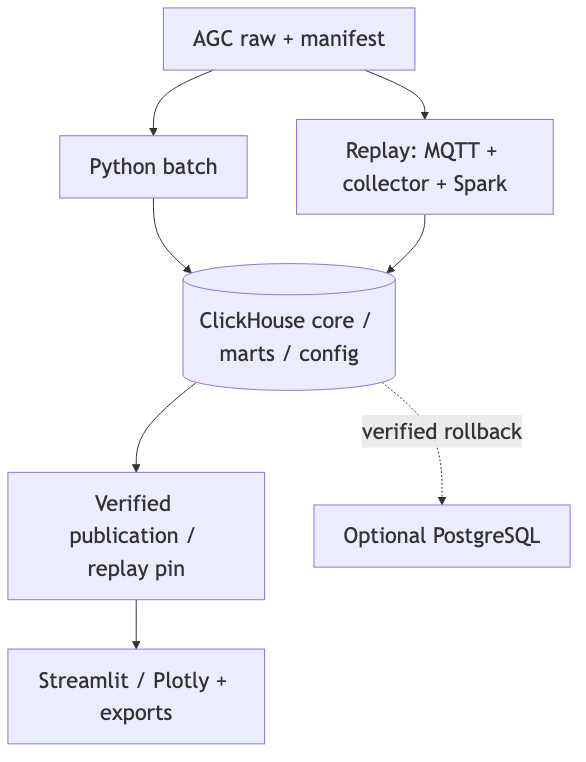

## I · 1. Bối cảnh và người dùng

- Người vận hành: khí hậu, tưới, drain; kỹ sư: EC/pH và quality.
- Quản lý: thu hoạch, năng lượng, chi phí và scenario.
- Vấn đề: khác grain/đơn vị, thiếu dữ liệu, khó truy nguồn.
- Mục tiêu: phân tích local có version, quality và bằng chứng.

## I · 2. Sáu BR cho ba thành viên

- A: BR-01 khí hậu; BR-03 EC/pH drain.
- B: BR-02 tưới/drain; BR-05 thu hoạch A/B.
- C: BR-04 kWh/kg A; BR-06 chi phí và scenario.
- Mỗi BR có công thức, edge cases, UI/export và AC.

## II · 3. Dataset và grain

- AGC 2nd edition 2019–2020:45 file,43 CSV,622.899 dòngCSV; ZIP khóa SHA-256.
- Climate:5 phút; Resources:ngày; Production:record thu hoạch.
- Full core:287.989 revision/14.062.934 measures được đối soát.
- Source clock chưa xác minh timezone; NULL khác 0; replay khác lịch sử.

## II · 4. Chất lượng và giả định

- Quality theo measure; missing/invalid/suspect có reason và provenance.
- Reference ngoài vụ: quarantine, không tự sửa năm.
- Basis 62,5 m² assumed_unverified; sensitivity 96/62,5=1,536.
- Rule demo/tariff lịch sử có nhãn; scenario không phải hóa đơn.

## III · 5. Kiến trúc thực chạy

## III · 6. Công nghệ và lý do chọn

- ClickHouse 25.8: columnar warehouse; Python native historical batch.
- Spark 4.0.1 Structured Streaming: sensor micro-batch/checkpoint.
- MQTT+SQLite: outbox/spool bền; Streamlit/Plotly:9 màn hình, CSV/JSON.
- Docker local/internal network; PG 17.10 đối chứng và rollback riêng.

## III · 7. Publication, retry và correction

- Append-only revisions; conflict không last-write-wins.
- Shared flock, durable intent/query ID; lost ACK phải reconcile.
- Verify bundles rồi COMPLETE; một action/export ghim một publication.
- Correction tạo pin mới; config/scenario lưu full immutable envelope.

## III · 8. Sensor: hai loại xác nhận

- Replay Climate→outbox→MQTT→durable collector→raw-ready→Spark→CH.
- PUBACK khác warehouse receipt; kiểm count/hash/cursor/control.
- Replay scope/checkpoint generation riêng; không cộng lịch sử.
- Finite replay complete vẫn có collector stale khi producer dừng.

## IV · 9. Demo BR-01/02

- Chọn scope/khoang/ngày/rule; xem episode, coverage và nguồn.
- Video gốc 4b08…: Automatoes 02–03/03,tưới 9,36/drain 3,89→41,56%.
- App hiện hành 5d45…: correction có audit+1 Irr→10,36/3,89→37,55%.
- Raw/pin gốc không đổi; export ghim đúng pin, không trộn số.

## IV · 10. Demo BR-03/05

- EC/pH: tìm episode ngoài rule demo, unknown/gap và nước ngày.
- Harvest: record/ngày/tuần; paired B/(A+B), lineage, completeness.
- Digilog 19/02:A 0,05/B 0,10 kg/m²→share B 66,67%.
- Reference quarantine khác một vụ đầy đủ; thiếu khác 0.

## IV · 11. Demo BR-04/06

- Automatoes 02–03/03:308,078 kWh; A=0→intensityNULL.
- Basis 62,5 m² giả định; tariff tham chiếu lịch sử.
- Baseline 17,6001→điện +20%:20,8407 EUR; tổng tăng 18,41%.
- Save/reopen frozen scenario; không áp pin cũ ngầm lên pin mới.

## IV · 12. Demo replay và bộ video

- Replay 30 dòng AGC, MQTT/Spark thật; theo dõi 10→30 và đối soát.
- Tách source clock/freshness; xem quality, trace và export.
- Bảy native video 1080p:109 bước/21 exports/27 phút 22,56 s.
- Thuyết trình 24 phút chỉ dùng highlights; toàn bộ video nộp riêng.

## V · 13. Correctness và rollback

- Full 6 BR/96 CSV/30 lineage/18 nhómthreshold/67.829 episode khớpPG/raw.
- T39:100 tests,91 chạy/chínheavy skips; không cộng các suite giao nhau.
- Cutover:315 configs/178 scenarios/62 intents/bảy replay pins bảo toàn.
- Backup đọc toàn bộ; reverse import→parity→mởapp; original PG giữ nguyên.

## V · 14. Hai phép so riêng biệt

- Kiến trúc: Hybrid vs Kimball gọn, cùng PostgreSQL và semantic contracts.
- Engine: native Hybrid CH vs PG, cùng snapshot/workload/caps.
- PG lifecycle có Spark stage; CH historical là Python: so implementation.
- Kimball ít lớp; chưa chứng minh recovery/correction tương đương Hybrid.

## V · 15. Performance engine: warm p95

- 1 CPU/2 GiB mỗiDB; Automatoes 166 ngày;5 warm-up+30 mẫu/BR.
- CH BR-01→06:1786/108/1363/118/99/134 ms; cả sáu≤2000 ms.
- PG tương ứng 1498/12/1052/20/5/17 ms: nhanh hơn lượt đã đo.
- CH active footprint thấp hơn; cold proof/scenario writes có chi phí lớn.

## V · 16. Cold và kiến trúc: đọc đúng số

- T49 cold catalog:PG 0,167 s/CH 141,242 s; không phải warm query.
- PG Hybrid/Kimball gốc:BR-01 p95 4061/3028 ms, đều vượt 2 s.
- Hybrid follow-up 1771 ms là lượt riêng; không thay số benchmark gốc.
- Chưa đo concurrent users/SLA; raw samples và điều kiện có trong report.

## V · 17. Effectiveness và lỗi đã xử lý

- Playwright có oracle/filter/export/save/reopen; đầy đủdecode/playerreview.
- Chưa có người tham gia; automation không đo user satisfaction/time.
- Sửa late HTTP stream error, cold metric_log memory và replay clock import.
- Giữ expected outputs/fault logs; không tăng memory cap để che lỗi.

## VI · 18. Chạy lại và bàn giao

- Images+ZIP chuẩn bị trước; snapshot→migrate→pipeline→tariff→app.
- Default CH không cầnPG; backup gồmDB/raw/config/journal/WAL/checkpoint.
- project-submit:report/slides/app+walkthrough; tên/MSSV placeholder.
- Video tổng thể 20–30 phút nhóm quay offline, kiểm gói cuối sau khi bổ sung.

## VI · 19. Kết luận và giới hạn

- SáuBR+sensor local có correctness/performance/UI evidence và alternatives.
- Giới hạn:single-node, cold minutes, scenario writes, basis/timezone/rule demo.
- Không có hardware/user study; chưa chứng minh năng suất/lợi nhuận thực tế.
- Nguồn:DE_Requirements.pdf, AGC ReadMe/Economics, docs/evaluation manifests.
