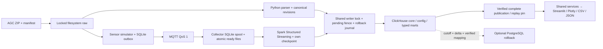

# Smart Greenhouse

Assignment môn **Data Engineering**: warehouse phân tích nhà kính chạy local với
**ClickHouse**, Python, MQTT, Spark Structured Streaming và Streamlit/Plotly.
Sáu BR bao gồm khí hậu, nước, EC/pH drain, năng lượng, thu hoạch và chi phí.
PostgreSQL là backend đối chứng và rollback theo nhu cầu.

Dữ liệu chính là AGC 2nd edition 2019–2020. Simulator phát lại các dòng Climate
thật qua outbox → MQTT → collector → Spark; đây là replay dữ liệu lịch sử,
không phải measurement mới từ phần cứng. Raw, lịch sử, replay và scenario có
định danh riêng. Ngưỡng demo và diện tích giả định luôn có nhãn.

## Chạy local

Cần Docker/Compose, image và dependency chuẩn bị trước, ZIP AGC đã khóa và
filesystem local hỗ trợ POSIX lock. Full AGC cần thêm dung lượng cho temporary
verified rows, warehouse và backup; nên chuẩn bị ít nhất 12 GiB trống cho lần
bootstrap riêng. Harness kiểm tối thiểu 6 GiB trước rebuild và 3 GiB trước read.
Không cần tài khoản cloud hoặc PostgreSQL server cho đường chạy mặc định.

Lệnh dưới dành cho checkout mới. Với deployment có sẵn, giữ `.env`, project,
volume và coordinator cũ; đọc [cutover/rollback](docs/implementation/clickhouse-cutover-rollback.md)
trước khi đổi backend.

```bash
test -e .env || cp .env.example .env
# Chỉnh CH_PASSWORD và host paths trong .env.
mkdir -p data/import data/raw tmp/clickhouse-state/coordinator tmp/clickhouse-state/output
chmod 777 tmp/clickhouse-state tmp/clickhouse-state/coordinator tmp/clickhouse-state/output
docker compose --profile tools build ch-client ch-job ch-app
docker compose up -d --wait --no-build --pull never clickhouse
```

Đặt ZIP `autonomous-greenhouse-challengeagc-2nd-2019.zip` trong `data/import/`.
SHA-256 bắt buộc là
`c19d385e7f4731a77e59ebfd763fd49e35e7ac4128d0aaf41b5717709cd75a68`.
Xem [snapshot](docs/implementation/dataset-snapshot.md) để lấy nguồn và kiểm
checksum. Không commit dataset hoặc credential.

```bash
# Snapshot cần raw mount writable; job phân tích bình thường chỉ đọc raw.
# Nếu đổi GREENHOUSE_RAW_PATH, thay host path dưới đây tương ứng.
docker compose --profile tools run --rm --no-deps --user 0:0 \
  -v "$PWD/data/raw:/data/raw" ch-job python -m greenhouse snapshot

docker compose --profile tools run --rm ch-job python -m greenhouse migrate
docker compose --profile tools run --rm ch-job python -m greenhouse run-pipeline \
  --scope-id agc-2nd-2019-c19d385e7f4731a77e59ebfd763fd49e35e7ac4128d0aaf41b5717709cd75a68:historical \
  --workflow-id first-local-run --agc-shared-basis
```

Lệnh pipeline chọn rõ giả định shared basis 62,5 m²; không biến giả định này
thành bằng chứng nguồn. Giữ publication ID từ output để đăng ký tariff:

```bash
docker compose --profile tools run --rm ch-job python -m greenhouse register-agc-tariff \
  --publication-id PUBLICATION_ID \
  --scope-id agc-2nd-2019-c19d385e7f4731a77e59ebfd763fd49e35e7ac4128d0aaf41b5717709cd75a68:historical
docker compose up -d --wait --no-build --pull never ch-app ch-web
```

Mở **http://127.0.0.1:18581**; port có thể đổi bằng `GREENHOUSE_CH_APP_PORT`.
Chọn khoang/vụ, ngày, rule version và scenario trong thanh bên. App không tự
migrate, nạp fixture hay tạo số liệu khi chưa có publication.

`compose.yaml` include cấu hình native; chỉ relay `ch-web` publish localhost.
App, job và DB dùng network internal. Native batch dùng CPython/shared semantic
transforms; Spark thực sự chạy ở sensor streaming. Image processing chung còn
chứa JDBC/driver cho PostgreSQL compatibility, không cần server PG để chạy CH.

## Yêu cầu nghiệp vụ

| BR | Câu hỏi | Đặc tả |
|---|---|---|
| BR-01 | Nhiệt độ/CO₂ lệch điều kiện khi nào, bao lâu? | [Khí hậu](docs/br/br_01_climate-condition-monitoring.md) |
| BR-02 | Lượng tưới, drain và tỷ lệ paired theo ngày/tuần/vụ? | [Nước](docs/br/br_02_irrigation-drainage-monitoring.md) |
| BR-03 | EC/pH drain có các đợt ngoài mục tiêu nào? | [EC/pH](docs/br/br_03_drain-nutrition-monitoring.md) |
| BR-04 | Năng lượng và cường độ trên sản lượng A là bao nhiêu? | [Năng lượng](docs/br/br_04_energy-intensity-analysis.md) |
| BR-05 | Sản lượng A/B, cơ cấu và mức độ đầy đủ thay đổi ra sao? | [Thu hoạch](docs/br/br_05_harvest-quality-tracking.md) |
| BR-06 | Chi phí theo tariff và kịch bản giá thay đổi thế nào? | [Chi phí](docs/br/br_06_energy-cost-scenarios.md) |

Các tên file BR đầy đủ được liệt kê tại [docs/br](docs/br/).
Missing, NULL, zero, suspect, invalid và partial được phân biệt. Source clock
chưa xác minh timezone; operating clock dùng UTC. Không điền thiếu bằng 0.
[Quyết định dữ liệu](docs/implementation/data-decisions.md) ghi unit, quality,
area basis, boundary và provenance trước khi diễn giải KPI.

## Kiến trúc thực chạy



[Danh mục 10 sơ đồ](docs/architecture/README.md) đi sâu vào deployment, sensor,
publication, core schema, metadata, marts, application contracts và recovery.
[ADR ClickHouse](docs/adr/003-clickhouse-warehouse.md) và
[migration contract](docs/implementation/clickhouse-migration-contract.md) giải
thích immutable envelopes, exact Decimal, correction và retry.

## Kiểm chứng và chạy lại

- [Correctness PostgreSQL](docs/evaluation/correctness.md) và [ClickHouse parity](docs/evaluation/clickhouse-parity.md): giữ nhãn engine và publication riêng.
- [ClickHouse acceptance](docs/evaluation/clickhouse-acceptance.md), [offline/restore](docs/evaluation/clickhouse-local-repro.md) và [cutover/rollback](docs/implementation/clickhouse-cutover-rollback.md): publication, config/scenario, WAL và checkpoints có bằng chứng.
- [Benchmark engine](docs/evaluation/clickhouse-performance.md): cùng workload/caps, warm-up và mẫu đo được ghi rõ. PostgreSQL nhanh hơn các workload đã đo; ClickHouse có active footprint thấp hơn. Cold verification và scenario writes có chi phí đáng kể.
- [Hybrid/Kimball](docs/evaluation/kimball.md): thí nghiệm riêng trên PostgreSQL; không gộp với so sánh engine.
- [Walkthrough](docs/evaluation/usability.md): bảy video native có 109 bước, 21 file xuất, gồm sensor MQTT/Spark thật. Đây là kiểm thử tự động, chưa có nghiên cứu người dùng.

Video nằm local tại `project-submit/demo-videos/clickhouse/index.html`, không
commit media. [Metadata/checksum](docs/evaluation/assets/clickhouse-walkthrough/README.md)
và [hướng dẫn recorder](tools/walkthrough/README.md) nằm trong Git. Video gốc ghim
publication đã nghiệm thu; các correction diễn tập sau đó có publication và
audit riêng, không thay raw hoặc giả làm quan sát AGC gốc.

Bản PostgreSQL giữ các script legacy: `scripts/test_local.sh`,
`scripts/test_offline_smoke.sh`, `scripts/test_sensor_backup_restore.sh` dùng
`compose.postgres.yaml` tường minh và fixture riêng. Với PG deployment thủ công,
luôn dùng project riêng, ví dụ `docker compose -p greenhouse-postgres -f
compose.postgres.yaml ...`; không dùng project native để tạo/xóa PG volumes.

Native test và replay harness: [client/package](src/greenhouse/clickhouse/README.md),
[UI/CLI](docs/implementation/clickhouse-ui-cli.md), [sensor](docs/implementation/clickhouse-sensor.md),
[full local rehearsal](scripts/clickhouse_repro/README.md). Đã cutover thì giữ
`GREENHOUSE_CH_REQUIRE_CUTOVER_JOURNAL=1`; thiếu journal/sai namespace hoặc intent
chưa rõ kết quả phải chặn ghi.

## Bàn giao

[project-submit](project-submit/) chứa report/slides PDF, gói ứng dụng, video
walkthrough và hướng dẫn. Source tài liệu ở [docs/submission](docs/submission/).
Video thuyết trình tổng thể do người dùng quay offline sau cùng theo kịch bản;
kiểm gói trước video và kiểm cuối cùng là hai trạng thái riêng.

Giới hạn thực tế: single-node/local flock; cold proof có thể mất nhiều phút;
raw/basis/rule chưa phải xác minh nông học; replay không chứng minh sensor phần
cứng; chưa có user study. Mọi mở rộng hoặc tối ưu cần giữ các contract và gate.
