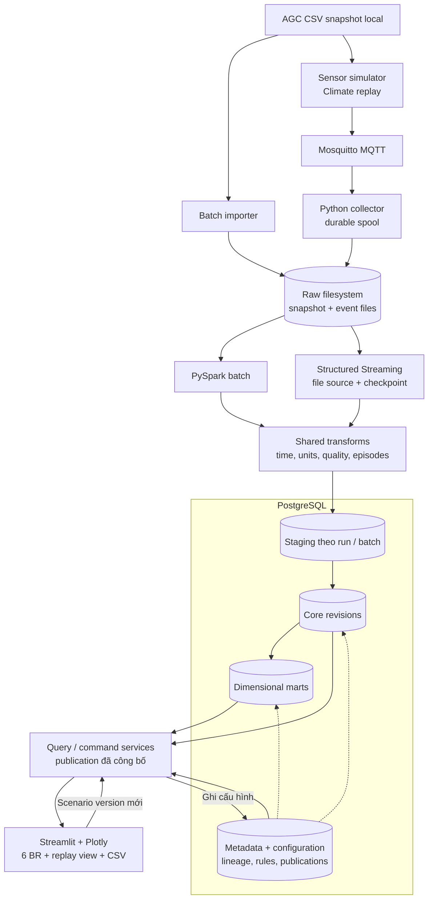
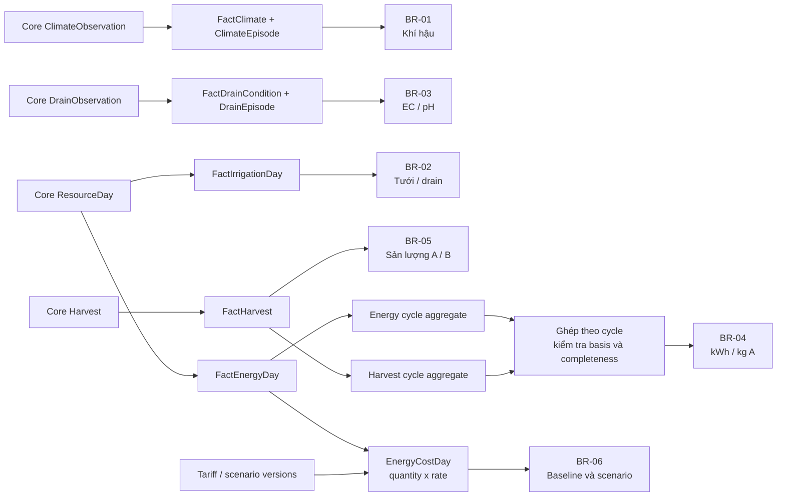

# Smart Greenhouse

Assignment môn **Data Engineering**: hệ thống phân tích dữ liệu nhà kính chạy
local, từ AGC snapshot và sensor replay qua PostgreSQL data warehouse tới
Streamlit/Plotly dashboard. Sáu nghiệp vụ bao gồm khí hậu, nước, EC/pH, năng
lượng, thu hoạch và chi phí; [đặc tả](docs/br/) và
[ma trận bằng chứng](docs/implementation/requirements-matrix.md) mô tả phạm vi.

**Trạng thái:** sáu màn hình BR, simulator/collector/Structured Streaming và
replay view đã triển khai. [Correctness và phục hồi](docs/evaluation/correctness.md)
có test và oracle theo BR; [benchmark](docs/evaluation/performance.md) cho thấy
lượt gốc BR-01 p95 uncached **4.060,81 ms**, chưa đạt 2.000 ms; [follow-up sau tối ưu](docs/evaluation/rule-engine-optimization.md) đo **1.770,93 ms** trên cùng workload trong một lượt riêng. [Sáu video walkthrough Playwright](docs/evaluation/usability.md) đã đạt: 93 bước,
19 file xuất, MP4 1080p có chú thích tiếng Việt. Đây là đánh giá tự động, chưa có
người tham gia. Kết quả lịch sử, replay và scenario luôn tách scope; giả định diện
tích và ngưỡng demo có nhãn, không phải khuyến nghị canh tác.

## Chạy local

Cần Docker Engine và Docker Compose, đủ dung lượng cho image, PostgreSQL và
snapshot. Lần build đầu tải base image, apt/pip và JDBC; chuẩn bị trước để vận
hành offline. Không cần cài Python, Java, Spark, PostgreSQL hay tài khoản cloud
trên host. Sau khi chuẩn bị, thao tác runtime dùng dịch vụ local.

```bash
cp .env.example .env
# Chỉnh GREENHOUSE_DB_PASSWORD và đường dẫn trong .env cho môi trường local.
docker compose --profile '*' build
docker compose up -d --wait db
docker compose run --rm job python -m greenhouse migrate
```

`.env` không được commit. Với DB volume đã tồn tại, đổi password trong `.env`
không tự đổi password trong PostgreSQL. Dừng dịch vụ bằng
`docker compose --profile '*' down` (giữ named volumes). Xem
[backup và khôi phục](docs/implementation/backup-restore.md) trước khi di chuyển
hoặc thay đổi dữ liệu.

### Chuẩn bị AGC và nạp dữ liệu lịch sử

Lấy archive AGC 2nd edition theo [hướng dẫn snapshot](docs/implementation/dataset-snapshot.md),
đặt bản ZIP đã khóa trong `data/import/`. SHA-256 bắt buộc:
`c19d385e7f4731a77e59ebfd763fd49e35e7ac4128d0aaf41b5717709cd75a68`.
Đường dẫn import/raw có thể đổi trong `.env`; không commit dataset hoặc credential.
Snapshot kiểm checksum, tạo manifest và không ghi đè snapshot bất biến.

Lệnh biểu giá đăng ký baseline lịch sử từ `Economics.pdf` cho BR-06: nhiệt
0,0083 EUR/MJ, điện cao 0,08 EUR/kWh và điện thấp 0,04 EUR/kWh trong khoảng
hiệu lực đã ghi trong nguồn. Đây là giá tham chiếu, không phải hóa đơn thực.
Chạy lệnh không có `--apply` để kiểm tra trước; lệnh chỉ chấp nhận scope AGC
lịch sử đã công bố energy mart và không thay biểu giá baseline khác đã có.

```bash
docker compose --profile tools run --rm snapshot
docker compose run --rm job python -m greenhouse run-pipeline --workflow-id first-local-run
docker compose run --rm job python -m greenhouse register-agc-tariff --apply
docker compose up -d --wait db app
```

Mở **http://127.0.0.1:8501**. Chọn publication, khoang/vụ và khoảng ngày;
chuyển giữa sáu BR, tổng quan và chất lượng bằng thanh bên. Nếu chưa có
publication thì app báo dữ liệu trống, không tự tạo fixture. Lệnh `setup` mặc
định chỉ kiểm tra môi trường, không nạp dữ liệu. Xem [ứng dụng](src/greenhouse/app/README.md)
và [pipeline](src/greenhouse/db/README.md) để hiểu rule, basis, lineage và export.

### Rule demo và diễn tập từ clone riêng

Pipeline không tự gán ngưỡng nông học. Khi cần minh họa đánh giá khí hậu,
EC/pH hoặc loại B, có thể đăng ký rõ các profile **demo**, rồi chọn version
trong dashboard. Bỏ `--apply` để xem kế hoạch trước:

```bash
docker compose run --rm job python -m greenhouse.db.demo_rules --kind climate --apply
docker compose run --rm job python -m greenhouse.db.demo_rules --kind drain --apply
docker compose run --rm job python -m greenhouse.db.demo_rules --kind harvest --apply
```

Để kiểm tra toàn bộ snapshot trên database mới, cách ly Internet runtime và
backup/restore raw, DB, outputs cùng trạng thái sensor, dùng
[hướng dẫn diễn tập full AGC](scripts/repro/README.md). Các script tạo project
Docker riêng; không trỏ vào volume hoặc database đang vận hành.

### Sensor replay và kiểm thử

Simulator phát lại Climate qua MQTT, collector lưu spool trước ACK và Spark
công bố replay trong scope riêng. [Hướng dẫn sensor](src/greenhouse/sensor/README.md)
mô tả simulator, collector, stream ID, checkpoint, scope và resume; không gộp
replay với publication lịch sử. [Bằng chứng replay](docs/evaluation/sensor-replay.md)
bao gồm duplicate/conflict/late và restart dịch vụ test riêng.

```bash
./scripts/test_local.sh           # backend, UI/export, sensor fault & recovery
./scripts/test_offline_smoke.sh   # fixture: Spark + UI + sensor trên network internal
./scripts/test_sensor_backup_restore.sh # fixture: SQLite WAL + Spark checkpoint restore
./scripts/test_effectiveness.sh   # sáu walkthrough UI tự động, không phải test người thật
```

Test tạo database fixture `test_` và container sensor riêng; log trong `tmp/`.
Thời gian AppTest không phải thời gian thao tác người dùng. Có thể mở
[prototype HTML](prototypes/dashboard/preview.html) offline; đây là fixture
review giao diện, khác app production.

Để quay lại hoặc mở bộ video sáu BR, xem [hướng dẫn Playwright](tools/walkthrough/README.md)
và [danh mục video local](docs/evaluation/assets/playwright-t26/README.md).

## Dữ liệu và phạm vi

AGC 2nd edition (2019–2020) chứa lịch sử nhà kính cà chua: `GreenhouseClimate.csv`
ở grain khoang × slot 5 phút, `Resources.csv` ở grain khoang × ngày và
`Production.csv` theo record thu hoạch. Weather và nguồn bổ sung không được tự
trộn vào KPI. Thiếu dữ liệu, NULL, zero, partial và chất lượng theo measure được
phân biệt; source timestamp chưa được gắn timezone suy đoán. Đọc
[quyết định dữ liệu](docs/implementation/data-decisions.md) trước khi diễn giải.

## Yêu cầu nghiệp vụ

| BR | Câu hỏi cần trả lời | Đặc tả |
|---|---|---|
| BR-01 | Khoang nào có đợt nhiệt độ/CO₂ lệch điều kiện, diễn ra khi nào và kéo dài bao lâu? | [Theo dõi khí hậu](docs/br/br_01_climate-condition-monitoring.md) |
| BR-02 | Lượng tưới, drain và tỷ lệ drain thay đổi thế nào theo ngày/tuần/vụ? | [Tưới và drainage](docs/br/br_02_irrigation-drainage-monitoring.md) |
| BR-03 | EC/pH drain có các đợt ngoài mục tiêu nào, và đâu là dữ liệu nghi lỗi? | [Dinh dưỡng qua EC/pH](docs/br/br_03_drain-nutrition-monitoring.md) |
| BR-04 | Cần bao nhiêu kWh cho mỗi kg loại A khi đủ bằng chứng về diện tích và dữ liệu? | [Cường độ năng lượng](docs/br/br_04_energy-intensity-analysis.md) |
| BR-05 | Sản lượng, cơ cấu A/B và lũy kế thu hoạch thay đổi ra sao? | [Thu hoạch và chất lượng](docs/br/br_05_harvest-quality-tracking.md) |
| BR-06 | Chi phí năng lượng thay đổi bao nhiêu nếu đổi biểu giá và giữ nguyên tiêu thụ? | [Kịch bản chi phí](docs/br/br_06_energy-cost-scenarios.md) |

Mỗi BR có quy tắc quality, missing data, đơn vị, mẫu số và tiêu chí đối soát. Giá trị `0`, `NULL`, kết quả partial và chưa đủ điều kiện tính được phân biệt rõ. Tính năng sensor replay mở rộng BR-01/03, không thay thế các yêu cầu phân tích lịch sử.

[Ma trận truy vết yêu cầu](docs/implementation/requirements-matrix.md) nối sáu BR với nguồn/cột, biến đổi, màn hình, AC và bằng chứng thực tế và các giới hạn còn lại; đồng thời phân biệt BR hiện hành với mã BR trong presentation cũ.

## Tech stack

| Thành phần | Công nghệ | Vai trò |
|---|---|---|
| Ngôn ngữ | Python, SQL | Tiếp nhận, xử lý, truy vấn và ứng dụng |
| Raw storage | Filesystem local | Snapshot, CSV/JSONL, checksum và manifest |
| Sensor giả lập | Python + MQTT Mosquitto | Replay, fault injection và collector lưu bền |
| Xử lý | PySpark batch + Structured Streaming | Chuẩn hóa, quality, episode và xử lý micro-batch |
| Data warehouse | PostgreSQL | Staging, core, marts, metadata và cấu hình có version |
| Dashboard | Streamlit + Plotly | Bộ lọc, biểu đồ, drill-down, scenario và export |
| Đóng gói | Docker Compose | Processing, UI, sensor images; profiles và volumes local |
| Kiểm thử | pytest; SQL assertions, contract/fault tests | Kiểm tra BR, publication, export và phục hồi sensor |

Prototype dùng fixture riêng; app production đọc publication đã công bố. Quyết định kiến trúc nằm trong [ADR-001](docs/adr/001-local-deployment-stack.md), phiên bản và bằng chứng spike trong [ADR-002](docs/adr/002-container-stack-compatibility.md).

## Kiến trúc tổng quan

Kiến trúc Hybrid giữ raw, chuẩn hóa dữ liệu trong core rồi tạo dimensional marts phục vụ các BR.



Collector lưu raw trước khi xác nhận nhận message; pipeline kiểm tra và công bố dữ liệu theo version. Dashboard dùng cùng `publication_id` cho KPI, drill-down và export. Thời gian nguồn phục vụ phân tích nghiệp vụ được tách khỏi thời gian phát/nhận phục vụ đo độ trễ.

## Data marts và luồng phân tích



Energy và Harvest được tổng hợp riêng trước khi ghép để tránh nhân dữ liệu. Các tỷ lệ dùng tử/mẫu trên cùng tập hợp lệ; không cộng các tỷ lệ ngày. Diện tích, completeness và các điều kiện công bố KPI được mô tả trong [thiết kế data marts](docs/architecture/07-data-marts.md).

## Tài liệu và sơ đồ

[Báo cáo, slide và kịch bản video dự thảo](docs/submission/README.md) giữ rõ các phần chưa hoàn tất.


Toàn bộ sơ đồ được viết bằng **Mermaid** trong Markdown. Xem [mục lục kiến trúc](docs/architecture/README.md) hoặc mở từng thành phần:

| Tài liệu | Nội dung |
|---|---|
| [Quyết định stack](docs/adr/001-local-deployment-stack.md) | PostgreSQL trước, chạy local, sensor replay và hướng chuyển ClickHouse |
| [Khóa phiên bản và spike container](docs/adr/002-container-stack-compatibility.md) | Docker-first, phiên bản/nguồn, lệnh kiểm tra MQTT–Spark–PostgreSQL và kết quả synthetic |
| [01 — Tổng quan](docs/architecture/01-overview.md) | Nguồn, ingestion, processing, warehouse và dashboard |
| [02 — Deployment local](docs/architecture/02-local-deployment.md) | Services, network, volumes và các profile dự kiến |
| [03 — Sensor ingestion](docs/architecture/03-sensor-ingestion.md) | Simulator, event envelope, collector, ACK và lưu bền |
| [04 — Processing & publication](docs/architecture/04-processing-publication.md) | Transform dùng chung, late data, idempotency và phục hồi |
| [05 — Core schema](docs/architecture/05-core-schema.md) | ERD nghiệp vụ, grain, revision và quality theo measure |
| [06 — Metadata & configuration](docs/architecture/06-metadata-schema.md) | ERD lineage, publication, rule, tariff và scenario |
| [07 — Data marts](docs/architecture/07-data-marts.md) | Conformed dimensions và luồng mart của sáu BR |
| [08 — Application contracts](docs/architecture/08-application-contracts.md) | UI/service/adapter, query contracts và tạo scenario |
| [09 — ClickHouse migration](docs/architecture/09-clickhouse-migration.md) | Backfill, parity checks, cutover và rollback sau MVP |
| [Benchmark Hybrid/Kimball](docs/evaluation/performance.md) | Pipeline mới/rerun/rebuild, storage, sáu BR và COPY so với INSERT; số đo và lệnh tái lập |
| [UI prototype](prototypes/dashboard/README.md) | Cách chạy, fixture, giới hạn và kiểm tra giao diện |

Tài liệu nền:

- [Yêu cầu assignment môn DE — PDF](DE_Requirements.pdf) và [bản Markdown](DE_Requirements.md).
- [Nghiên cứu các cách thiết kế data warehouse](docs/ref/DWH_Design_Approaches_Research.md).
- [Phân tích kiến trúc Hybrid](docs/ref/DWH_Hybrid_Approach_Deep_Dive.md).
- [Phân tích nguồn dữ liệu Smart Greenhouse](docs/ref/SmartGreenhouse_Case_Analysis.md).

Các tài liệu trong `docs/ref/` là tham khảo từ giai đoạn nghiên cứu và có thể chứa đề xuất cũ. Khi có khác biệt, dùng bộ BR, ADR và thiết kế hiện tại làm cơ sở triển khai.

## Cấu trúc repository

```text
.
├── readme.md
├── .streamlit/config.toml          # Theme và cấu hình UI local
├── compose.yaml                    # Profiles batch / sensor / test / tools
├── docker/                         # Processing / UI / sensor images và Mosquitto config
├── requirements*.lock              # Dependency closure từng image, pin chính xác
├── src/greenhouse/                 # Package, CLI, config và diagnostic probes
│   └── app/                        # Sáu BR, replay, catalog và export (Streamlit)
├── tests/                          # Unit/integration tests, tests/ui (AppTest) và fixture synthetic
├── config/                         # Quy ước cấu hình
├── scripts/                        # Quy ước wrapper Compose
├── DE_Requirements.pdf
├── DE_Requirements.md
├── docs/
│   ├── adr/                       # Quyết định kiến trúc
│   ├── architecture/              # Mermaid diagrams và thiết kế chi tiết
│   ├── br/                        # Sáu đặc tả nghiệp vụ
│   ├── implementation/            # Ma trận truy vết yêu cầu và bằng chứng
│   └── ref/                       # Tài liệu nghiên cứu và tham khảo
└── prototypes/dashboard/
    ├── app.py                     # Ứng dụng Streamlit
    ├── data.py                    # Fixture, KPI demo và Plotly figures
    ├── build_preview.py           # Tạo HTML offline
    ├── template.html              # Layout của HTML preview
    ├── preview.html               # Artifact để mở review
    ├── requirements.txt
    └── README.md
```

## Giới hạn và công việc còn lại

- Đánh giá người dùng theo [protocol](docs/evaluation/usability.md) là mở rộng tùy chọn; T26 dùng walkthrough Playwright theo phạm vi đã chốt. Không suy ra hiệu quả thực tế từ test tự động.
- BR-01 vượt mục tiêu p95 ở lượt gốc; lượt sau tối ưu đạt 1.770,93 ms trong điều kiện đo, cần lặp lại trước khi kết luận SLA. Xem [benchmark](docs/evaluation/performance.md) và [follow-up](docs/evaluation/rule-engine-optimization.md).
- [Full AGC/offline và backup/restore](docs/evaluation/local-repro.md) đã đạt trên clone riêng; sensor phục hồi được kiểm trên 30 dòng AGC. Còn hoàn thiện metadata nhóm, báo cáo/slide cuối và video thuyết trình để chốt nộp.
- ClickHouse đang được chuyển đổi theo [các gate migration](docs/architecture/09-clickhouse-migration.md); PostgreSQL vẫn là baseline đến khi đủ nghiệm thu.

### ClickHouse candidate

Cả sáu BR có bản ClickHouse chạy local, dùng cùng dashboard và contracts. Xem [cách chạy và đối soát](docs/implementation/clickhouse-water.md). Xem thêm [thu hoạch và completeness](docs/implementation/clickhouse-harvest.md), [khí hậu/drain và episode](docs/implementation/clickhouse-thresholds.md), [năng lượng và scenario giá](docs/implementation/clickhouse-energy-cost.md). Backend mặc định vẫn là PostgreSQL đến khi đủ các gate chuyển đổi; sensor sink, full backfill và các gate vận hành ClickHouse còn đang được triển khai.
