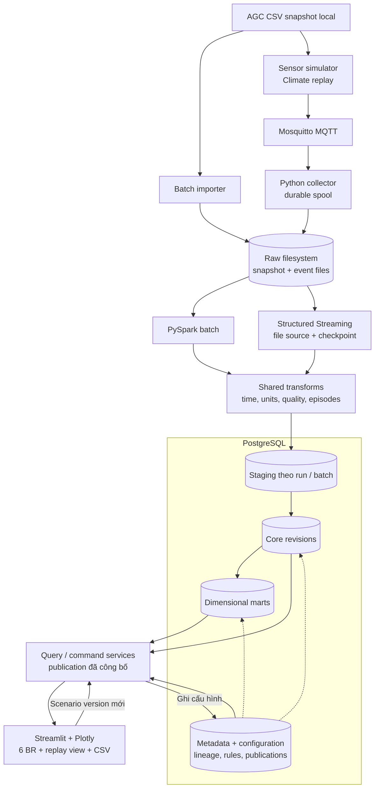
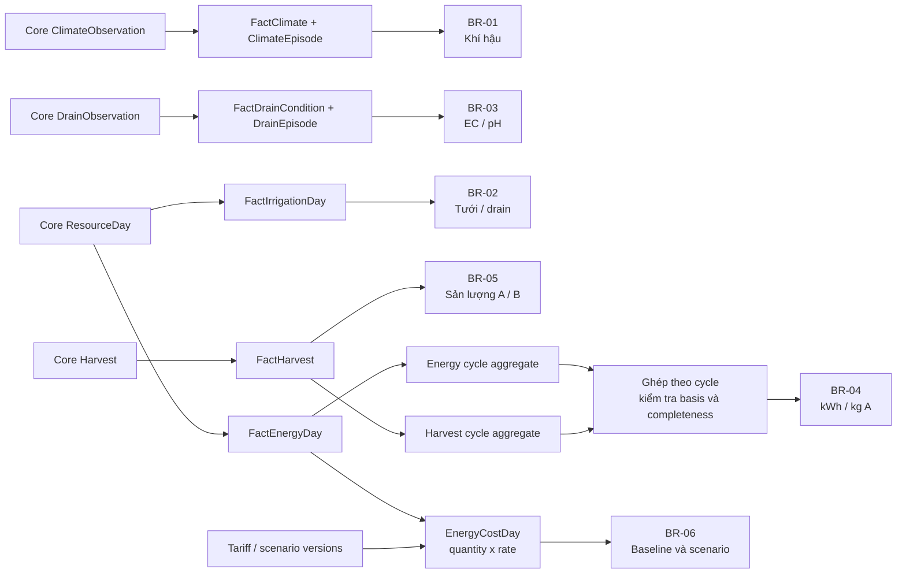

# Smart Greenhouse

Assignment môn **Data Engineering (DE)**: thiết kế hệ thống phân tích dữ liệu nhà kính, từ tiếp nhận và kiểm tra chất lượng đến data warehouse và dashboard hỗ trợ quyết định.

Project hướng đến ba nhóm người dùng: người vận hành theo dõi điều kiện nhà kính, kỹ sư canh tác phân tích nước và dinh dưỡng, quản lý đánh giá sản lượng, năng lượng và chi phí. Toàn bộ hệ thống được thiết kế để chạy **local**, với **PostgreSQL** là database đầu tiên và khả năng chuyển sang ClickHouse sau khi có kết quả đối soát.

**Bắt đầu:** [Chạy UI demo](#chạy-ui-demo) · [Yêu cầu nghiệp vụ](#yêu-cầu-nghiệp-vụ) · [Kiến trúc](#kiến-trúc-tổng-quan) · [Tài liệu và sơ đồ](#tài-liệu-và-sơ-đồ)

## Trạng thái hiện tại

| Hạng mục | Trạng thái |
|---|---|
| Sáu business requirements (BR) | Đã có đặc tả, công thức, điều kiện dữ liệu và tiêu chí nghiệm thu |
| Kiến trúc và schema | Đã có ADR, sơ đồ Mermaid tổng quan và chi tiết |
| Ứng dụng nước (BR-02) | Chạy được trên publication có water mart; [bằng chứng chức năng](docs/evaluation/br_02.md): 10/10 AC, đối soát raw↔publication AGC, p95 ≪ 2s — basis nước vẫn giả định chưa xác minh |
| UI demo Streamlit + Plotly | Prototype fixture-only để review giao diện; có bản HTML tương tác offline |
| PostgreSQL, Spark và MQTT | Có môi trường container và integration tests synthetic; pipeline AGC + water mart đã chạy |
| Docker Compose | Scaffold batch/sensor/test/tools; app production và pipeline nước chạy qua container, sensor còn là stub |
| ClickHouse | Phương án chuyển đổi sau MVP, chưa triển khai |

Prototype dashboard chỉ để review giao diện với fixture tổng hợp. Ứng dụng nước đọc publication đã publish; các kết quả chưa trải qua nghiệm thu BR-02 hoàn chỉnh.

## Chạy UI demo

### Bản HTML — không cần cài Python

Sau khi clone hoặc tải repository, mở `prototypes/dashboard/preview.html` bằng trình duyệt. File nhúng sẵn thư viện Plotly, biểu đồ và dữ liệu nên hoạt động offline. Khi xem repository trên GitHub, tải file về để mở; trang xem mã HTML không chạy dashboard trực tiếp.

[File HTML demo](prototypes/dashboard/preview.html) · [Hướng dẫn và source của prototype](prototypes/dashboard/README.md)

Các thao tác có thể thử:

- Chọn một trong ba khoang và hai ngày minh họa.
- Xem nhiệt độ, CO₂, EC hoặc pH; hover và zoom biểu đồ Plotly.
- Mở chi tiết các đợt ngoài dải demo và kiểm tra khoảng thiếu dữ liệu.
- Thay đổi giá điện để so sánh chi phí baseline với kịch bản.
- Xuất CSV theo bộ lọc, kèm quality, đơn vị và phiên bản dữ liệu.

### Chạy bằng Docker — ứng dụng nước và môi trường scaffold

Host chỉ cần **Docker Engine + Compose v2 trở lên**; không cài Python/Java/Spark/PostgreSQL/Mosquitto trên host. Từ root clone mới:

```bash
cp .env.example .env
docker compose --profile '*' build
docker compose --profile batch run --rm job
docker compose --profile test run --rm test-runner
docker compose --profile batch up -d --wait db app
```

Mở **http://127.0.0.1:8501**. Service app là **[ứng dụng nước](src/greenhouse/app/README.md)**: bộ lọc publication/khoang/ngày từ published catalog, KPI tưới/drain, biểu đồ ngày, bảng tuần, chi tiết ngày + lineage, xuất CSV/JSON. DB chưa có publication → ứng dụng báo trạng thái trống kèm lệnh; publication thiếu water mart → báo lỗi rõ, không fallback fixture. Lệnh `job` mặc định chỉ chạy `python -m greenhouse setup`: kiểm tra env/mount/DB, không ingest hoặc tạo schema nghiệp vụ. Chạy lại setup không sửa import/raw.

`.env` bị Git ignore; giá trị password trong `.env.example` chỉ là mẫu local. Compose báo lỗi nếu thiếu `GREENHOUSE_DB_PASSWORD`. Có thể đổi cổng app và đường dẫn archive trong `.env`; mặc định nguồn nhập là `data/import/` (read-only), raw `data/raw/` (read-only khi xử lý), output nằm trong named volume riêng. Không cần dataset để chạy setup/tests/prototype; phần snapshot T05 có lệnh riêng ở dưới.

Kiểm tra cấu hình sensor mà không khởi chạy các stub:

```bash
docker compose --profile sensor config --quiet
```

`ingest` có [parser/staging và manifest theo run](src/greenhouse/ingestion/README.md). Các lệnh [migrate, load-core, explain-core, run-pipeline, publish, lineage](src/greenhouse/db/README.md) dựng core PostgreSQL, chạy lại có recovery và publish membership/quality/basis cùng water mart. [Query contracts và service BR-02](src/greenhouse/queries/README.md) đọc published Resources qua PostgreSQL adapter, có sealed water mart, query ngày/ISO week/vụ, pure summary oracle và DTO dùng chung; [ứng dụng nước](src/greenhouse/app/README.md) và [catalog](src/greenhouse/app/README.md#chạy) tái dùng đúng service/DTO đó, không nhúng SQL vào UI. `transform` là alias của `run-pipeline`, chạy water mart hook trong publish transaction. `simulate`, `collect`, `stream` hiện thoát **mã 2**, ghi rõ “chưa hiện thực” và task sở hữu. Profile sensor đã khai báo broker, simulator, collector, stream-worker và volumes; chưa có replay hoặc xử lý streaming thật. Không gọi `up` toàn bộ sensor để coi như đã chạy pipeline.

Tạo lại HTML bằng image UI, mặc định xuất vào `data/output/preview/preview.html` bị ignore:

```bash
docker compose --profile tools run --rm preview-build
```

Khi chủ đích cập nhật artifact tracked `prototypes/dashboard/preview.html`:

```bash
GREENHOUSE_PREVIEW_PATH=./prototypes/dashboard docker compose --profile tools run --rm preview-build
```

Dừng dịch vụ và giữ volumes bằng `docker compose --profile '*' down`. Chỉ dùng lệnh dưới khi muốn **xóa toàn bộ named volumes của project này**, gồm PostgreSQL, output và trạng thái sensor; bind mounts import/raw không bị xóa:

```bash
docker compose --profile '*' down -v
```

Chi tiết [service/profile/port/volume, resource limits, lệnh kiểm tra và giới hạn](docs/implementation/local-environment.md). Môi trường và tests chỉ chứng minh hạ tầng scaffold; chưa nghiệm thu sáu BR.

## Dữ liệu và phạm vi

Nguồn dữ liệu đã khóa là **Autonomous Greenhouse Challenge, 2nd edition (2019–2020)**: dữ liệu lịch sử trồng cà chua trong các khoang nhà kính, gồm điều kiện khí hậu, tưới và drain, tài nguyên tiêu thụ, thu hoạch và các nguồn đo bổ sung. Bối cảnh và phân tích nguồn được ghi trong [tài liệu phân tích dataset](docs/ref/SmartGreenhouse_Case_Analysis.md).

Ba loại dữ liệu chính có grain khác nhau:

| Nguồn | Grain sử dụng | Mục đích |
|---|---|---|
| `GreenhouseClimate.csv` | Khoang/vụ × slot 5 phút | Khí hậu, setpoint và EC/pH drain |
| `Resources.csv` | Khoang/vụ × ngày | Tưới, drain, nhiệt và điện |
| `Production.csv` | Bản ghi thu hoạch | Sản lượng A/B, tỷ lệ và lũy kế |

Sensor simulator sẽ phát lại Climate qua MQTT với tốc độ điều chỉnh được, bổ sung tình huống trùng, trễ, thiếu và lỗi dữ liệu để kiểm chứng pipeline. Resources và Production vẫn giữ grain nguồn. Dữ liệu lịch sử, replay và fault injection có scope riêng để tránh cộng trùng vào KPI.

Demo giao diện hiện dùng **fixture tổng hợp**, chưa đọc dataset này. Các ngưỡng và basis diện tích trong demo là giả định có nhãn; không được diễn giải thành tiêu chuẩn canh tác hoặc kết quả thực tế.

## Chuẩn bị snapshot AGC

Nguồn ZIP đã khóa SHA-256 `c19d385e7f4731a77e59ebfd763fd49e35e7ac4128d0aaf41b5717709cd75a68` (12,793,984 byte). Đặt ZIP trong `data/import/`, hoặc cấu hình `GREENHOUSE_IMPORT_PATH` trỏ tới thư mục chứa bản copy ZIP local. Import luôn read-only; bản giải nén thủ công không phải snapshot.

```bash
docker compose -p smart-greenhouse --profile tools build snapshot
docker compose -p smart-greenhouse --profile tools run --rm snapshot
```

Nhánh tải ẩn danh (GET, không token) có network setup riêng:

```bash
docker compose -p smart-greenhouse --profile tools run --rm dataset-download
```

Cả hai lệnh tự kiểm fixture synthetic và checksum trước khi công bố snapshot. Raw mặc định ở `data/raw/agc-2nd-2019/<sha256>/`; chỉ snapshot writer được ghi raw, job/stream vẫn read-only. Chạy lại xác minh rồi báo already-exists, không ghi đè. Checksum sai giữ bằng chứng và thoát khác 0.

[Inventory đo từ snapshot](docs/implementation/data-inventory.md): 45 file (43 CSV + 2 PDF), 622,899 dòng CSV. [Lệnh inventory, fixture × AC và giới hạn](docs/implementation/dataset-snapshot.md). [Ingest](src/greenhouse/ingestion/README.md) đọc nguồn vào staging JSONL gzip có lineage và manifest; đã có loader candidate core/quality riêng sau migrate; chưa có publication hoặc KPI nghiệm thu. Không commit dataset.

## Yêu cầu nghiệp vụ

| BR | Câu hỏi cần trả lời | Đặc tả |
|---|---|---|
| BR-01 | Khoang nào có đợt nhiệt độ/CO₂ lệch điều kiện, diễn ra khi nào và kéo dài bao lâu? | [Theo dõi khí hậu](docs/br/br_01_climate-condition-monitoring.md) |
| BR-02 | Lượng tưới, drain và tỷ lệ drain thay đổi thế nào theo ngày/tuần/vụ? | [Tưới và drainage](docs/br/br_02_irrigation-drainage-monitoring.md) |
| BR-03 | EC/pH drain có các đợt ngoài mục tiêu nào, và đâu là dữ liệu nghi lỗi? | [Dinh dưỡng qua EC/pH](docs/br/br_03_drain-nutrition-monitoring.md) |
| BR-04 | Cần bao nhiêu kWh cho mỗi kg loại A khi đủ bằng chứng về diện tích và dữ liệu? | [Cường độ năng lượng](docs/br/br_04_energy-intensity-analysis.md) |
| BR-05 | Sản lượng, cơ cấu A/B và lũy kế thu hoạch thay đổi ra sao? | [Thu hoạch và chất lượng](docs/br/br_05_harvest-quality-tracking.md) |
| BR-06 | Chi phí năng lượng thay đổi bao nhiêu nếu đổi biểu giá và giữ nguyên tiêu thụ? | [Kịch bản chi phí](docs/br/br_06_energy-cost-scenarios.md) |

Mỗi BR có quy tắc quality, missing data, đơn vị, mẫu số và tiêu chí đối soát. Giá trị `0`, `NULL`, kết quả partial và chưa đủ điều kiện tính được phân biệt rõ. Tính năng sensor replay mở rộng BR-01/03, không thay thế các yêu cầu phân tích lịch sử.

[Ma trận truy vết yêu cầu](docs/implementation/requirements-matrix.md) nối sáu BR với nguồn/cột, biến đổi, màn hình, AC và bằng chứng dự kiến; đồng thời phân biệt BR hiện hành với mã BR trong presentation cũ. Các BR hiện đều chưa nghiệm thu.

## Tech stack

| Thành phần | Công nghệ | Vai trò |
|---|---|---|
| Ngôn ngữ | Python, SQL | Tiếp nhận, xử lý, truy vấn và ứng dụng |
| Raw storage | Filesystem local | Snapshot, CSV/JSONL, checksum và manifest |
| Sensor giả lập | Python + MQTT Mosquitto | Replay, fault injection và collector lưu bền |
| Xử lý | PySpark batch + Structured Streaming | Chuẩn hóa, quality, episode và xử lý micro-batch |
| Data warehouse | PostgreSQL | Staging, core, marts, metadata và cấu hình có version |
| Dashboard | Streamlit + Plotly | Bộ lọc, biểu đồ, drill-down, scenario và export |
| Đóng gói | Docker Compose | Processing, UI, sensor images; profiles và volumes local |
| Kiểm thử | pytest; SQL assertions, contract/fault tests dự kiến | Spike integration hiện có; correctness BR, phục hồi và đối soát batch–streaming sẽ triển khai tiếp |

UI prototype và spike synthetic có phạm vi riêng; chưa có pipeline AGC/BR hoàn chỉnh. Quyết định kiến trúc nằm trong [ADR-001](docs/adr/001-local-deployment-stack.md), phiên bản và bằng chứng spike trong [ADR-002](docs/adr/002-container-stack-compatibility.md).

## Kiến trúc tổng quan

**Thiết kế đích**, chưa phải sơ đồ một hệ thống đã triển khai đầy đủ. Kiến trúc Hybrid giữ raw, chuẩn hóa dữ liệu trong core rồi tạo dimensional marts phục vụ các BR.



Collector lưu raw trước khi xác nhận nhận message; pipeline kiểm tra và công bố dữ liệu theo version. Dashboard dùng cùng `publication_id` cho KPI, drill-down và export. Thời gian nguồn phục vụ phân tích nghiệp vụ được tách khỏi thời gian phát/nhận phục vụ đo độ trễ.

## Data marts và luồng phân tích



Energy và Harvest được tổng hợp riêng trước khi ghép để tránh nhân dữ liệu. Các tỷ lệ dùng tử/mẫu trên cùng tập hợp lệ; không cộng các tỷ lệ ngày. Diện tích, completeness và các điều kiện công bố KPI được mô tả trong [thiết kế data marts](docs/architecture/07-data-marts.md).

## Tài liệu và sơ đồ

Toàn bộ sơ đồ được viết bằng **Mermaid** trong Markdown. Xem [mục lục kiến trúc](docs/architecture/README.md) hoặc mở từng thành phần:

| Tài liệu | Nội dung |
|---|---|
| [Quyết định stack](docs/adr/001-local-deployment-stack.md) | PostgreSQL trước, chạy local, sensor replay và hướng chuyển ClickHouse |
| [Khóa phiên bản và spike container](docs/adr/002-container-stack-compatibility.md) | Docker-first, phiên bản/nguồn, lệnh kiểm tra MQTT–Spark–PostgreSQL và kết quả synthetic |
| [01 — Tổng quan](docs/architecture/01-overview.md) | Nguồn, ingestion, processing, warehouse và dashboard |
| [02 — Deployment local](docs/architecture/02-local-deployment.md) | Services, network, volumes và các profile dự kiến |
| [03 — Sensor ingestion](docs/architecture/03-sensor-ingestion.md) | Simulator, event envelope, collector, ACK và lưu bền |
| [04 — Processing & publication](docs/architecture/04-processing-publication.md) | Transform dùng chung, late data, idempotency và phục hồi |
| [05 — Core schema](docs/architecture/05-core-schema.md) | ERD nghiệp vụ, grain, revision và quality theo measure |
| [06 — Metadata & configuration](docs/architecture/06-metadata-schema.md) | ERD lineage, publication, rule, tariff và scenario |
| [07 — Data marts](docs/architecture/07-data-marts.md) | Conformed dimensions và luồng mart của sáu BR |
| [08 — Application contracts](docs/architecture/08-application-contracts.md) | UI/service/adapter, query contracts và tạo scenario |
| [09 — ClickHouse migration](docs/architecture/09-clickhouse-migration.md) | Backfill, parity checks, cutover và rollback sau MVP |
| [Benchmark Hybrid/Kimball](docs/evaluation/performance.md) | Pipeline mới/rerun/rebuild, storage, sáu BR và COPY so với INSERT; số đo và lệnh tái lập |
| [UI prototype](prototypes/dashboard/README.md) | Cách chạy, fixture, giới hạn và kiểm tra giao diện |

Tài liệu nền:

- [Yêu cầu assignment môn DE — PDF](DE_Requirements.pdf) và [bản Markdown](DE_Requirements.md).
- [Nghiên cứu các cách thiết kế data warehouse](docs/ref/DWH_Design_Approaches_Research.md).
- [Phân tích kiến trúc Hybrid](docs/ref/DWH_Hybrid_Approach_Deep_Dive.md).
- [Phân tích nguồn dữ liệu Smart Greenhouse](docs/ref/SmartGreenhouse_Case_Analysis.md).

Các tài liệu trong `docs/ref/` là tham khảo từ giai đoạn nghiên cứu và có thể chứa đề xuất cũ. Khi có khác biệt, dùng bộ BR, ADR và thiết kế hiện tại làm cơ sở triển khai.

## Cấu trúc repository

```text
.
├── readme.md
├── .streamlit/config.toml          # Theme và cấu hình UI local
├── compose.yaml                    # Profiles batch / sensor / test / tools
├── docker/                         # Processing / UI / sensor images và Mosquitto config
├── requirements*.lock              # Dependency closure từng image, pin chính xác
├── src/greenhouse/                 # Package, CLI, config và diagnostic probes
│   └── app/                        # Ứng dụng nước production (Streamlit) + catalog + export
├── tests/                          # Unit/integration tests, tests/ui (AppTest) và fixture synthetic
├── config/                         # Quy ước cấu hình
├── scripts/                        # Quy ước wrapper Compose
├── DE_Requirements.pdf
├── DE_Requirements.md
├── docs/
│   ├── adr/                       # Quyết định kiến trúc
│   ├── architecture/              # Mermaid diagrams và thiết kế chi tiết
│   ├── br/                        # Sáu đặc tả nghiệp vụ
│   ├── implementation/            # Ma trận truy vết yêu cầu và bằng chứng dự kiến
│   └── ref/                       # Tài liệu nghiên cứu và tham khảo
└── prototypes/dashboard/
    ├── app.py                     # Ứng dụng Streamlit
    ├── data.py                    # Fixture, KPI demo và Plotly figures
    ├── build_preview.py           # Tạo HTML offline
    ├── template.html              # Layout của HTML preview
    ├── preview.html               # Artifact để mở review
    ├── requirements.txt
    └── README.md
```

## Hướng triển khai tiếp theo

1. Dựng môi trường local, snapshot, schema PostgreSQL và query contracts.
2. Hoàn thiện một luồng nguồn → mart → dashboard → đối soát, bắt đầu với BR-02: ứng dụng nước đã chạy; còn nghiệm thu BR-02 và bằng chứng hiệu năng.
3. Mở rộng sáu BR và đường sensor replay, kiểm tra duplicate, late data và restart.
4. Đánh giá correctness, performance và hiệu quả khai thác; so Hybrid/Kimball trên cùng engine.
5. Sau MVP, cân nhắc ClickHouse bằng backfill và benchmark trên cùng workload; giữ đường quay lại đã kiểm chứng.

Khả năng chuyển database dựa trên raw độc lập, định danh nguồn ổn định, transforms dùng chung và adapter truy vấn. Không triển khai hai database hoặc dual-write trong phạm vi đầu tiên.
