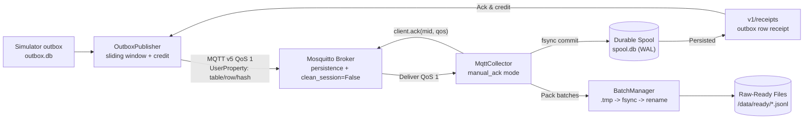

# Greenhouse Sensor Simulator and Telemetry Ingestion (T32)

Deterministic sensor replay simulator and versioned envelope specification for Greenhouse Climate telemetry.

## Architecture and Scope

The sensor simulator replays historical `GreenhouseClimate.csv` datasets (or synthetic fixtures) into versioned telemetry and control envelopes designed for downstream MQTT ingestion (T33) and Structured Streaming (T34).

Key architectural boundaries:
- **Explicit Data Scope & Isolation**: Each replay assigns an isolated `data_scope_id` and `replay_id` (`{snapshot_id}:sim-{replay_id}`). It never modifies historical database publications or baseline snapshots.
- **Simulated Device Identity**: Devices are explicitly marked as simulated (e.g. `sim-climate-AICU`), never confused with real physical hardware.
- **Strict Separation of Categories (Authoritative from ReadMe.pdf)**:
  - Actual indoor climate (`Tair`, `Rhair`, `CO2air`, `HumDef`, `PipeGrow`, `PipeLow`)
  - Computed climate (`Tot_PAR` [µmol/m² s], `Tot_PAR_Lamps` [µmol/m² s])
  - Actuators (`AssimLight` [%], `EnScr` [%], `BlackScr` [%], `VentLee` [%], `Ventwind` [%])
  - Computed actuator (`co2_dos` [kg/ha hour] calibrated dosing)
  - Drain / irrigation (`EC_drain_PC` [dS/m], `pH_drain_PC` [1], `water_sup` [minutes], `Cum_irr` [L/m²])
  - Controller requested setpoints (`t_heat_sp`, `co2_sp`, `dx_sp` [g/m³], `water_sup_intervals_sp_min` [minutes], etc.)
  - Controller realized setpoints / VIP (`t_heat_vip`, `co2_vip`, `dx_vip` [g/m³], `water_sup_intervals_vip_min` [minutes], etc.)
- **Historical SourceParser Reuse**: Reuses `SourceParser` directly to guarantee identical physical line tracking, raw text, raw hashes, and source record IDs without parser drift. Missing values strictly retain their explicit lexical null reasons (`empty`, `nan_token`, `na_token`, `n_a_token`); no synthetic imputation or NaN tokens in JSON.

## Wire Schemas

Machine-readable JSON Schemas:
- Telemetry: `src/greenhouse/sensor/telemetry-envelope.schema.json`
- Control: `src/greenhouse/sensor/control-envelope.schema.json`

### 1. Telemetry Envelope (`greenhouse-telemetry-envelope-v1`)

```json
{
  "schema_version": "greenhouse-telemetry-envelope-v1",
  "event_id": "8f3b...",
  "data_scope_id": "agc-2nd-2019-...:sim-replay-001",
  "replay_id": "replay-001",
  "device_id": "sim-climate-AICU",
  "compartment_id": "AICU",
  "cycle_id": "agc-cycle-AICU",
  "source_record_id": "3a7c...",
  "source_provenance": {
    "snapshot_id": "agc-2nd-2019-c19d385e...",
    "snapshot_sha": "c19d385e...",
    "source_file": "AICU/GreenhouseClimate.csv",
    "file_checksum": "a4d2...",
    "line_number": 2,
    "line_end": 2,
    "raw_hash": "b2f1...",
    "source_time_serial": "43815.0034722222",
    "adapter_id": "agc-standard",
    "parser_version": "agc-parser-v1",
    "source_issues": []
  },
  "sequence": 1,
  "source_observed_at": "2019-12-16T00:05:00",
  "published_at": "2026-11-06T02:50:00+00:00",
  "payload": {
    "actual_measurements": {
      "Tair": "21.6",
      "Rhair": "78.2",
      "CO2air": "650",
      "Tot_PAR": "45.0"
    },
    "drain_measurements": {
      "EC_drain_PC": "3.2",
      "pH_drain_PC": "6.1",
      "water_sup": "0.0",
      "Cum_irr": "0.0"
    },
    "actuators": {
      "AssimLight": "100",
      "EnScr": "0",
      "BlackScr": "0",
      "VentLee": "15",
      "Ventwind": "10",
      "co2_dos": "12.5"
    },
    "controller_context": {
      "t_heat_sp": "18.0",
      "t_heat_vip": "18.5",
      "dx_sp": "4.5"
    },
    "null_reasons": {},
    "category_tags": {
      "Tair": "actual_climate",
      "Tot_PAR": "computed_climate",
      "EC_drain_PC": "actual_drain",
      "AssimLight": "actuator",
      "co2_dos": "computed_actuator",
      "t_heat_sp": "controller_requested"
    }
  },
  "units": {
    "Tair": "°C",
    "Tot_PAR": "µmol/m² s",
    "EC_drain_PC": "dS/m",
    "pH_drain_PC": "1",
    "water_sup": "minutes",
    "co2_dos": "kg/ha hour",
    "dx_sp": "g/m³"
  },
  "fault_tags": []
}
```

### 2. Control Messages (`greenhouse-control-envelope-v1`)

Published on a distinct topic (`v1/control/{replay_id}`):
- `replay_cursor`: tracks monotone logical progress (`logical_cursor_line`, `logical_cursor_sequence`). The cursor is strictly monotonic and never inferred from out-of-order event timestamps.
- `pause_state`: captures state at clean pause boundaries.
- `completion_manifest`: requests end-to-end reconciliation:
  - `expected_unique_events`
  - `emitted_unique_events`
  - `emitted_total_messages`
  - `payload_checksum`: deterministic Merkle hash chain over emitted messages
  - `fault_summary`: tally of duplicates, drops, delays, conflicts injected
  - `reconciliation_requested`: `true`

## Deterministic Fault Injection

The `FaultScheduler` provides reproducible fault testing:
- **Duplicate**: emits the same event twice with identical event ID and exact wire bytes.
- **Conflict**: emits the original event PLUS a divergent variant with the same `event_id`, tagged with `"injected_conflict"` in `fault_tags` and logged in the fault audit trail.
- **Delay / Reorder**: holds messages in a bounded buffer and emits them later, testing out-of-order transport without mutating event contents.
- **Drop**: skips message transmission and logs the intentional gap; `expected_unique_events` increments but `emitted_unique_events` does not.

## Transactional Persistence & Crash Recovery

- **SQLite Authoritative Transaction Store (`outbox.db`)**:
  - The SQLite database is the authoritative committed transport and checkpoint store.
  - WAL journal mode with `PRAGMA synchronous = FULL` ensures power-loss durable commits backed by fsync.
  - Tail reconciliation: upon crash recovery, automatically rolls back any uncommitted messages past the last valid checkpoint.
  - Exact retry lookup: `get_event_for_retry(event_id)` retrieves the exact wire bytes and original `published_at` timestamp without regeneration.
  - Replay isolation: strictly prevents accidental outbox reuse under a new non-resume run; requires explicit `--resume` and verifies configuration and scope hashes.
- **JSONL Export Snapshots**:
  - `telemetry_outbox.jsonl` and `control_outbox.jsonl` are atomic snapshot exports generated from `outbox.db` at pause and completion boundaries via streaming `fetchmany(500)` temporary-file replacement.
  - After any process interruption or crash, the JSONL snapshots can be regenerated directly from the authoritative SQLite database.
- **Durable Source Rejection Auditing & Reconciliation**:
  - Source rows with off-grid timestamps (residual > 0.5s) or unrecoverable time errors are rejected and recorded in SQLite `fault_audit` with their parser issues, line numbers, and raw provenance references.
  - Cumulative `rejected_source_rows` are recorded in each SQLite `checkpoints` row and accurately restored upon `--resume`.
  - At every boundary (pause, resume, completion, crash rollback), the cumulative `rejected_source_rows` count strictly reconciles across `SimulationResult`, `completion_manifest`, and SQLite `fault_audit`.
  - Rejections are processed incrementally with bounded pending state (chunked checkpoints every 50 records) to preserve the 128 MiB cgroup cap.
  - Defined handling for all-rejected, trailing-rejected, and empty source files preserves monotonic cursor progress and emits truthful control envelopes without invalid timestamps or crashes.
  - Backward compatibility: pre-fix `outbox.db` instances missing `rejected_source_rows` column are automatically migrated via schema alteration and reconstructed from persisted `fault_audit` records.

- **Bounded Memory**:
  - Input CSV files are stream-hashed in 64 KiB chunks rather than loaded into memory.
  - Records are streamed row-by-row via `SourceParser` and inserted into SQLite.
  - Operates comfortably within the 128 MiB container memory cgroup cap (`--memory=128m --cpus=0.2`).
- **Transport Scope & T33 Implementation**:
  - Full broker transport policies, persistent disk queues, MQTT network backpressure, and durable collector are implemented in T33.

## Durable MQTT Collector & Transport Publisher (T33)

T33 provides the end-to-end transport and ingestion path between the simulator outbox, Mosquitto broker, and raw-ready staging.



### 1. End-to-End Backpressure & Credit (Mosquitto Queue Protection)
- **Problem**: Mosquitto queue limits (`max_queued_messages`, `max_queued_bytes`) can silently drop excess queued messages for offline/slow subscribers even when publisher receives PUBACK. Thus, broker PUBACK is transport acknowledgement only, never warehouse or collector persistence.
- **Credit-Based Backpressure Solution**:
  - `MqttCollector` commits incoming deliveries to SQLite WAL spool (`spool.db`) before issuing `client.ack(mid, qos)` and emits a signed receipt to `v1/receipts/{replay_id}/{compartment_id}`.
  - Receipt carries immutable publisher identity: `outbox_table`, `outbox_row_id`, `replay_id`, `payload_hash`, `spool_free_bytes`, and transmission `credit`.
  - `OutboxPublisher` maintains a bounded sliding in-flight window (`max_inflight`, default 20) backed by an active window cache and indexed SQLite `published_receipts` table, advancing checkpoint only when receipts are verified.
  - When spool or ready capacity approaches physical quota, collector withholds ACK and emits `status="backpressure"`, causing publisher to pause and preventing Mosquitto queue overflow. Backpressure notices are strictly scoped by `replay_id` and `compartment_id` to prevent foreign replays from pausing unrelated publishers.
  - In MQTT v5, `SessionExpiryInterval` (default 86,400s) is explicitly negotiated in `CONNECT` and `DISCONNECT` properties, ensuring Mosquitto preserves subscriber subscriptions and queued messages across collector offline periods.

### 2. Finite Broker & Client Bounds and Packet Budget Policy
- **Broker Configuration (`mosquitto.conf`)**:
  - `max_queued_messages 1000` (or 100 in constrained test environments)
  - `max_queued_bytes 10485760` (10 MiB)
  - `max_inflight_messages 20`
  - `max_packet_size 10485760` (10 MiB)
- **Client Outgoing Queue Bounds**:
  - `OutboxPublisher`: calls `client.max_inflight_messages_set(max_inflight)` (20) and `client.max_queued_messages_set(max_inflight * 5)` (100).
  - `MqttCollector`: calls `client.max_inflight_messages_set(50)` and `client.max_queued_messages_set(100)`.
- **Packet vs Payload Budget Separation**:
  - In MQTT v5, `MaximumPacketSize` covers the entire packet frame including fixed header, topic name, packet identifier, and `UserProperty` headers.
  - The collector separates the protocol `MaximumPacketSize` budget (`max_packet_bytes = max_payload_bytes + 65536`) from the raw application payload limit (`max_payload_bytes = 10485760`).
  - **Oversized Packet Policy**: If an MQTT packet exceeds the protocol `MaximumPacketSize` or broker `max_packet_size`, the MQTT broker rejects or drops the packet at network level before application delivery. Such protocol-rejected packets are not received and cannot be spooled. Messages within protocol packet limits that exceed `max_payload_bytes` are accepted by the network, flagged by `handle_message`, and quarantined in the durable spool with their raw bytes preserved.
- **Capacity Full & Resumption**:
  - When spool or ready directory capacity is exhausted (taking into account projected batch sizes and safety headroom), the collector withholds `client.ack()` and emits backpressure receipts without terminating.
  - Once downstream consumption clears ready files or quota space is restored, the collector automatically resumes intake and batch sealing on subsequent iterations without data loss.

### 3. Transport Identity & Exact Outbox Mapping
- Original payload bytes from the outbox are transmitted completely unadulterated.
- Transport metadata is carried in MQTT v5 `UserProperty` headers:
  - `outbox_table`: `"telemetry_messages"` or `"control_messages"`
  - `outbox_row_id`: integer primary key in outbox table
  - `replay_id`: unique replay identifier
  - `payload_hash`: SHA-256 of exact payload bytes
  - `compartment_id`: compartment target
- Transport metadata is parsed defensively: non-integer row IDs or malformed headers do not crash MQTT callbacks and are quarantined with exact raw bytes.
- Broker `mid` and `DUP` flags are treated as transient transport metadata, never durable event identity.
- Mismatched or stale receipts (e.g. from prior replays or divergent hashes) are rejected.
- Out-of-order receipts cannot advance over unconfirmed holes in outbox sequences.
- Publisher registers in-flight state prior to wire transmission, eliminating receipt-vs-PUBACK race conditions. Retries are strictly bounded by `max_retries` with explicit failure reporting.

### 4. Durable Spool & Quarantine Handling
- Backed by SQLite WAL mode with `PRAGMA synchronous = FULL`.
- Completely offline and decoupled from PostgreSQL (collector requires no database connection).
- **Quarantine & Transport Receipts**:
  - **Durable Raw Persistence**: A `persisted` receipt signifies that raw bytes are durably fsynced to the SQLite spool with verified, matching transport identity (`outbox_table`, `outbox_row_id`, `replay_id`, `compartment_id`, `payload_hash`).
  - **Malformed Payload Handling**: If an outbox row contains intentional malformed non-JSON or schema-invalid bytes, but its transport identity is verified, the collector durably persists it as quarantine, ACKs to Mosquitto, and emits a `persisted` receipt with `disposition="quarantined"` and `quarantine_reason`. This allows outbox transmission reconciliation and checkpoints to advance cleanly without poison-loop infinite retries.
  - **Invalid Transport Identity**: If transport metadata itself is damaged or mismatched (mismatched topic/header replay, mismatched table, corrupted declared hash, repeated keys, non-positive integer row ID), the raw bytes are retained in spool as quarantine, ACKed to Mosquitto to prevent broker head-of-line blocking, but receive a `rejected` receipt (never `persisted`).
- **Lineage Preservation**:
  - Duplicates (same `event_id` + identical hash): preserved with distinct `delivery_id` and collector `received_at`.
  - Conflicts (same `event_id` + divergent hash): preserved with distinct `delivery_id`, distinct `payload_hash`, and collector `received_at`.

### 5. Atomic Raw-Ready Batch Packing
- `BatchManager` writes complete JSONL batches to temporary files (`/data/ready/.tmp_<batch_id>.jsonl`) on the **same filesystem** as `/data/ready`.
- Calls `fsync()` on the file, atomically renames to `/data/ready/<batch_id>.jsonl` via `os.replace`, and calls `fsync()` on the directory entry.
- Existing ready files are immutable and strictly protected from overwrite.
- Quota check projects batch payload size and headroom before sealing to prevent overruns.
- Deterministic recovery on startup cleans orphaned `.tmp_*` files, verifies SHA-256 file checksums and line hashes against `spool_messages` (raising `CorruptBatchError` if an unrecorded file is tampered with), and updates `manifest.json`.

## CLI Usage

```bash
# Basic simulation of AICU climate data
python -m greenhouse simulate --compartment AICU --limit 50 --outbox-dir /data/outbox

# Simulate and publish directly to Mosquitto broker
python -m greenhouse simulate --compartment AICU --limit 50 --outbox-dir /data/outbox --publish --mqtt-host broker

# Resume or publish an existing completed outbox without re-running generation
python -m greenhouse simulate --publish-only --outbox-dir /data/outbox --mqtt-host broker
python -m greenhouse simulate --resume --publish --outbox-dir /data/outbox --mqtt-host broker

# Run standalone durable MQTT collector with persistent MQTT v5 session
python -m greenhouse collect --spool-dir /data/spool --ready-dir /data/ready --mqtt-host broker --session-expiry-interval 86400

# Deterministic fault injection with seed
python -m greenhouse simulate --compartment AICU --seed 42 --duplicate-rate 0.05 --conflict-rate 0.02 --outbox-dir tmp/outbox

# Pause after 20 events, then resume
python -m greenhouse simulate --compartment AICU --pause-after 20 --replay-id replay-demo --outbox-dir tmp/outbox
python -m greenhouse simulate --resume --outbox-dir tmp/outbox

# Verify retry lookup stability
python -m greenhouse simulate --outbox-dir tmp/outbox --retry-event <EVENT_ID>
```

## Streaming landing đang phát triển

Collector ghi `raw_payload_base64` trong từng dòng raw-ready để có thể kiểm tra
chính xác payload gốc, kể cả JSON lỗi. Các batch cũ không có trường này sẽ được
đưa vào quarantine với lý do `raw_payload_unavailable`; không thể khôi phục byte
gốc chỉ từ JSON đã parse. Spool cũ có thể chứa byte gốc, nhưng phải kiểm tra và
xử lý riêng; không tự sửa các file ready bất biến.

Migration `016_sensor_stream.sql` và các module `stream_records`, `stream_store`,
`stream_landing` cung cấp lớp landing: xác thực, ghi transaction,
chặn batch ID tái sử dụng khác nội dung và giữ mọi biến thể xung đột. View
`uncontested_event` loại identity có nhiều hash. Cursor và manifest được đối
soát bảo thủ; bộ fault matrix và nghiệm thu sensor end-to-end vẫn thuộc T36.
Kết quả BR từ `replay_evaluation` là provisional nếu replay chưa đối soát xong.

`replay_state` kiểm tra thứ tự control liên tục, đối chiếu checksum outbox,
phát hiện event thiếu hoặc xung đột và theo dõi thời gian nhận theo UTC. Trạng
thái hoàn tất chỉ được tính khi đủ các bằng chứng này; publication được chốt
theo membership riêng của replay, còn nghiệm thu KPI end-to-end thuộc T36.

### Chạy stream local

Sau khi build lại processing image, chạy migration, khởi động PostgreSQL và
collector, đặt các biến sau cùng replay do simulator tạo. `scope` phải là
`data_scope_id` trong envelope; các tham số là bắt buộc để tránh trộn replay.

```bash
GREENHOUSE_STREAM_ID=demo-stream \
GREENHOUSE_CHECKPOINT_GENERATION=demo-v1 \
GREENHOUSE_REPLAY_ID=demo \
GREENHOUSE_REPLAY_SCOPE_ID='<snapshot-id>:sim-demo' \
GREENHOUSE_REPLAY_CYCLE_ID=agc-cycle-AICU \
GREENHOUSE_REPLAY_COMPARTMENT_ID=AICU \
GREENHOUSE_REPLAY_QUALITY_POLICY=AGC_QUALITY_V1 \
docker compose --profile sensor up stream-worker
```

Một checkpoint gắn với stream ID, generation, đường dẫn source và PostgreSQL
endpoint. Đổi generation phải chọn checkpoint mới. Publication ghi cùng
transaction với batch; replay chưa đủ manifest/checksum hoặc có gap/conflict
không được gắn nhãn complete. `--available-now` chạy các file hiện có rồi dừng.
Hợp đồng `replay_evaluation.evaluate_publication` nhận rule revisions gắn rõ
scope replay; không tự gán rule của historical.
